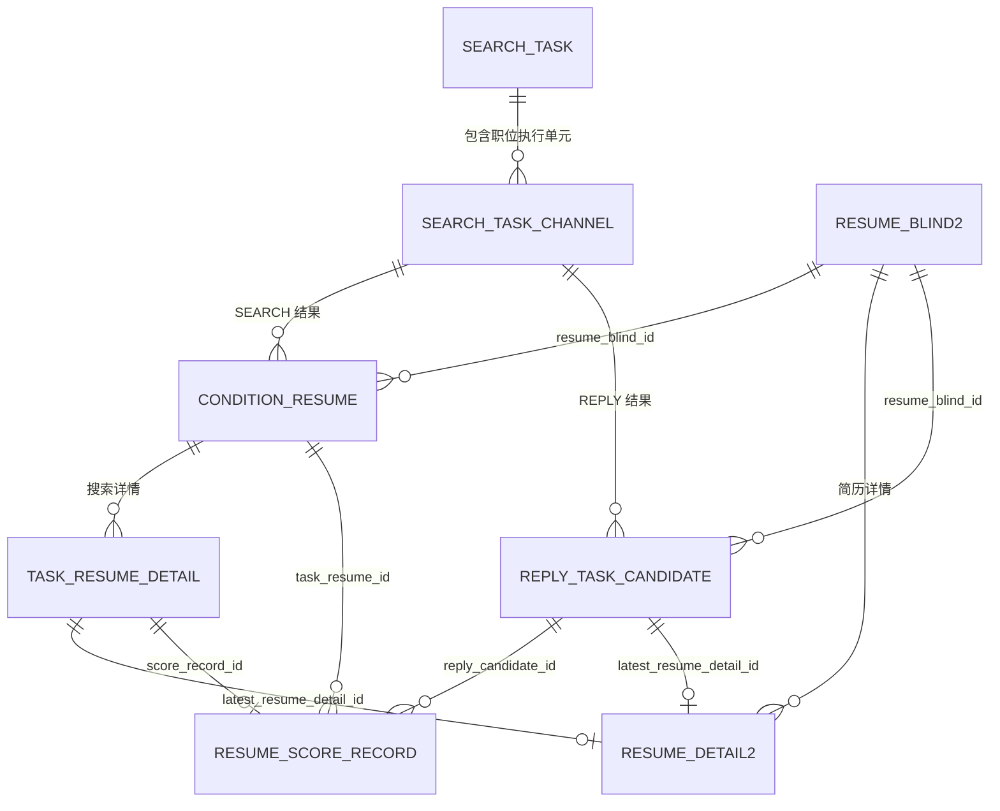

# AI 寻聘助手 V2.1 表设计（沿用现有登录与唤醒链路版）

> 状态：待技术评审
> 日期：2026-11-19
> 来源：[完整技术方案](./ai-recruit-v2.1-technical-design-legacy-launch.md)
> 相关文档：[接口设计](./ai-recruit-v2.1-interface-design-legacy-launch.md)
> 说明：本文由完整技术方案拆出，保留原第 12 章编号，避免跨文档引用失效。

## 12. 表设计

### 12.1 通用字段约定

所有业务表主键优先统一为 `id`。默认使用自增 `bigint unsigned`；当实体本身已有稳定的业务 ID 时，`id` 直接采用该业务 ID 的类型和值，不再额外增加自增主键。确需使用联合主键且没有独立业务 ID 的关联实例表除外，例如 `ai_client_instance`。公共时间字段建议统一：

```text
create_time datetime(3) not null default current_timestamp(3)
update_time datetime(3) not null default current_timestamp(3)
  on update current_timestamp(3)
```

新建表优先使用 `id` 作为主键。本表已有独立稳定业务 ID 时，直接将该业务 ID 存为 `id`，不再同时保留一个自增 `id`；其他表通过带实体语义的外键列关联，例如子表使用 `channel_account_id` 关联 `channel_account.id`。`ai_client_instance` 的完整业务身份必须包含企业作用域，因此使用 `tenant_id + company_id + client_instance_id` 联合主键，不保留无业务引用的自增 `id`。

例如 `channel_account.id` 就是 i快招生成的稳定渠道账号 ID；`ai_client_session/search_task/ai_recruit_day_plan` 等表继续使用 `channel_account_id` 关联 `channel_account.id`。接口和事件字段仍命名为 `channelAccountId`，不暴露表结构命名差异。

身份字段沿用两边现有用户体系，不做统一改造：

```text
招聘后端新表:
  company_id varchar(64)  = 招聘 companyId
  user_id    varchar(64)  = 招聘 userId
  staff_id   varchar(64)  = 招聘 staffId

i快招后端:
  tenant_id  bigint       = i快招现有接入租户 ID
  user_id    bigint       = third_party_user.id，保持现有用户体系不变
  company_id varchar(64)  = 招聘 companyId
```

`third_party_user.third_party_user_id` 继续保存招聘 `userId`。跨服务接口和事件在需要表达用户身份时，必须使用明确的 `recruitUserId` 或 `ihUserId`，不新增第二套用户映射表，也不修改现有 i快招 `search_task.user_id` 等字段的语义。

i快招既有的 `tenant_id` 体系不改。当前招聘接入链路使用同一个 i快招接入租户时，`tenant_id` 可以相同；它只表示接入或部署租户，不能作为招聘企业隔离依据。`company_id` 是招聘企业数据的硬隔离边界，`user_id` 只表示用户归属、创建人、操作人或最近使用者。

#### 12.1.1 身份字段与数据隔离职责

| 字段 | 含义 | 是否作为硬隔离条件 |
|---|---|---|
| `tenant_id` | i快招既有接入或部署租户；用于兼容现有租户体系 | 否，不能代替招聘 `company_id` |
| `company_id` | 招聘企业 ID；所有企业级数据都必须可追溯到该字段 | 是 |
| `user_id` | i快招用户 ID；表示创建人、操作人、归属人或最近使用者 | 否，不能作为所有表的统一过滤条件 |
| `headcount_id` | 招聘系统职位 ID；表达职位级资源范围 | 是，必须在招聘职位权限范围内 |
| `client_session_id` | 当前桌面端执行会话 | 任务执行和结果回传时是 |
| `channel_account_id` | 当前渠道账号稳定 ID | 账号级业务关联时是 |

隔离规则：

- 企业级共享数据以 `tenant_id + company_id` 定位数据域，其中 `company_id` 是客户数据隔离边界。
- `tenant_id + company_id + user_id` 可以作为用户归属或用户私有数据的组合条件，但不能作为任务、职位、权益、日计划、候选人结果等共享数据的统一隔离键。
- 同一企业有多个用户时，任务和结果按 `company_id + headcount_id` 的职位权限共享，不按任务创建人 `user_id` 隐藏。
- `user_id` 必须保留用于审计、操作归属、个人偏好和“我的”视图；用户离职或换企业不能导致企业级任务和结果不可用。
- `company_id` 和 `user_id` 必须来自已认证上下文；禁止信任请求体自报值。
- 新表默认直接保存 `company_id`。`search_task/condition_resume` 等已有任务结果表如通过全局唯一的 `channel_account_id` 能确定企业，可不重复保存 `company_id`，但查询和授权必须先通过 `channel_account` 校验企业范围，不能信任客户端自报企业 ID。
- 企业业务唯一键必须包含 `company_id` 或能够唯一确定企业的全局业务 ID。仅按 `tenant_id` 查询企业业务数据属于错误实现。
- 新建企业级表的历史数据必须通过 `third_party_user/third_party_user_id` 或招聘用户企业映射回填 `company_id`。无法回填的数据只能按原所有者 `user_id` 受限访问，不能作为跨用户共享结果上线；已有任务结果表通过 `channel_account_id` 补齐企业范围。

#### 12.1.2 新表主键与业务 ID

新建表物理主键统一为 `id`，业务 ID 只作为唯一键、跨表关联或跨服务传输字段：

| 新表 | 主键 | 主要业务 ID/唯一键 |
|---|---|---|
| `ai_recruit_channel_account` | `id` | `projection_key` |
| `ai_recruit_position_config` | `id` | `company_id + headcount_id` |
| `ai_recruit_job_binding` | `id` | `company_id + headcount_id + channel_code` |
| `ai_recruit_channel_job_projection` | `id` | 企业、账号、渠道公司、渠道职位组合 |
| `ai_client_instance` | `tenant_id + company_id + client_instance_id`（联合主键） | `client_instance_id` 是联合主键的一部分，不另设独立业务 ID |
| `ai_client_session` | `id`（char(36)，本身即业务 ID） | `open_request_id`、`active_owner_key` |
| `channel_account` | `id`（varchar，本身即业务 ID） | `tenant_id + company_id + channel_code + external_user_id` |
| `ai_recruit_day_plan` | `id`（varchar，本身即业务 ID） | 账号公司业务日组合 |
| `reply_task_candidate` | `id` | 企业、任务、职位执行单元和会话组合 |
| `sync_outbox` | `id` | `event_id` |
| `sync_inbox` | `id` | `consumer + event_id`；最新事件查询键为 `company_id + consumer + aggregate_id + aggregate_version` |

`channelAccountId/clientSessionId/dayPlanId` 分别对应 `channel_account.id/ai_client_session.id/ai_recruit_day_plan.id`；`taskId/clientInstanceId` 等接口字段继续使用各自业务 ID，不要求与数据库列名完全一致。

渠道通用字段统一使用：

```text
channel_code
channel_account_id
external_user_id
external_company_id
channel_job_snapshot_id
external_job_id
rights_source
quota_confidence
channel_ext_json
ext_schema_version
adapter_version
```

字段分层如下。不是每张表都需要全部字段，表只保存自己职责范围内的核心列：

| 分层 | 字段 | 说明 |
|---|---|---|
| 账号身份 | `channel_code/channel_account_id/external_user_id/external_company_id` | 账号、渠道和公司上下文；业务关联只使用 `channel_account_id` |
| 职位身份 | `channel_job_snapshot_id/external_job_id` | `external_job_id` 是渠道职位 ID，`channel_job_snapshot_id` 是本次执行引用的逻辑版本号；自动任务上下文保存在日计划 `execution_context_json`，手动任务上下文保存在 `search_task_channel.execution_snapshot_json` |
| 任务上下文 | `client_session_id/session_epoch/business_date/headcount_id` | 表达谁在哪个业务日、由哪个客户端会话执行哪个系统职位 |
| 权益 | `rights_source/quota_confidence/*_quota_*/allocated_limit/ai_used_count` | 用于准入和展示的通用数值；渠道原始权益结构不得进入核心列 |
| 适配器扩展 | `channel_ext_json/ext_schema_version/adapter_version` | 渠道特有字段、扩展协议版本和适配器实现版本，不参与通用业务判断 |

本版已有任务表不使用独立 `client_session_id` 列，当前或最后执行会话统一落在 `search_task.lease_owner`；职位执行单元从父任务继承企业、账号、公司和会话上下文，候选人结果从 `search_task_channel_id` 关联职位执行单元，再通过父任务 `day_plan_id + external_job_id` 读取日计划职位执行上下文。

新表禁止再新增 `boss_user_id/boss_company_id/boss_job_id` 作为业务关联列。BOSS 原始 ID 只作为适配器输入，归一化后写入 `external_*`；通用表不再重复保存原始 ID。历史字段如果已经存在，保留一个兼容周期，读取时通过适配映射转换成通用字段，不能与新字段双写形成两套事实源。

数据库列统一使用 snake_case，接口和事件使用 camelCase。例如 `channel_ext_json` 在接口中为 `channelExt`，`ext_schema_version` 在接口中为 `extSchemaVersion`。

金额/权益/分数：

- 权益数量使用 `int`。
- 分数使用 `decimal(5,2)`。
- JSON 使用 `json`；兼容旧库时可使用 `longtext`，应用层严格序列化。

时间：

- 统一保存 UTC `datetime(3)` 或在应用层固定转换。
- 展示层按 `Asia/Shanghai`。
- `business_date` 使用 `date`。

表设计阅读约定：

- 除特别说明外，每张表都包含通用时间字段 `create_time/update_time`，主键默认命名为 `id`。`ai_client_instance` 使用联合主键，不设 `id`；各表字段说明只列业务字段。
- `id` 是表主键。跨表、跨接口和跨事件通常使用带实体语义的业务 ID；当 `id` 本身保存稳定业务 ID 时，接口仍使用对应业务字段名，例如 `channelAccountId/clientSessionId/dayPlanId`。
- `current` 表示当前态，可按最新事件更新；`snapshot` 表示不可变历史事实，只新增、不覆盖；`projection` 表示消费其他服务事实后生成的查询副本，不能反向作为源数据权威源。
- 空值不能统一解释为“无”。每张表会单独说明空值语义；状态字段无法识别新值时按 `UNKNOWN` 处理并禁止自动执行，不能按默认成功处理。
- `source_version/aggregate_version` 是防乱序版本。消费事件时只有版本大于当前已应用版本才更新当前态，旧版本消息直接确认成功，不覆盖新数据。
- JSON 字段只保存白名单、已脱敏、可演进的扩展数据；任务准入、唯一键、权限和状态机不得只依赖 JSON 中的隐式字段。
- 跨服务只保存逻辑关联 ID，不建立跨库外键，也不允许直接写对方数据库。招聘 -> i快招使用同步命令和版本号；i快招 -> 招聘使用 i快招 outbox、至少一次投递、招聘业务幂等和版本号保证最终一致性。
- 本节的“删除”只表示关闭当前有效状态或逻辑失效，不物理删除任务、快照、同步事件和审计数据。

表归属与事实类型总览：

| 服务 | 表 | 事实类型 | 权威数据 | 主要写入方 |
|---|---|---|---|---|
| 招聘 | `ai_recruit_channel_account` | 账号、权益及最新会话当前态投影 | 否，账号、权益和会话源为 i快招 | 招聘事件消费者 |
| 招聘 | `ai_recruit_position_config` | 配置主数据 | 是 | 招聘配置接口 |
| 招聘 | `ai_recruit_job_binding` | 配置主数据/当前关联 | 是 | 招聘绑定接口及校验任务 |
| 招聘 | `ai_recruit_channel_job_projection` | 当前态投影 | 否，职位和权益源为 i快招 | 招聘事件消费者 |
| i快招 | `ai_client_instance` | 客户端安装实例当前态 | 是 | 桌面端心跳/会话接口 |
| i快招 | `ai_client_session` | 桌面端运行会话及当前渠道运行态 | 是 | `session/open`、心跳、关闭和渠道状态接口 |
| i快招 | `channel_account` | 渠道账号及最新账号权益当前态 | 是 | 渠道采集 |
| i快招 | `ai_recruit_day_plan` | 业务日运行上下文 | 是 | i快招调度器 |
| i快招 | `reply_task_candidate` | 回复任务候选会话、附件评分和导入结果 | 是 | 回复任务、附件评分和导入接口 |
| i快招 | `sync_outbox` | 待投递事件 | 是 | i快招业务事务 |
| i快招 | `sync_inbox` | 同步命令幂等记录及最新配置/绑定查询源 | 否，招聘配置和职位关联为权威源 | i快招同步命令接口 |
| i快招 | `search_task/search_task_channel` | 搜索任务、回复任务及其职位执行单元 | 是 | i快招任务接口/调度器 |
| i快招 | `condition_resume/task_resume_detail` | 搜索候选人结果与搜索详情快照 | 是 | 搜索预筛、详情和评分接口 |

搜索和回复共用 `search_task/search_task_channel`，但候选人结果分表。搜索以 `condition_resume` 为结果根，分别关联 `resume_blind2/task_resume_detail` 和 `resume_score_record`；回复以 `reply_task_candidate` 为结果根，关联 `resume_blind2/resume_detail2` 和 `resume_score_record`。`reply_task_candidate` 与 `condition_resume` 是并列结果表，不建立直接外键或逻辑关联。

全量渠道职位列表不在 i快招新增表保存。自动任务使用招聘侧回传并写入 `ai_recruit_day_plan.execution_context_json` 的职位上下文；现有手动搜索允许目标职位不在该自动任务集合中，因此手动任务把本次职位执行上下文写入 `search_task_channel.execution_snapshot_json`。

招聘职位配置和职位关联也不在 i快招新增投影表保存。i快招以 `sync_inbox` 中每个 `company_id + consumer + aggregate_id` 的最高 `aggregate_version` 事件为当前同步值；任务首次进入 `RUNNING` 时再把该值固化到 `search_task.config_snapshot_json`。

两类任务的职位上下文读取路径不同：自动任务先按任务主键取得 `day_plan_id`，再按唯一的 `externalJobId` 读取日计划 JSON；手动任务直接读取 `search_task_channel.execution_snapshot_json`。手动任务仍关联 `day_plan_id` 用于串行调度和回复任务协调，但不要求职位存在于日计划职位集合。

### 12.2 招聘后端新增 4 张表（表功能、字段及生命周期）

#### 1. `ai_recruit_channel_account`

**表功能与边界**

招聘侧渠道账号、账号权益和当前客户端会话的合并当前态投影。它同时回答两个问题：

- 当前企业在某个渠道账号、某个渠道公司上下文下，最后一次已知的账号身份、权益来源和同步新鲜度是什么。
- 该账号当前由哪个客户端会话执行，客户端是否在线、BOSS 是否登录、最后心跳和错误原因是什么。

一行表示一个 `projection_key`。有账号时按账号上下文聚合；BOSS 尚未登录或身份还未识别时，允许先按招聘用户和客户端实例保存一行 `CLIENT` 临时运行态。该表只保存当前态，不保存客户端会话历史；任务和结果事实继续保存在 i快招侧，通过二方查询读取，招聘侧不落任务/结果投影。该表不是账号认证表，不保存密码、Cookie、Token、deep link 或完整渠道响应。

**事实类型、写入与更新**

- 事实类型：当前态投影，由 `CHANNEL_ACCOUNT_SYNCED` 和 `CLIENT_SESSION_CHANGED` 共同维护。
- 账号事件：消费 `CHANNEL_ACCOUNT_SYNCED` 时按 `ACCOUNT:{channelAccountId}:{externalCompanyId}` upsert 账号、公司、权益和 freshness 字段；`sourceVersion` 只接受更高版本。
- 会话事件：消费 `CLIENT_SESSION_CHANGED` 时更新同一账号行的 `clientSessionId/sessionEpoch/channelStateVersion/state/channelLoginState/lastHeartbeatAt` 等会话字段；`channelStateVersion` 只接受更高版本。
- 未识别账号：会话开始时没有 `channelAccountId` 或 `externalCompanyId`，先按 `CLIENT:{userId}:{clientInstanceId}` upsert `projectionScope=CLIENT` 行，用于招聘侧展示“客户端已启动、BOSS 未登录”。
- 账号识别：同一事务内 upsert `ACCOUNT` 行并删除对应 `CLIENT` 临时行；删除失败可重试，但查询必须优先使用存在账号上下文的行。
- 会话关闭：保留账号和最近权益，更新 `state/closedAt/closeReason/lastHeartbeatAt`；不删除行，保证离线时仍可查看最后账号和权益。
- 会话历史：不在招聘侧保存完整历史。需要追溯某次任务由哪个客户端执行时，使用 i快招任务二方查询返回的 `clientSessionId`、任务配置快照和日计划职位执行上下文；招聘侧只保留该账号最后一次活动会话字段。

**关联关系**

- `projectionScope=ACCOUNT` 时，`channel_account_id` 逻辑关联 i快招 `channel_account.id`，不建立跨库外键。
- `projectionScope=CLIENT` 时，`channel_account_id/external_user_id/external_company_id` 为空，只用于当前客户端运行态展示，不能绑定职位或生成自动任务。
- 被 `ai_recruit_job_binding` 和 `ai_recruit_channel_job_projection` 通过账号上下文读取；任务和候选人结果查询使用 i快招二方接口，不通过本表建立反向关联。
- `client_session_id` 逻辑关联 i快招 `ai_client_session.id`，只保留该账号最近一次活动会话，不保存历史会话列表。

**字段说明**

| 字段 | 类型 | 必填/默认 | 含义、写入方与空值规则 |
|---|---|---|---|
| `projection_key` | varchar(192) | 必填 | `ACCOUNT:{channelAccountId}:{externalCompanyId}` 或 `CLIENT:{userId}:{clientInstanceId}`；合并后的当前态唯一键。 |
| `projection_scope` | varchar(16) | 必填 | `ACCOUNT/CLIENT`；账号识别后必须迁移为 `ACCOUNT`。 |
| `company_id` | varchar(64) | 必填 | 招聘企业 ID；所有查询都必须带该字段，空值数据非法。 |
| `channel_code` | varchar(32) | 必填 | 渠道适配器编码，如 `BOSS`、`LIEPIN`。 |
| `channel_account_id` | varchar(64) | ACCOUNT 必填，CLIENT 可空 | i快招生成的跨会话稳定账号 ID；CLIENT 行尚未识别账号时为空。 |
| `external_user_id` | varchar(128) | ACCOUNT 必填，CLIENT 可空 | 渠道原始账号 ID，BOSS 为 `bossUserId`；只用于展示、排障和同渠道比对。 |
| `external_company_id` | varchar(128) | ACCOUNT 必填，CLIENT 可空 | 渠道公司上下文 ID；切换公司时生成新的 ACCOUNT 行，不覆盖旧公司上下文。 |
| `external_company_name` | varchar(255) | 可空 | 渠道公司展示名称快照，仅用于界面。 |
| `display_name` | varchar(128) | 可空 | 渠道账号展示名或脱敏姓名，不参与权限、唯一键和账号一致性判断。 |
| `business_date` | date | 可空 | 权益快照对应业务日，按 Asia/Shanghai 计算；CLIENT 行或未采集权益时为空。 |
| `rights_source` | varchar(32) | 必填，默认 `UNKNOWN` | `PURCHASED/ACCOUNT_POOL/CHANNEL_MANAGED/UNKNOWN`；未知值不得自动分配权益。 |
| `communication_quota_total` | int unsigned | 可空 | 账号沟通权益总量；空值表示未知，不按 0 处理。 |
| `communication_quota_used` | int unsigned | 可空 | 渠道侧账号权益已用量，包含人工消耗。 |
| `communication_quota_remaining` | int unsigned | 可空 | 渠道返回或计算出的剩余量；0 可阻止分配，空值按 `quota_confidence` 判断。 |
| `quota_confidence` | varchar(16) | 必填，默认 `UNKNOWN` | `EXACT/ESTIMATED/UNKNOWN`；`UNKNOWN` 禁止自动任务。 |
| `allocation_batch_no` | int | 必填，默认 0 | 最近一次权益分配批次；0 表示未参与分配。 |
| `collect_status` | varchar(24) | 必填，默认 `FAILED` | `SUCCESS/PARTIAL/FAILED`；CLIENT 行没有权益采集时为 `FAILED`。 |
| `entitlement_captured_at` | datetime(3) | 可空 | 渠道侧权益采集时间；CLIENT 行或尚未成功采集时为空。 |
| `last_synced_at` | datetime(3) | 可空 | 招聘侧最后一次成功应用账号权益事件的时间。 |
| `source_version` | bigint | 必填，默认 0 | `CHANNEL_ACCOUNT_SYNCED` 已应用的最大 `aggregateVersion`；只用于账号权益字段防乱序。 |
| `client_instance_id` | varchar(64) | CLIENT 必填，ACCOUNT 可空 | 客户端安装实例 ID，用于区分同一用户的多个设备。 |
| `user_id` | varchar(64) | 必填 | 招聘 userId，表示最近一次客户端会话由哪个招聘用户发起；不等于渠道账号 ID。 |
| `client_session_id` | char(36) | 可空 | 最近一次活动或已关闭客户端会话 ID；i快招任务和结果仍保存各自的历史会话 ID。 |
| `session_epoch` | bigint | 可空 | 最近会话 epoch；用于拒绝旧 SSE、心跳和结果回传。 |
| `channel_state_version` | bigint | 必填，默认 0 | `CLIENT_SESSION_CHANGED` 已应用的最大渠道状态版本，只用于会话字段防乱序。 |
| `state` | varchar(32) | 必填，默认 `UNKNOWN` | 最近客户端会话及渠道执行状态，枚举见 5.2；不能把心跳在线状态重复写成另一字段。 |
| `channel_login_state` | varchar(24) | 必填，默认 `UNKNOWN` | `NOT_LOGGED_IN/LOGGED_IN/ACCOUNT_CHANGED/IDENTITY_UNVERIFIED/UNKNOWN`。 |
| `last_channel_snapshot_at` | datetime(3) | 可空 | 最近一次渠道账号、职位和权益采集完成时间。 |
| `adapter_version` | varchar(32) | 可空 | 最近会话使用的渠道适配器版本；不兼容版本不能进入 `READY`。 |
| `app_version` | varchar(32) | 可空 | 最近桌面客户端版本，用于兼容提示和排障。 |
| `device_id` | varchar(128) | 可空 | 脱敏设备标识；不得保存硬件序列号原文。 |
| `last_heartbeat_at` | datetime(3) | 可空 | 最近一次会话心跳时间；在线状态由查询时动态计算。 |
| `last_session_event_at` | datetime(3) | 可空 | 最近一次应用会话事件的时间，用于识别投影延迟。 |
| `closed_at` | datetime(3) | 可空 | 最近会话关闭时间；活动会话为空。 |
| `close_reason` | varchar(128) | 可空 | 固定关闭原因码；活动会话为空。 |
| `last_error_code` | varchar(64) | 可空 | 固定错误或关闭原因码，用于状态机。 |
| `last_error_message` | varchar(512) | 可空 | 脱敏错误摘要，仅展示和排障。 |
| `channel_ext_json` | json | 可空 | 渠道账号白名单扩展，例如 BOSS 的 `brandId/brandName/userTitle` 和 `accountPrivileges.viewQuota/onlineCompetitiveJobQuota`；沟通权益继续使用通用字段。禁止敏感字段和完整响应。 |
| `ext_schema_version` | int | 必填，默认 1 | `channel_ext_json` 的结构版本。 |

唯一键：

```text
uk_company_channel_projection(company_id, channel_code, projection_key)
idx_company_channel_account(company_id, channel_code, channel_account_id, external_company_id)
idx_client_session(client_session_id)
idx_session_state(company_id, channel_code, state, last_heartbeat_at)
```

关键约束与异常处理：

- `projectionScope=CLIENT` 的行不得绑定职位、生成任务或作为账号权益来源；账号识别完成后必须迁移为 `ACCOUNT`。
- `projectionScope=ACCOUNT` 且 `channelLoginState=LOGGED_IN` 时，账号、公司和会话上下文必须一致；不一致时标记 `CHANNEL_ACCOUNT_MISMATCH` 或 `EXTERNAL_COMPANY_MISMATCH`。
- 同一账号公司上下文只有一个 ACCOUNT 行。新客户端会话更新该行，不按 `clientSessionId` 无限新增行；旧会话历史由任务、结果和同步日志承担。
- `source_version` 和 `channel_state_version` 分别防账号事件和会话事件乱序，不能用同一版本号互相覆盖。
- `CLIENT_SESSION_CHANGED` 的 `sessionEpoch` 小于账号行当前值时，只记录日志并确认成功，不能把 `client_session_id/state/channel_login_state/last_heartbeat_at/closed_at` 回退到旧会话；旧会话的延迟关闭事件同样不能覆盖新会话。
- 当前状态查询必须先查 `projection_scope=ACCOUNT`；只有同一账号上下文没有任何 ACCOUNT 行时，才展示对应的 CLIENT 临时行。ACCOUNT 与 CLIENT 行短暂并存时，ACCOUNT 行优先。
- 会话关闭后保留最后账号和权益，招聘页面仍可展示最后成功数据和“客户端已离线”；新会话重新打开时更新同一 ACCOUNT 行。
- 账号切换时关闭旧账号行的会话状态并创建或更新新 ACCOUNT 行；旧职位绑定只标记失效，不自动改绑。
- 查询账号权益时必须同时返回 `quotaConfidence/collectStatus/entitlementCapturedAt/freshnessState`，不能只返回可能过期的数字。

#### 2. `ai_recruit_position_config`

**表功能与边界**

系统职位的 AI 寻聘配置主表，一行对应招聘的一个 `headcountId`。它保存用户可编辑、需要同步给 i快招并会影响后续日计划和任务生成的配置，是招聘侧配置权威源。它也保存当前职位画像的 ID 和内容摘要；画像正文继续复用现有 Harness，招聘表不重复保存正文，也不保存任务执行结果。运行中的任务使用自己的任务级配置快照，但评分按画像 ID 使用当前最新内容。

**事实类型、写入与更新**

- 事实类型：配置主数据，可更新。
- 写入时机：用户首次保存职位 AI 寻聘配置时插入；之后每次保存都在同一本地事务内更新、将 `config_version` 加 1，并把 `sync_status` 置为 `SYNCING`。本地事务提交后同步调用 i快招，确认成功后更新 `SYNCED/synced_config_version/last_synced_at`，失败或超时更新 `SYNC_FAILED/last_sync_error`。
- 更新规则：采用最后保存覆盖。客户端提交 `expectedConfigVersion` 时可用于乐观并发保护；版本不一致返回冲突，不允许静默覆盖其他用户的新版本。
- 生效时点：正在执行的任务继续使用首次开始时写入的 `search_task.config_snapshot_json` 中的任务级配置和 `positionHarnessProfileId`；尚未开始的后续职位任务在各自首次进入 `RUNNING` 时读取最新配置。画像评分不冻结版本，同一任务后续评分按该画像当前最新内容执行；i快招编辑画像必须先经招聘保存成功。
- `last_synced_at`：表示招聘侧最后一次收到 i快招成功确认的时间；必须与 `synced_config_version` 一起判断。`config_version` 大于 `synced_config_version` 时，当前版本不得视为已在 i快招生效。

**关联关系**

- `company_id + headcount_id` 逻辑关联招聘职位主数据；职位删除或关闭时由招聘业务校验，不依赖数据库级联。
- `config_version` 与新版本同步命令的 `aggregateVersion` 对应；i快招必须按企业、职位和渠道应用，并写入 inbox 幂等。
- 日计划只固化职位集合、绑定、顺序和权益分配等执行上下文；任务级行为配置在 `search_task` 首次进入 `RUNNING` 时复制到 `config_snapshot_json`，变更不回写已经执行的任务。

**字段说明**

| 字段 | 类型 | 必填/默认 | 含义、写入方与空值规则 |
|---|---|---|---|
| `company_id` | varchar(64) | 必填 | 招聘企业 ID，隔离不同企业配置；任何读写都必须校验企业权限。 |
| `headcount_id` | bigint | 必填 | 招聘系统职位 ID，是配置的业务主键之一；一个职位只有一条当前配置。 |
| `ai_enabled` | tinyint | 必填，默认 0 | AI 寻聘开关。1 表示允许为该职位生成自动任务；关闭后不删除绑定和历史结果，只停止后续自动任务。 |
| `filter_mode` | varchar(32) | 必填，默认 `FILTER_ONLY` | 搜索任务的候选人处理模式：`FILTER_ONLY` 只筛选；`FILTER_AND_GREET` 评分通过并收藏后打招呼。不能与回复任务模式混用。 |
| `position_harness_profile_id` | varchar(64) | 可空 | 招聘当前生效职位画像主体 ID。为空表示该职位未启用画像，不能创建依赖画像评分的自动搜索任务。 |
| `profile_content_hash` | varchar(80) | 可空 | 当前画像正文内容摘要，用于排障和识别评分时使用的画像内容；不保存正文。 |
| `score_line` | decimal(5,2) | 必填 | 该职位画像评分分数线，范围 0 到 100；达到或等于该分数才算通过。分数线属于任务级配置，不随画像内容更新自动改写。 |
| `expected_resume_count` | int unsigned | 必填，默认 0 | 本业务日期望获得的达标简历数。0 表示该职位暂不执行搜索任务，不是“不限量”；保存时允许为 0，但日计划生成时跳过。 |
| `reply_resume_enabled` | tinyint | 必填，默认 0 | 是否允许该职位参与账号级“回复并求简历”任务。0 表示不扫描该职位的未读消息；1 仍需适配器具备 `REPLY_RESUME` 能力。 |
| `channel_filters_json` | json | 可空 | 按 `channelCode` 分组的渠道筛选项，例如 BOSS 的学历、经验、城市等。只保存前端明确支持、适配器可校验的字段；空值表示没有额外渠道筛选。迁移期兼容旧 i快招配置，但新配置必须按渠道命名空间写入。 |
| `chat_limit_override` | int unsigned | 可空 | 人工覆盖的职位沟通上限。空值表示使用系统分配结果；非空时必须大于等于 0，并从下一次任务分配开始生效。0 表示不分配沟通次数，但仍可保留筛选任务。单独购买职位权益可按此字段配置独立上限。 |
| `sort_order` | int | 必填，默认 0 | 职位在日计划中的执行顺序，数值越小越先执行；相同值按 `headcount_id` 稳定排序。编辑后只影响新日计划。 |
| `config_version` | bigint | 必填，默认 1 | 配置聚合版本，每次成功保存原子递增；用于同步命令幂等、乱序保护和客户端并发编辑检测。不能由前端自由指定。 |
| `synced_config_version` | bigint | 可空 | 最近一次被 i快招确认成功的配置版本；为空表示从未同步成功。必须单独保存，不能只看 `last_synced_at`。 |
| `sync_status` | varchar(24) | 必填，默认 `SYNCING` | `SYNCING/SYNCED/SYNC_FAILED`。只有 `SYNCED` 且 `synced_config_version=config_version` 表示当前版本已同步；失败时向用户展示错误并允许重试。 |
| `last_sync_error` | varchar(1024) | 可空 | 最近一次同步 i快招失败的错误码和脱敏摘要；成功同步后清空。不得保存 token、Cookie 或完整请求体。 |
| `updated_by` | varchar(64) | 必填 | 最近一次编辑该配置的招聘 `userId`；仅用于展示和审计辅助，权限判断仍以当前请求上下文为准。 |
| `last_synced_at` | datetime(3) | 可空 | 最近一次 i快招确认配置同步成功的时间；为空表示从未同步成功。 |

唯一键：

```text
uk_company_headcount(company_id, headcount_id)
idx_company_ai_enabled(company_id, ai_enabled, sort_order, headcount_id)
```

关键约束与异常处理：

- `score_line` 必须在 0 到 100 之间；`expected_resume_count`、`chat_limit_override` 和 `sort_order` 不得为负数。
- 启用画像评分时，`position_harness_profile_id/profile_content_hash` 必须存在；i快招保存画像后，招聘重新读取 Harness 当前画像内容并更新摘要。评分请求不传画像版本。
- i快招不能直接改招聘表中的画像指针；必须通过招聘画像保存接口，并在返回成功后由招聘刷新当前画像 ID、正文摘要和同步时间。
- `chat_limit_override` 不能突破渠道权益总量；分配时若所有职位覆盖值之和超过权益总量，按无覆盖的职位优先、再按 `sort_order` 稳定分配，超出部分记录告警并由下一次分配批次修正。
- `channel_filters_json` 写入前必须由对应渠道适配器校验 schema；不支持的筛选项拒绝保存，不能保存后静默忽略。
- 本地配置版本更新与 `SYNCING` 状态必须在同一事务提交；远程 i快招调用不得放在该数据库事务内。
- i快招同步失败时不回滚已提交的本地配置，但必须保留 `SYNC_FAILED/last_sync_error` 并向用户返回失败。
- 只有 `sync_status=SYNCED` 且 `synced_config_version=config_version` 的配置可以视为已同步；重试复用同一业务版本的同步请求 ID。

#### 3. `ai_recruit_job_binding`

**表功能与边界**

系统职位与渠道职位的当前关联主表。每行回答“哪个招聘系统职位当前关联哪个渠道账号、渠道公司和渠道职位，当前是否还能自动执行”。本期 BOSS 每个系统职位最多一行，未来同一系统职位可分别关联一个 BOSS 职位和一个猎聘职位。该表不提供主动解绑，不保存完整历史版本；历史通过招聘 `operate_log` 留痕。

**事实类型、写入与更新**

- 事实类型：招聘侧配置主数据，可更新，但每次变化都递增 `binding_version`。
- 写入时机：首次关联时插入；编辑关联时原子覆盖当前行并标记 `SYNCING`；招聘侧渠道职位当前投影校验不通过时只更新 `binding_status/invalid_reason/last_verified_at`，不清空原关联；恢复时再次更新状态和版本。每次用户可见变更都写 `operate_log`，提交后同步调用 i快招并根据回执更新同步状态。
- 一致性规则：账号、公司和职位 ID 记录绑定时值，不能被后续渠道职位当前投影悄悄改写。当前账号或公司不一致时保留原值，仅标记失效，等待用户重新编辑关联。
- 不提供解绑：用户关闭 AI 开关表达停止执行；若确需更换目标，使用编辑覆盖，产生 `CHANGE` 操作记录，不产生“先失效再新建”的用户可见步骤。

**关联关系**

- `company_id + headcount_id` 关联招聘系统职位。
- `channel_account_id/external_company_id/external_job_id` 关联 i快招当前账号和职位投影，用于生成任务。
- `channel_job_snapshot_id` 不在绑定表保存；绑定是长期关系，具体执行使用日计划 `execution_context_json` 中的逻辑快照版本。校验时按 `external_job_id` 在招聘侧当前职位投影中查找。
- 每次变更写招聘 `operate_log`，`data_id=headcount_id`，业务详情放 `data_body`。

**字段说明**

| 字段 | 类型 | 必填/默认 | 含义、写入方与空值规则 |
|---|---|---|---|
| `company_id` | varchar(64) | 必填 | 招聘企业 ID；绑定查询和唯一约束必须包含该字段。 |
| `headcount_id` | bigint | 必填 | 系统职位 ID；同一企业同一渠道只能有一条当前记录。 |
| `channel_code` | varchar(32) | 必填 | 渠道编码；本期 `BOSS`，未来可扩展 `LIEPIN`。渠道差异由适配器处理。 |
| `channel_account_id` | varchar(64) | 必填 | 绑定时选择的 i快招渠道账号 ID；账号切换后不自动改绑，状态变为 `CHANNEL_ACCOUNT_MISMATCH`。 |
| `external_user_id` | varchar(128) | 必填 | 绑定时渠道原始账号 ID，用于兼容展示和校验；翻译自适配器的账号身份，不参与业务主键。 |
| `external_company_id` | varchar(128) | 必填 | 绑定时渠道公司上下文 ID；用于发现同账号切换公司导致的失效。 |
| `external_job_id` | varchar(128) | 必填 | 渠道职位唯一 ID。BOSS 使用 `encryptJobId`，不使用页面 URL 中的数值字段。 |
| `job_name` | varchar(255) | 可空 | 绑定当时的职位名称展示快照；渠道改名不回写历史，只用于列表和排障，不参与唯一键。 |
| `rights_source` | varchar(32) | 必填 | 绑定时/最近校验时的权益来源；用于展示“VIP 账号权益”或“单独购买职位权益”。未知值不允许自动执行。 |
| `binding_status` | varchar(32) | 必填，默认 `CHANNEL_NOT_LOGGED_IN` | 当前绑定健康状态，枚举见 2.4。`ACTIVE` 才允许进入自动任务；`NOT_BOUND` 只能通过新增关联离开。状态不可用时禁止执行，旧结果仍可查看。 |
| `binding_version` | bigint | 必填，默认 1 | 绑定聚合版本，每次新增、编辑、自动失效、恢复都递增；同时用于同步命令防乱序和 operate log 追踪。 |
| `synced_binding_version` | bigint | 可空 | 最近一次被 i快招确认成功的绑定版本；为空表示从未同步成功。 |
| `sync_status` | varchar(24) | 必填，默认 `SYNCING` | `SYNCING/SYNCED/SYNC_FAILED`。只有 `SYNCED` 且 `synced_binding_version=binding_version` 表示当前绑定已同步。 |
| `last_sync_error` | varchar(1024) | 可空 | 最近一次同步 i快招失败的错误码和脱敏摘要；成功同步后清空。 |
| `invalid_reason` | varchar(128) | 可空 | 失效原因码或短摘要，例如 `CHANNEL_ACCOUNT_MISMATCH`、`JOB_NOT_FOUND`、`JOB_NOT_OPEN`；成功恢复时清空。自由文本不得替代状态枚举。 |
| `last_verified_at` | datetime(3) | 可空 | 最近一次用招聘侧渠道职位当前投影校验该绑定的时间；为空表示尚未完成首次校验。 |
| `last_synced_at` | datetime(3) | 可空 | 最近一次 i快招确认绑定同步成功的时间；为空表示从未同步成功。 |
| `channel_ext_json` | json | 可空 | 渠道特有展示或适配元数据，例如绑定操作来源、职位页展示提示；禁止保存完整权益 URL、Cookie 或凭证。 |
| `ext_schema_version` | int | 必填，默认 1 | 扩展 JSON schema 版本；用于兼容解析，不参与绑定匹配。 |

唯一键：

```text
uk_company_headcount_channel(company_id, headcount_id, channel_code)
uk_company_channel_job(
  company_id,
  channel_code,
  channel_account_id,
  external_company_id,
  external_job_id
)
idx_company_channel_account(company_id, channel_code, channel_account_id)
```

关联新增、编辑变更、自动失效和恢复不新增历史表，统一写入招聘现有 `operate_log`。使用新增 `OperateLogType.AI_RECRUIT_JOB_BINDING_CHANGED(12, "AI寻聘职位绑定变更")`；如果开发分支已占用 12，则顺延使用下一个未占用值。`data_id=headcountId`，`data_body` 保存 JSON 形式的 `action/fromStatus/toStatus/channelCode/channelAccountId/externalCompanyId/externalJobId/previous*/bindingVersion/channelExt/reason`。`action` 固定为 `BIND/CHANGE/INVALIDATE/RESTORE`，不设计 `UNBIND`。`operator_id` 保存招聘 `staffId`，系统自动操作使用现有系统操作人常量。新类型还需要加入 `OperateLogService` 查询白名单。

关键约束与异常处理：

- 同一渠道同一外部职位不能同时关联多个系统职位；发生唯一键冲突时拒绝保存，并提示用户先编辑原系统职位关联。
- 账号或公司变化只改变 `binding_status`，不得自动把 `channel_account_id/external_company_id/external_job_id` 改成新账号的值。
- 编辑关联的本地事务必须完成：更新当前绑定、递增 `binding_version`、写 `operate_log`、置 `sync_status=SYNCING`。事务结束后再同步调用 i快招。
- i快招确认成功后更新 `SYNCED/synced_binding_version/last_synced_at`；失败或超时更新 `SYNC_FAILED/last_sync_error` 并向用户返回错误。
- 自动失效和恢复同样需要同步 i快招；失败时保留本地状态和错误，由下一次用户保存或显式同步重试处理。
- 自动校验任务只能改变状态和版本，不能改变用户选择的账号、公司和职位；恢复 `ACTIVE` 前必须同时通过账号、公司、职位存在性、职位开放状态和权益完整性校验。
- `job_name` 变化不视为绑定变化；只有账号、公司、外部职位或状态变化才递增 `binding_version` 并调用 i快招同步命令。

#### 4. `ai_recruit_channel_job_projection`

**表功能与边界**

招聘侧渠道职位与职位权益的当前态投影。它回答“某渠道账号在某公司上下文下有哪些职位、职位是否开放、权益来源和 AI 沟通名额是多少”，用于可绑定职位列表、配置页和任务状态展示。它保存渠道全量职位当前态，但不保存完整职位描述、完整渠道响应或不可变历史；自动搜索和回复任务的职位执行历史由 i快招日计划 `execution_context_json` 保存，现有手动搜索任务的职位执行历史由 `search_task_channel.execution_snapshot_json` 保存。

**事实类型、写入与更新**

- 事实类型：当前态投影，一行对应一个渠道账号、公司上下文和外部职位。
- 写入时机：消费 `CHANNEL_JOB_LIST_SYNCED` 时按唯一键 upsert；同一事件携带完整职位列表，招聘侧逐职位更新当前行。账号切换公司后使用新的 `external_company_id` 生成新行，不覆盖旧上下文。
- 更新规则：按 `job_snapshot_version` 拒绝旧职位列表，按 `source_version` 处理职位级增量更新；`collect_status=PARTIAL/FAILED` 时允许展示最后成功值，但不能把未知权益当作 0，也不能开启自动任务。
- 完整列表规则：`collect_status=SUCCESS` 且 `isFullList=true` 时，事件内职位标记 `present_in_latest_list=1`，同一账号、公司上下文中未出现在本次完整列表的旧投影标记 `present_in_latest_list=0`；部分列表不得执行缺失标记。
- 权益分配：`allocated_limit` 表示招聘侧给该职位本轮 AI 使用的沟通上限，`ai_used_count` 表示最近一次同步时 BOSS 确认消息发送成功的 AI 沟通展示值；渠道返回的原始剩余量单独保存，不能混用这三个口径。任务停止和日报统计以 i快招 `condition_resume.communication_type=0` 的结果事实为准，不依赖招聘侧展示缓存。

**关联关系**

- `channel_account_id + external_company_id` 逻辑关联 `ai_recruit_channel_account` 和 i快招 `channel_account`。
- `channel_job_snapshot_id` 是 i快招归一化职位列表时生成的逻辑版本 ID，仅代表当前采集版本，不是独立快照表主键；自动任务保存在日计划 `execution_context_json`，手动任务保存在 `search_task_channel.execution_snapshot_json`。
- `ai_recruit_job_binding` 通过 `channelAccountId + externalCompanyId + externalJobId` 查找当前职位；绑定不保存职位投影数据库外键。
- 自动搜索结果以 i快招 `ai_recruit_day_plan.execution_context_json`、`condition_resume/task_resume_detail` 为事实源；现有手动搜索结果以 `search_task_channel.execution_snapshot_json`、`condition_resume/task_resume_detail` 为事实源；回复候选人以 `ai_recruit_day_plan.execution_context_json`、`reply_task_candidate` 和 `resume_detail2/resume_score_record` 为事实源。招聘侧只通过二方查询读取，与本表当前行解耦。

**字段说明**

| 字段 | 类型 | 必填/默认 | 含义、写入方与空值规则 |
|---|---|---|---|
| `company_id` | varchar(64) | 必填 | 招聘企业 ID；所有查询和唯一键必须包含。 |
| `channel_code` | varchar(32) | 必填 | 渠道编码，如 `BOSS`；不同渠道的同名职位不能互换。 |
| `channel_account_id` | varchar(64) | 必填 | 所属 i快招渠道账号 ID；账号切换后旧职位的当前态不应被新账号覆盖。 |
| `external_user_id` | varchar(128) | 必填 | 所属渠道原始账号 ID，用于展示和账号一致性排障。 |
| `external_company_id` | varchar(128) | 必填 | 渠道公司上下文 ID；同账号切换公司时与旧上下文分开。 |
| `external_job_id` | varchar(128) | 必填 | 渠道职位唯一 ID。BOSS 为 `encryptJobId`，不保存页面 URL 中的数值职位 ID。 |
| `present_in_latest_list` | tinyint | 必填，默认 1 | 是否出现在最近一次完整职位列表中；0 表示当前渠道已找不到该职位，绑定校验必须标记 `JOB_NOT_FOUND`，不能继续作为可绑定或自动执行职位。 |
| `channel_job_snapshot_id` | varchar(64) | 可空 | 最近一次归一化职位版本的逻辑 ID；首次投影尚未成功写入时为空，不能据此生成自动任务。 |
| `job_name` | varchar(255) | 可空 | 渠道职位展示名称；只用于展示，改名不回写绑定 `job_name`，也不参与唯一键。 |
| `job_status` | varchar(24) | 必填，默认 `UNKNOWN` | 归一化职位状态：`OPEN/NOT_OPEN/UNKNOWN`。`OPEN` 也只表示渠道状态开放，仍需校验权益、绑定和执行时间。 |
| `rights_source` | varchar(32) | 必填，默认 `UNKNOWN` | 该职位权益来源：`PURCHASED/ACCOUNT_POOL/CHANNEL_MANAGED/UNKNOWN`；前端展示必须使用此字段，不能通过数量是否为空猜测。 |
| `business_date` | date | 可空 | 当前职位投影对应权益的业务日；为空表示兼容旧事件或未完成成功采集。 |
| `job_privilege_count` | int unsigned | 可空 | 单独购买职位时的职位权益总量；账号池职位为空，0 表示确有采集值且为零。空值不能当作 0。 |
| `job_privilege_used_count` | int unsigned | 可空 | 单独购买职位权益的渠道已用量；账号池职位为空。包含人工和 AI 的渠道侧消耗。 |
| `channel_remaining_count` | int unsigned | 可空 | 渠道返回或归一化计算的剩余权益；为空表示未知，0 表示已知用完。任务执行中仍需保留渠道不足兜底。 |
| `quota_confidence` | varchar(16) | 必填，默认 `UNKNOWN` | `EXACT/ESTIMATED/UNKNOWN`；`UNKNOWN` 禁止自动任务，`ESTIMATED` 允许展示但执行时必须处理渠道拒绝。 |
| `allocated_limit` | int unsigned | 必填，默认 0 | 招聘侧给本职位分配的 AI 沟通上限；VIP 账号按账号权益平均分配，单独购买职位优先使用职位权益。0 表示不分配，不能表示未知。 |
| `ai_used_count` | int unsigned | 必填，默认 0 | 本业务日该职位由 AI 寻聘成功确认发送沟通数的最近同步展示值；人工沟通不计入。它是投影缓存，不是任务停止和日报统计的事实源。 |
| `allocation_batch_no` | int | 必填，默认 0 | 产生该上限的分配批次；权益重新采集或人工覆盖后递增，用于避免跨批次重复覆盖。 |
| `collect_status` | varchar(24) | 必填，默认 `FAILED` | `SUCCESS/PARTIAL/FAILED`；只有 `SUCCESS` 才能作为严格自动执行依据，`PARTIAL` 只允许展示。 |
| `source_client_session_id` | char(36) | 可空 | 最近一次采集该职位的客户端会话 ID，逻辑关联 `ai_client_session.id`，用于追踪数据来源和排障。 |
| `job_snapshot_version` | bigint | 必填，默认 0 | 最近一次完整职位列表同步版本；用于拒绝旧职位列表事件。 |
| `source_version` | bigint | 必填，默认 0 | 已应用到该职位的当前态版本；用于拒绝旧职位级更新，必须单调递增。 |
| `last_synced_at` | datetime(3) | 可空 | 招聘侧最后一次成功应用该职位投影的时间，不代表渠道当前在线。 |
| `channel_ext_json` | json | 可空 | BOSS 原始状态、脱敏职位链接、展示扩展等白名单字段；不得保存完整权益 URL、Cookie、原始详情或敏感候选人信息。 |
| `ext_schema_version` | int | 必填，默认 1 | 扩展 JSON 结构版本，按渠道读取。 |
| `adapter_version` | varchar(32) | 可空 | 生成该投影的适配器版本，用于排障和兼容；不代替当前权限与状态校验。 |

招聘侧投影保存业务唯一键 `companyId + channelCode + channelAccountId + externalCompanyId + externalJobId`、职位名称、归一化状态、权益和同步版本。`job_name` 只用于展示，不参与唯一判断。城市、薪资、原始状态、列表顺序和完整原始响应不进入通用列；BOSS 原始状态和链接放 `channel_ext_json`。

`rights_source` 必须映射为招聘接口字段 `rightsSource` 返回前端。职位配置详情和可绑定职位列表使用同一枚举，前端不能通过权益数量是否为空推断权益来源。`UNKNOWN` 必须展示为未知并禁止自动执行。

关键约束与异常处理：

- 唯一键冲突时按 `channel_account_id + external_company_id + external_job_id` 更新当前行，不能插入同名职位的第二个投影。
- 只有 `present_in_latest_list=1` 的职位可以出现在可绑定列表；完整列表同步后消失的职位保留当前行用于排障，但不得继续生成执行上下文。
- `job_status` 的原始值只能放 `channel_ext_json`；业务判断统一使用归一化列。新原始状态没有明确映射时写入 `UNKNOWN`。
- `allocated_limit` 和 `ai_used_count` 必须满足 `ai_used_count >= 0`；不能允许 AI 用量超过分配上限，除非存在已确认的权益扩容快照并提升分配批次。
- 权益重新采集或用户修改沟通上限后生成新的分配版本，但不得修改已经进入 `RUNNING` 的任务。已有自动任务的日计划继续使用 `execution_context_json` 中的原批次；尚未开始的任务和新业务日计划读取最新且 `quota_confidence != UNKNOWN` 的投影。手动搜索按点击时当前权益校验，并在首次 `RUNNING` 后冻结本次任务上限。
- 前端展示必须同时显示权益来源、分配上限、AI 已用和最后同步时间；不能只显示一个剩余数导致用户误判。

唯一键：

```text
uk_company_channel_job(
  company_id,
  channel_code,
  channel_account_id,
  external_company_id,
  external_job_id
)
idx_company_channel_account_status(company_id, channel_code, channel_account_id, job_status)
```

#### 权益投影收敛说明

账号权益并入 `ai_recruit_channel_account`，职位权益和 AI 分配上限并入 `ai_recruit_channel_job_projection`。这样可以去掉 `scope_type/scope_id` 多态字段和独立权益同步事件，同时保留渠道账号级与职位级展示能力。


#### 招聘侧同步可靠性边界

招聘侧不新增 `sync_outbox` 和 `sync_inbox`。

- 招聘 -> i快招的配置、职位关联和启用状态由招聘接口直接同步调用 i快招，只有收到成功回执后才向用户返回成功。失败和超时直接返回前端，不使用招聘后台异步投递或自动补偿。
- i快招 -> 招聘继续使用 i快招 `sync_outbox` 至少一次投递账号、职位、会话和任务终止通知事件。招聘侧没有通用 inbox，事件消费必须直接具备业务幂等。
- 账号投影按 `company_id + channel_code + projection_key` 唯一，并分别用 `source_version/channel_state_version/session_epoch` 拒绝旧账号和旧会话事件。
- 职位投影按 `company_id + channel_code + channel_account_id + external_company_id + external_job_id` 唯一，并用 `source_version/job_snapshot_version` 拒绝旧职位列表。
- 招聘侧不保存任务和候选人结果投影；任务列表、任务摘要和候选人结果始终通过 i快招二方查询读取。
- 任务终止通知按 `clientSessionId + notificationType` 幂等；迟到通知不得重复发送或把已关闭的客户端重新展示为运行中。
- 通知和任务终止事件必须使用业务幂等键；附件导入不增加请求级幂等键，由 `reply_task_candidate` 行锁、固定业务键和导入状态机防止重复调用。
- 招聘接口和日志仍记录 `eventId/traceId`，便于定位 i快招 outbox 与招聘消费结果，但 `eventId` 本身不要求落招聘通用 inbox 表。

### 12.3 i快招后端新增 7 张表

#### 1. `ai_client_instance`

**表功能与边界**

某招聘企业作用域下的桌面客户端安装实例表。它表示“某台设备上的某个 i快招 客户端安装”，用于关联同一企业下的多次客户端会话、判断版本和平台能力，并辅助排障。它不是用户表、公司表或渠道账号表；同一设备可被同一企业的不同 i快招用户登录，实例 ID 保持不变。若同一物理设备先后登录不同招聘企业，则按 `tenant_id + company_id + client_instance_id` 形成不同的逻辑实例行，避免最近企业覆盖其他企业的安装上下文。

**事实类型、写入与更新**

- 事实类型：客户端安装实例当前态，可更新。
- 写入时机：首次调用 `session/open` 且请求未携带 `client_instance_id` 时，由 i快招后端生成并以 `tenant_id + company_id + client_instance_id` 插入，随后把 `clientInstanceId` 返回给客户端持久化；后续 `session/open` 携带该值并按企业作用域校验、更新最近用户、版本、平台、能力。心跳只更新已有实例的 `last_seen_at`，不能创建实例。
- 主键：本表不设置自增 `id`，使用 `tenant_id + company_id + client_instance_id` 联合主键。客户端安装标识只在企业作用域内唯一；同一设备先后登录两个招聘企业时可以形成两条联合主键不同的实例记录，不能只用 `client_instance_id` 单列做主键。
- 更新规则：`client_instance_id` 必须由 i快招后端生成，建议格式为 `ci_ + UUIDv7/ULID`，客户端不得自行生成。同一招聘企业内不因用户退出或客户端重启生成新行；用户变化只更新最近 `user_id`。不同招聘企业使用同一物理安装时，允许用同一个 `client_instance_id` 形成不同企业作用域的逻辑实例行，不能把 `tenant_id/company_id/user_id` 覆盖成最近企业上下文。卸载重装或本地持久化数据丢失时重新申请 `client_instance_id`，旧行保留历史会话关联。
- 并发规则：实例 ID 不能替代会话 ID；同一逻辑实例可以产生多次历史 session，但同一 BOSS 账号同一公司仅允许一个活动执行会话，由 `ai_client_session.active_owner_key` 唯一键保证。

**关联关系**

- 一个 `ai_client_instance` 通过 `tenant_id + company_id + client_instance_id` 对应多个 `ai_client_session`；本期一个 session 只承载一个 BOSS 渠道运行态。
- `user_id` 是 i快招 `third_party_user.id`，沿用现有用户体系；招聘 userId 仍通过 `third_party_user.third_party_user_id` 映射。它表示该企业作用域下最近一次使用该安装的用户，不参与其他企业的安装实例唯一键。

**字段说明**

| 字段 | 类型 | 必填/默认 | 含义、写入方与空值规则 |
|---|---|---|---|
| `client_instance_id` | varchar(64) | 必填 | 桌面客户端安装实例 ID，由 i快招后端在首次 `session/open` 时生成并返回，客户端收到后按 `tenant_id + company_id` 分企业持久化；不得由客户端自行生成，也不得让不同企业覆盖同一个本地值。后续启动继续使用该值，卸载重装或本地数据丢失时重新申请。物理安装标识不能单独作为企业数据隔离键，逻辑唯一性由 `tenant_id + company_id + client_instance_id` 保证。 |
| `tenant_id` | bigint | 必填 | i快招现有接入租户 ID；沿用现有体系，但不能代替招聘 `company_id` 作为企业隔离条件。 |
| `company_id` | varchar(64) | 必填 | 招聘企业 ID，是安装实例逻辑归属和查询的硬隔离字段；不能使用渠道公司 ID。 |
| `user_id` | bigint | 可空 | 同一 `tenant_id + company_id` 下最近一次使用该实例的 i快招用户 ID，对应 `third_party_user.id`；退出后保留最后值，不表示当前已登录，也不作为实例唯一键。 |
| `device_id` | varchar(128) | 可空 | 脱敏设备标识；用于排障和多设备识别，不保存硬件序列号原文，不单独作为执行授权。 |
| `app_version` | varchar(32) | 可空 | 客户端版本，格式由客户端约定；用于兼容门禁和升级提示。 |
| `platform` | varchar(16) | 可空 | `macOS/Windows/Linux` 等平台枚举；未知值不应假设支持全部 RPA 能力。 |
| `capability_json` | json | 可空 | 客户端声明的协议、RPA、SSE 和渠道能力，例如 `AUTO_SEARCH/REPLY_RESUME/SCREENSHOT`；服务端仍需按适配器版本校验。 |
| `first_seen_at` | datetime(3) | 必填 | 首次注册该实例的时间；由服务端写入，不接受客户端回填历史时间。 |
| `last_seen_at` | datetime(3) | 必填 | 最近一次有效会话/心跳到达时间；用于判断实例是否仍活跃。 |

唯一键与索引：

```text
PRIMARY KEY(tenant_id, company_id, client_instance_id)
idx_tenant_company_device(tenant_id, company_id, device_id)
idx_last_seen(last_seen_at)
```

`device_id` 只建普通索引，不建唯一键；同一设备的标识可能因客户端重装或安全策略变化，不能因此拒绝用户启动。客户端本地必须保存 `tenantId + companyId -> clientInstanceId` 映射，切换招聘企业时使用新企业作用域首次申请的实例 ID。

#### 2. `ai_client_session`

**表功能与边界**

桌面端一次运行会话及当前渠道运行态表。它表示用户打开客户端、完成现有 SSO 登录后调用 `session/open` 形成的一次运行上下文，并在同一行保存本期唯一 BOSS 渠道的登录态、当前账号、公司上下文、职位列表同步版本和执行状态。它回答“这个客户端当前是否在线、是否登录 BOSS、登录哪个账号、能否领取任务”。该表不保存账号权益明细、全量职位列表、任务配置或日计划职位执行上下文。

**事实类型、写入与更新**

- 事实类型：运行会话当前态，可更新状态、渠道运行态和关闭信息，但不能把关闭会话重新激活。
- 写入时机：SSO 成功后 `session/open` 插入；`channel-state` 更新 BOSS 登录态、账号、公司、职位列表版本和 `channel_state_version`；心跳更新 `last_heartbeat_at/current_task_id`；正常退出进入 `DRAINING` 后写 `closed_at/close_reason`，异常也由关闭接口或超时清理写入。
- 幂等规则：相同 `open_request_id` 重复调用返回同一会话；客户端重启必须生成新的本表 `id`，接口字段仍为 `clientSessionId`。
- 账号切换规则：本期一个会话只承载一个 BOSS 账号和一个公司上下文。账号或公司变化时，旧会话直接 `CLOSED`，客户端必须重新调用 `session/open` 创建新会话。
- 会话互斥：`active_owner_key` 仅在会话可执行且 BOSS 账号、公司已确认时写入，值为标准化 `companyId + channelCode + channelAccountId + externalCompanyId` 的 SHA-256。数据库唯一键保证同一范围最多一个活动会话；会话关闭时置空。
- 状态边界：`state` 同时表达客户端生命周期和当前 BOSS 渠道执行状态；`channel_login_state` 单独表达登录态。只有登录成功、全量职位版本完整、执行上下文可用、会话在线且 `state=READY` 才可领取任务。

**关联关系**

- `tenant_id + company_id + client_instance_id` 逻辑关联 `ai_client_instance`。
- 一个 `ai_client_instance` 可对应多个 `ai_client_session`；本期一个 `ai_client_session` 只承载一个活动渠道运行态。
- `channel_account_id` 关联 `channel_account.id`；未登录可为空。
- `job_snapshot_version` 对应该账号最近一次完整职位列表同步版本，不直接作职位外键；任务职位由 `external_job_id` 关联日计划 `execution_context_json` 中的逻辑 `channelJobSnapshotId`。
- `tenant_id + company_id` 是会话的数据域和硬隔离条件；`user_id` 只表示本次登录用户和任务操作归属，不能隐藏同企业有职位权限用户应看到的共享任务。招聘 userId 仍由 `third_party_user` 映射，不在本表另存一套映射。
- 任务领取、结果回传和 SSE 都必须携带 `clientSessionId + sessionEpoch`；其他表保存的 `client_session_id` 外键列关联本表 `id`。

**字段说明**

| 字段 | 类型 | 必填/默认 | 含义、写入方与空值规则 |
|---|---|---|---|
| `id` | char(36) | 主键，必填 | 一次桌面客户端运行会话 ID，由 i快招服务端在 `session/open` 时生成；接口字段为 `clientSessionId`。不能跨重启或账号切换复用，也不再另设自增主键。 |
| `client_instance_id` | varchar(64) | 必填 | 所属 `tenant_id + company_id` 作用域下的逻辑安装实例 ID；用于把同一企业、同一物理设备的多次会话聚合。 |
| `open_request_id` | varchar(64) | 可空，唯一 | 客户端生成的幂等请求 ID；同一请求重试返回同一会话，旧客户端未提供时为空。 |
| `tenant_id` | bigint | 必填 | i快招现有租户 ID，保持原用户体系。 |
| `company_id` | varchar(64) | 必填 | 招聘企业 ID，用于跨服务投影和业务权限；不可被客户端自报覆盖。 |
| `user_id` | bigint | 必填 | 当前 i快招用户 ID，对应 `third_party_user.id`；由 SSO 登录上下文确定，用于操作归属和用户私有数据，不作为企业级任务的强制过滤键，不直接信任客户端入参。 |
| `session_epoch` | bigint | 必填，默认 1 | 会话请求隔离版本；旧 epoch 的 SSE、心跳、任务结果和动作回传全部拒绝。 |
| `channel_state_version` | bigint | 必填，默认 0 | 渠道运行态版本；登录态、账号、公司、职位列表版本或适配器状态每次有效变化时原子递增，旧版本请求不覆盖新状态。 |
| `channel_code` | varchar(32) | 必填，默认 `BOSS` | 当前渠道编码；本期固定为 BOSS，后续多渠道演进时新增子运行态表，不在本字段塞多个值。 |
| `channel_account_id` | varchar(64) | 可空 | 当前识别到的渠道账号 ID；未登录、身份未验证或未采集时为空，此时禁止执行任务。 |
| `external_user_id` | varchar(128) | 可空 | 当前渠道原始账号 ID，用于展示和排障；为空不等于账号不存在。 |
| `external_company_id` | varchar(128) | 可空 | 当前渠道公司上下文；为空或与绑定不一致时禁止自动执行。 |
| `active_owner_key` | char(64) | 可空，唯一 | 活动执行互斥键，值为标准化 `companyId + channelCode + channelAccountId + externalCompanyId` 的 SHA-256；仅活动且已确认账号公司时写入，进入 `DRAINING/CLOSED/ERROR` 时置空。 |
| `channel_login_state` | varchar(24) | 必填，默认 `UNKNOWN` | `NOT_LOGGED_IN/LOGGED_IN/ACCOUNT_CHANGED/IDENTITY_UNVERIFIED/UNKNOWN`，见 5.2.2；控制采集和任务准入。 |
| `state` | varchar(32) | 必填，默认 `SSO_AUTHENTICATED` | 客户端及当前渠道执行状态，见 5.2：`SSO_AUTHENTICATED/CHANNEL_LOGIN_REQUIRED/CHANNEL_LOGGED_IN/SYNCING_CHANNEL_DATA/READY/BUSY/SYNC_FAILED/DRAINING/CLOSED/ERROR`；心跳不直接写该字段。 |
| `adapter_version` | varchar(32) | 可空 | 当前渠道适配器版本；不兼容时进入 `SYNC_FAILED` 或要求升级。 |
| `job_snapshot_version` | bigint | 必填，默认 0 | 最近一次完整职位列表同步版本；用于判断当前会话是否完成全量职位同步，不能替代日计划 `execution_context_json` 中的 `channelJobSnapshotId`。 |
| `current_task_id` | varchar(64) | 可空 | 当前正在领取或执行的搜索/回复任务 ID；状态非 `BUSY` 时为空，仅作当前态和排障，不替代任务表。 |
| `current_task_lease_epoch` | bigint | 可空 | 当前任务租约 epoch；与任务表 `lease_epoch` 一致。为空表示当前无任务。 |
| `last_heartbeat_at` | datetime(3) | 可空 | 会话最近心跳时间；为空表示尚未收到心跳，不能判定在线。 |
| `started_at` | datetime(3) | 必填 | 会话创建时间；服务端时间。 |
| `closed_at` | datetime(3) | 可空 | 正常或异常收尾时间；活动会话为空。 |
| `close_reason` | varchar(128) | 可空 | 固定原因码，如 `USER_EXIT/APP_CRASH/SSO_EXPIRED/CHANNEL_ACCOUNT_CHANGED/EXTERNAL_COMPANY_MISMATCH/SESSION_SUPERSEDED`；活动会话为空，禁止自由文本参与状态机。 |
| `last_error_code` | varchar(64) | 可空 | 最近一次可恢复或终态错误码；用于告警和前端展示，不替代 `state/channel_login_state`。 |

唯一键：

```text
uk_open_request(open_request_id)
uk_active_owner(active_owner_key)
```

辅助索引：

```text
idx_tenant_company_user_state(tenant_id, company_id, user_id, state)
idx_company_instance_started(tenant_id, company_id, client_instance_id, started_at)
idx_channel_account(company_id, channel_code, channel_account_id, state)
idx_heartbeat(last_heartbeat_at)
```

查询“当前有效会话”时必须同时排除 `DRAINING/CLOSED/ERROR`，不能只按最近 `started_at` 选择会话。

关键约束与异常处理：

- 新会话确认 `channelAccountId + externalCompanyId` 时，服务端在同一事务内关闭同 `active_owner_key` 的旧活动会话并把旧键置空，再让新会话占用该键。
- 领取任务、心跳和任务结果回传都必须带当前 `sessionEpoch`；旧 epoch 不得领取或写结果。
- 心跳只能更新 `last_heartbeat_at/current_task_id`，不能绕过登录态校验直接把会话改为 `READY`。
- 用户正常退出时先把当前任务标记 `STOPPED`，再进入 `DRAINING`；异常退出按 `ERROR` 处理并发送通知，不自动创建替代任务。
- 同一会话重复关闭必须幂等，不能重复发送通知或重复回写任务终态。

#### 3. `channel_account`

**表功能与边界**

跨渠道通用账号当前态表。一行表示一个招聘企业在一个渠道下的稳定账号，同时保存最近一次完整采集得到的账号身份、公司上下文、账号权益和职位列表版本。本期只写 BOSS，未来猎聘等渠道复用同一张表。它不是登录凭证表，也不是账号或权益历史表；不保存全量渠道职位列表、完整渠道响应、Cookie、密码或 Token。

**事实类型、写入与更新**

- 事实类型：账号与最新账号权益的当前态，可直接更新。
- 稳定唯一键：`tenantId + companyId + channelCode + externalUserId`。同一账号重复登录时更新当前字段，不新增账号行，也不新增账号快照行。
- 主键：`id` 本身就是 i快招生成的渠道账号稳定 ID，不再另设自增 `id`。首次成功识别账号时由服务端生成不可变字符串，推荐使用 `ca_` + UUID/ULID；之后按稳定唯一键查找并复用，不能按客户端会话生成。
- 完整采集：账号信息、公司和账号权益采集成功后更新身份、权益、`business_date`、`source_version`、`job_snapshot_version` 和采集状态。
- 部分失败：允许记录诊断状态和错误，但不得用未知值覆盖最近一次成功权益；只有 `SUCCESS` 的账号权益可以作为严格任务准入依据。
- 公司切换：同一账号切换公司时更新最近公司上下文，本表 `id` 不变；其他业务表仍通过 `channel_account_id` 引用该值。招聘侧按公司上下文维护独立当前投影，旧职位绑定不自动改绑。
- 身份不可验证：`identity_verified=0` 时允许展示诊断数据，但不能自动执行任务。

**关联关系**

- `ai_client_session`、`ai_recruit_day_plan`、搜索任务和回复任务均通过 `channel_account_id` 关联本表 `id`。`channel_account_id` 是外键列名，不是本表的第二套 ID。
- 全量渠道职位列表同步到招聘侧 `ai_recruit_channel_job_projection`，不在 i快招建立独立职位列表或职位快照业务表；采集事务只把完整列表作为 `CHANNEL_JOB_LIST_SYNCED` 的 outbox payload 暂存到投递成功。
- 招聘侧完成配置和绑定计算后，通过 `EXECUTION_CONTEXT_PUBLISHED` 回传自动任务和回复任务可使用的已绑定职位上下文；i快招写入日计划 `execution_context_json`。现有手动搜索不受该自动职位集合限制，首次执行时把本次职位上下文写入 `search_task_channel.execution_snapshot_json`。自动任务和结果通过 `day_plan_id + external_job_id` 关联读取，手动搜索任务读取职位执行单元自己的快照，两者不会复制整份日计划职位列表。
- 招聘侧 `ai_recruit_channel_account.channel_account_id` 是逻辑副本，不是本表物理外键。

**字段说明**

| 字段 | 类型 | 必填/默认 | 含义、写入方与空值规则 |
|---|---|---|---|
| `id` | varchar(64) | 主键，必填 | i快招生成的渠道账号稳定业务 ID；首次识别账号时创建并跨客户端重启保持不变。其他表以 `channel_account_id` 列关联本字段，接口字段为 `channelAccountId`。 |
| `tenant_id` | bigint | 必填 | i快招现有租户 ID，保持原有租户隔离。 |
| `company_id` | varchar(64) | 必填 | 招聘企业 ID；不是 BOSS 公司 ID，不能混用。 |
| `channel_code` | varchar(32) | 必填 | 渠道编码，如 `BOSS/LIEPIN`；同一外部账号 ID 在不同渠道不能合并。 |
| `external_user_id` | varchar(128) | 必填 | 渠道稳定账号 ID。BOSS 为 `personalCenter.userBaseInfo.id` 归一化后的 `bossUserId`；缺失或校验不一致不得写为已验证。 |
| `display_name` | varchar(128) | 可空 | 渠道账号展示名，仅展示；为空不表示账号无效。 |
| `external_company_id` | varchar(128) | 可空 | 最近一次识别的渠道公司上下文 ID；首次登录尚未采集时为空，为空时禁止自动任务。 |
| `external_company_name` | varchar(255) | 可空 | 最近一次渠道公司名称展示值；账号切换公司时更新，不保留账号历史快照。 |
| `account_status` | varchar(24) | 必填，默认 `UNKNOWN` | `UNKNOWN/ACTIVE/DISABLED`；`DISABLED` 禁止新任务，`UNKNOWN` 不得自动执行。 |
| `identity_verified` | tinyint | 必填，默认 0 | 是否通过适配器稳定身份校验。BOSS 需校验账号信息与职位权益中的 uid 一致；0 时禁止自动任务。 |
| `capability_json` | json | 可空 | 账号可用的渠道能力声明，例如 `AUTO_SEARCH/REPLY_RESUME`；仍需结合适配器版本和登录态校验。 |
| `rights_source` | varchar(32) | 必填，默认 `UNKNOWN` | 最新账号级权益来源：`PURCHASED/ACCOUNT_POOL/CHANNEL_MANAGED/UNKNOWN`。 |
| `communication_quota_total` | int unsigned | 可空 | 最近一次成功采集的账号沟通权益总量；空值表示未知，不能按 0 处理。 |
| `communication_quota_used` | int unsigned | 可空 | 最近一次成功采集的账号权益已用量；包含渠道侧全部消耗，不等同于 AI 已沟通数。 |
| `communication_quota_remaining` | int unsigned | 可空 | 最近一次成功采集的账号权益剩余量；0 表示已用尽，空值表示未知。 |
| `quota_confidence` | varchar(16) | 必填，默认 `UNKNOWN` | `EXACT/ESTIMATED/UNKNOWN`；`UNKNOWN` 禁止自动执行，`ESTIMATED` 必须保留渠道权益不足兜底。 |
| `business_date` | date | 可空 | 最新成功权益对应的 Asia/Shanghai 业务日；为空表示尚未成功采集。 |
| `allocation_batch_no` | int | 必填，默认 0 | 最近一次账号权益分配批次；招聘侧重新分配职位上限时递增，0 表示尚未分配。 |
| `collect_status` | varchar(24) | 必填，默认 `FAILED` | `SUCCESS/PARTIAL/FAILED`；只有 `SUCCESS` 可作为严格自动执行依据，`PARTIAL/FAILED` 只允许展示和排障。 |
| `job_snapshot_version` | bigint | 必填，默认 0 | 最近一次完整职位列表采集版本；完整列表归一化成功后递增，并随同步事件发送，用于乱序和恢复校验。 |
| `source_client_session_id` | char(36) | 可空 | 最近一次产出账号或职位列表事件的客户端会话 ID，逻辑关联 `ai_client_session.id`；会话关闭后仍保留用于排障。 |
| `source_version` | bigint | 必填，默认 0 | 账号当前态聚合版本，由服务端单调递增；用于招聘侧拒绝旧事件。 |
| `entitlement_captured_at` | datetime(3) | 可空 | 渠道权益实际采集时间；为空表示没有成功采集权益。 |
| `last_job_sync_sent_at` | datetime(3) | 可空 | 最近一次职位列表同步事件成功交给投递器的时间；只表示事件已发出，不保证招聘侧已应用，也不表示客户端在线。 |
| `channel_ext_json` | json | 可空 | 渠道账号白名单扩展，如 BOSS 品牌、标题、脱敏权益路径及 `accountPrivileges.viewQuota/onlineCompetitiveJobQuota`；沟通权益继续使用通用字段，不在扩展中重复。不得存 Cookie、密码、完整用户对象或完整接口响应。 |
| `ext_schema_version` | int | 必填，默认 1 | 渠道扩展 JSON 版本。 |
| `adapter_version` | varchar(32) | 可空 | 最近一次成功采集该账号的适配器版本；为空表示尚未成功采集。 |
| `first_seen_at` | datetime(3) | 必填 | 首次识别该账号的时间；由服务端写入。 |
| `last_seen_at` | datetime(3) | 必填 | 最近一次识别该账号的时间；只表示账号出现，不表示当前在线。 |
| `valid` | tinyint | 必填，默认 1 | 逻辑有效标记；停用后保留任务和结果历史，不物理删除账号。 |

唯一键：

```text
uk_company_channel_external_user(tenant_id, company_id, channel_code, external_user_id)
```

辅助索引：

```text
idx_company_channel_status(tenant_id, company_id, channel_code, account_status, valid)
idx_last_seen(channel_code, last_seen_at)
idx_job_snapshot_version(tenant_id, company_id, channel_code, job_snapshot_version)
```

关键约束与异常处理：

- `external_user_id` 是账号稳定身份，不得用 BOSS `openId`、Cookie 值、设备 ID 或职位列表中的 `uid` 单独代替；若适配器无法稳定识别，保持 `identity_verified=0`。
- `id` 首次生成后不可修改；重复登录、重新采集或公司上下文变化只更新本行当前字段，不能重新生成 ID。稳定唯一键用于识别同一账号，`id` 用于其他表和跨服务永久引用。
- 同一账号重复登录只更新本行，不因 `display_name/company_name` 变化新增账号；本期不保存账号权益历史。
- `collect_status != SUCCESS` 时不得把缺失权益写成 0，也不得覆盖最近一次成功权益；页面可以展示最后同步时间和旧值。
- `external_company_id` 为空时不得生成可执行职位上下文，也不得用于恢复职位绑定。
- 全量职位列表只在招聘侧保存当前投影；i快招只把已绑定且可执行职位写入日计划 `execution_context_json`，不能在任务或 `channel_account` JSON 中复制另一份职位列表。
- 投递成功后按 outbox 清理策略删除或归档职位列表 payload，不能把 `sync_outbox` 当作职位查询表。
- `valid=0` 后不得领取新任务，但已存在任务、结果和同步事件必须保留用于审计。

#### 4. `ai_recruit_day_plan`

**表功能与边界**

渠道账号的业务日执行计划。每个 `companyId + channelCode + channelAccountId + externalCompanyId + businessDate` 最多一条，负责自动搜索任务集合和顺序、手动搜索队列、回复任务入口和下一次回复触发时间。它是当天调度的运行上下文，不是配置权威源，也不保存全量渠道职位列表或每个候选人的结果。

**事实类型、写入与更新**

- 事实类型：当天运行上下文，可更新状态和游标。
- 创建时机：`00:00` 仅切换业务日，不执行全量用户日计划批处理。客户端会话进入 `READY` 且招聘侧 `EXECUTION_CONTEXT_PUBLISHED` 已就绪后，由 i快招调度器按最新配置、绑定和已分配权益按需幂等创建；08:00 前创建但保持 `WAITING_WINDOW`。用户当天未登录客户端或 BOSS 未进入 `READY` 时不生成可执行计划；客户端跨天在线时，在新业务日首次调度或 SSE 快照时幂等创建新计划。
- 更新规则：同一账号公司上下文当天复用同一计划；重启客户端不新建计划，只切换 `owner_client_session_id`。当天第一个自动 `search_task` 创建前可以应用更高的 `executionContextVersion`；创建首个自动 `search_task` 时必须在同一事务内固定本业务日自动任务的 `execution_context_json/position_order_json`。此后新增职位、修改关联或更新权益不会补建自动任务，也不会修改自动任务顺序。手动搜索不受该职位集合限制，按用户点击时的当前有效关联重新校验。更高版本执行上下文写入当前业务日起最早的未应用日计划，通常是下一业务日计划，不存在时创建该未来计划；不新增 latest/pending 上下文表。旧版本执行上下文直接忽略。
- 跨日规则：到 24:00 停止并完成当天计划；次日生成新的本表 `id`，接口字段仍为 `dayPlanId`，不跨午夜继续回复。

**关联关系**

- `channel_account_id + external_company_id` 关联当天可执行的账号（`channel_account.id`）和公司上下文。
- `execution_context_json` 保存自动任务生成时招聘侧回传的有效职位及权益，不得保存未绑定的全量职位列表。它只服务自动任务，不限制手动搜索职位范围。
- `position_order_json` 中每项引用 `headcountId/bindingVersion/channelJobSnapshotId`，是当天自动任务的执行顺序。
- `current_search_task_id` 关联当前正在执行的 `task_kind=SEARCH` 任务，既可以是自动搜索也可以是手动搜索；`current_reply_task_id` 关联 `task_kind=REPLY` 的 `search_task` 业务 ID。
- `owner_client_session_id` 必须关联该账号当前活动且未关闭的 `ai_client_session.id`，否则计划不能执行。

**字段说明**

| 字段 | 类型 | 必填/默认 | 含义、写入方与空值规则 |
|---|---|---|---|
| `id` | varchar(64) | 主键，必填 | 日计划业务 ID，由 i快招调度器生成；接口字段为 `dayPlanId`，其他任务表通过 `day_plan_id` 外键列关联本字段。重启客户端不重新生成同业务日同账号公司的计划，也不再另设自增主键。 |
| `tenant_id` | bigint | 必填 | i快招现有租户 ID。 |
| `company_id` | varchar(64) | 必填 | 招聘企业 ID。 |
| `channel_code` | varchar(32) | 必填 | 渠道编码。 |
| `channel_account_id` | varchar(64) | 必填 | 当天执行账号 ID；换账号后生成新计划。 |
| `external_company_id` | varchar(128) | 必填 | 渠道公司上下文；同账号切公司后与原计划隔离。 |
| `owner_client_session_id` | char(36) | 可空 | 当前执行计划的客户端会话；会话关闭时必须清空或切换为新的活动会话，等待窗口时可为空。 |
| `business_date` | date | 必填 | 业务日，按 Asia/Shanghai 的 00:00 切换；执行窗口为 08:00-24:00。 |
| `plan_version` | bigint | 必填，默认 1 | 日计划版本，每次职位顺序或状态机关键变化递增，用于 SSE 和幂等。 |
| `execution_context_version` | bigint | 必填，默认 0 | 最近应用的 `EXECUTION_CONTEXT_PUBLISHED.executionContextVersion`；只接受更高版本，防止配置、绑定或权益事件乱序覆盖。 |
| `status` | varchar(32) | 必填，默认 `CREATED` | `CREATED/WAITING_WINDOW/SEARCHING/SEARCH_COMPLETED/REPLY_WAITING/REPLY_RUNNING/MANUAL_SEARCHING/STOPPED/FAILED/COMPLETED`，见 7.2。`MANUAL_SEARCHING` 表示自动搜索完成后正在执行用户手动搜索队列。 |
| `execution_context_json` | json | 必填 | 由 `EXECUTION_CONTEXT_PUBLISHED` 写入、在首个自动 `search_task` 创建时固定的自动任务职位执行上下文，包含 `headcountId/bindingVersion/channelJobSnapshotId/externalJobId/jobStatus/rightsSource/quotaConfidence/allocatedLimit/channelExt/adapterVersion` 等字段；数组为空表示当天无自动可执行职位。 |
| `position_order_json` | json | 必填 | 当天自动任务职位执行顺序数组，每项至少包含 `headcountId/bindingVersion/channelJobSnapshotId`；数组为空表示当天无自动可执行职位。 |
| `current_search_task_id` | varchar(64) | 可空 | 当前执行的自动或手动搜索任务 ID；搜索结束、手动搜索队列为空或等待回复时为空。 |
| `current_reply_task_id` | varchar(64) | 可空 | 当天账号级回复任务 ID；实际是 `task_kind=REPLY` 的 `search_task` 业务 ID，自动搜索全部完成并创建回复任务后写入。 |
| `next_reply_at` | datetime(3) | 可空 | 下一次回复任务触发时间；未创建回复任务或当天不再触发时为空。 |
| `started_at` | datetime(3) | 可空 | 首次进入执行窗口并开始搜索的时间；排队/等待时为空。 |
| `search_completed_at` | datetime(3) | 可空 | 自动搜索职位全部完成或跳过后写入，手动搜索不会修改该时间；只有该时间存在后才开始回复随机计时，并作为允许手动搜索的边界。 |
| `completed_at` | datetime(3) | 可空 | 当天计划进入 `COMPLETED/STOPPED/FAILED` 的时间。 |
| `last_error_code` | varchar(64) | 可空 | 最近错误码；成功恢复后可清空或保留最后一次错误待排障，具体由状态机定义，不能用自由文本判断。 |

唯一键：

```text
uk_tenant_company_channel_account_date(
  tenant_id,
  company_id,
  channel_code,
  channel_account_id,
  external_company_id,
  business_date
)
```

辅助索引：

```text
idx_day_plan_owner(owner_client_session_id, status)
idx_day_plan_due(status, next_reply_at)
idx_day_plan_company_date(company_id, business_date, status)
```

关键约束与异常处理：

- 同一业务日同账号公司上下文只有一条计划；客户端重启只更换 `owner_client_session_id`，不能重复创建计划。
- 自动搜索任务全部结束后设置 `search_completed_at` 并创建回复任务；自动搜索过程中不能提前启动 0.5-2 小时回复计时。手动搜索开始和结束都不重置该字段。
- 到 24:00 后不再触发回复任务；`next_reply_at` 超过当天 24:00 时保持当天不执行，次日由新计划重新安排。
- `position_order_json` 在首个自动 `search_task` 创建前可以随更高版本的 execution context 一起更新，首个自动任务创建后与 `execution_context_json` 一起固定，作为当天自动任务集合；后续新增职位或修改关联不会补建自动任务。若账号、公司或绑定失效，调度器跳过对应职位并记录原因。
- `execution_context_json` 中的自动职位必须来自招聘侧当时有效绑定且可执行集合，数组内每个 `channelJobSnapshotId/externalJobId` 均唯一，且 `externalJobId` 是自动任务关联该职位的稳定查找键。是否存在已创建自动任务用于判断自动集合是否已生成，不额外增加标记列。手动搜索不读取、不追加、不修改该 JSON。
- 更新 `execution_context_json` 必须校验 `executionContextVersion > execution_context_version`，并在同一事务内递增 `execution_context_version` 和 `plan_version`。
- 自动任务的职位执行上下文保存在 `ai_recruit_day_plan.execution_context_json`；手动任务的职位执行上下文保存在 `search_task_channel.execution_snapshot_json`。手动搜索允许当天新增职位或修复关联后的职位，不要求能在日计划 JSON 中定位。日计划保留周期仍不得短于引用它的任务和候选人结果。
- 同一 `channel_account_id + external_company_id` 同业务日只能有一个执行 owner；账号被另一个会话接管时，旧会话已关闭，其日计划只允许新活动会话按现有队列规则继续。

#### 现有表扩展：统一任务根与职位执行单元

**结论**

搜索和回复统一复用任务根与职位执行单元，但候选人结果表按任务类型拆分：

- `search_task`：任务根记录。`task_kind=SEARCH` 表示职位搜索任务，`task_kind=REPLY` 表示账号级回复任务。
- `search_task_channel`：职位执行单元。搜索任务一行对应一个搜索职位；回复任务一行对应一个开启“回复并求简历”的可回复职位。
- `condition_resume/task_resume_detail`：只保存搜索候选人、搜索详情和搜索评分归属，主键仍为 `id + resume_blind_id + search_condition_id`，不迁移主键。
- `reply_task_candidate`：只保存回复任务候选会话、固定动作状态、附件摘要、画像评分和导入状态。
- `resume_blind2/resume_detail2/resume_score_record`：保存回复候选人附件简历摘要、详情和评分记录；回复评分通过 `resume_score_record.reply_candidate_id` 关联 `reply_task_candidate`。
- 不恢复旧的 `reply_task` 根表。回复任务根记录继续复用 `search_task`，避免任务调度、租约和状态机出现两套实现。

完整结果关系如下：



`CONDITION_RESUME` 与 `REPLY_TASK_CANDIDATE` 之间没有连线：二者是搜索和回复的并列结果，不允许通过 `resume_blind_id`、候选人姓名或其他字段互相拼接。

现有 `search_task.task_type` 已表示 `INITIAL/CONTINUE/RESTART`，不能复用为搜索/回复类型。新增 `task_kind`，两者语义独立：

```text
task_kind = SEARCH / REPLY
task_type = INITIAL / CONTINUE / RESTART   # 仅搜索任务使用
```

**`search_task` 回复任务根记录**

回复任务按渠道账号所属企业、`channelAccountId + externalCompanyId + businessDate` 每天一个；企业范围和渠道编码通过 `channel_account_id` 关联 `channel_account` 获取，不在任务表重复保存。自动搜索全部完成后创建，首次 `next_executable_time = now + random(30-120 分钟)`；每次扫描结束重新随机并回到 `WAITING`，同一行复用，不为每轮新建任务。

新增字段：

| 字段 | 类型 | 用途 |
|---|---|---|
| `task_kind` | varchar(16) | `SEARCH/REPLY`；新任务必填，历史行迁移为 `SEARCH`。 |
| `task_scope_key` | varchar(160) | 非空幂等键。自动搜索为 `JOB:{headcountId}`，现有手动搜索为 `USER:{requestId}:JOB:{headcountId}`，回复为 `ACCOUNT:{externalCompanyId}`。 |
| `channel_account_id` | varchar(64) | 执行任务的渠道账号内部 ID。 |
| `external_company_id` | varchar(128) | 渠道公司上下文；与渠道账号一起校验当前会话。 |
| `day_plan_id` | varchar(64) | 任务所属日计划；回复任务必须绑定生成它的日计划。 |
| `headcount_id` | bigint | 搜索结果所属系统职位；回复任务为空，具体职位由职位执行单元表达。 |
| `business_date` | date | 搜索和回复都不可跨业务日复用。 |
| `config_snapshot_json` | json | 任务首次进入 `RUNNING` 时固定的配置快照，包含 `configVersion`、`positionHarnessProfileId`、筛选方式、分数线、期望简历数、打招呼模式、固定文案版本和回复开关。任务配置和筛选项冻结，画像内容不冻结版本，后续评分按画像 ID 使用当前最新内容。完整画像正文仍由现有 `search_condition.harness_profile_content` 保存。自动任务的绑定、职位和权益通过日计划执行上下文读取；手动任务通过 `search_task_channel.execution_snapshot_json` 读取。对外 `QUEUED`（内部 `WAITING`）可为空，首次执行时必须写入。 |
| `lease_owner` | varchar(64) | 当前或最后执行任务的 `clientSessionId`；任务租约统一在本表维护。 |
| `lease_epoch` | bigint | 任务租约代次，每次成功领取递增。 |
| `lease_expires_at` | datetime(3) | 任务租约过期时间。 |

`next_executable_time/waiting_reason/result_count` 是现有字段，回复任务继续复用，不新增列。回复轮次、搜索预筛游标和职位扫描进度由日计划与 `search_task_channel.scan_cursor_json` 表达，不在任务根记录重复保存。

唯一键：

```text
uk_task_scope(
  business_date,
  task_kind,
  channel_account_id,
  task_scope_key
)
```

回复任务兼容约束：

- `headcount_id`、`target_count` 为空；具体职位由 `search_task_channel` 表达。
- `task_type=INITIAL`、`trigger_source=SYSTEM`；`task_type` 不参与搜索/回复分支。
- `chat_id` 保留现有非空约束，但回复任务写兼容值 `REPLY:{channelAccountId}:{externalCompanyId}`；业务唯一性只认 `task_scope_key`。
- `WAITING/RUNNING` 可多轮复用；正常退出或异常退出把当前轮次标记 `STOPPED/FAILED`，同一业务日不创建替代回复任务，重启后只允许后续新轮次按日计划状态继续。
- 到 24:00 后不再设置新的 `next_executable_time`，任务在当天结束；次日新建日计划和回复任务。

**`search_task` 现有手动搜索根记录**

自动搜索阶段完成后，用户可以针对当前任意有效关联的职位创建手动搜索任务。当天新增职位或后来修复、变更关联的职位也可以搜索。手动搜索不新增表，也不新增任务根字段：

| 字段 | 手动搜索规则 |
|---|---|
| `task_kind` | 固定 `SEARCH`。 |
| `task_scope_key` | 固定 `USER:{requestId}:JOB:{headcountId}`；重试复用同一 `requestId`，用户再次主动触发使用新值。 |
| `trigger_source` | 固定 `USER_CLICK`。它只表示任务由用户触发，不表示候选人沟通方式；机器人自动打招呼仍写 `communication_type=0`。 |
| `business_date` / `channel_account_id` / `day_plan_id` / `headcount_id` | 与当前业务日、执行账号和目标职位一致；`day_plan_id` 用于串行调度，不表示职位必须存在于日计划 `execution_context_json`。 |
| `target_count` | 首次进入 `RUNNING` 时按 `sync_inbox` 最新 `POSITION_CONFIG_PUBLISHED` 中的 `expectedResumeCount` 固化。 |
| `config_snapshot_json` | 首次进入 `RUNNING` 时生成，后续重试和恢复不刷新。 |

手动搜索允许同一职位在同一业务日存在多条任务记录，但每条必须使用不同的 `requestId`。自动任务仍按 `JOB:{headcountId}` 每天最多一条，自动与手动互不冲突。多个手动任务由日计划串行调度，不能并发打开同一个 BOSS 页面。

**`search_task_channel` 职位执行单元**

回复任务创建时为每个符合条件的职位插入一行：

| 字段 | 回复任务规则 |
|---|---|
| `business_channel` | 固定为 `REPLY`；搜索任务继续使用 `SEARCH/RECOMMEND`。 |
| `search_condition_id` | 允许为空；回复任务不使用搜索条件。 |
| `external_job_id` | 渠道职位 ID，和 `search_task_id` 共同保证职位执行单元幂等，并用于结果追溯和日报关联。 |
| `execution_snapshot_json` | 回复任务不使用，保持为空；自动搜索为空，手动搜索必填。手动搜索首次进入 `RUNNING` 时保存本次使用的账号、公司、系统职位、BOSS 职位、逻辑职位快照、绑定版本、权益来源、置信度、分配上限、适配器版本和采集时间，后续关联修改不得覆盖。 |
| `task_channel_status` | `WAITING/RUNNING/COMPLETED/STOPPED/FAILED`，与根任务状态分开推进。 |
| `scan_cursor_json` | 仅搜索任务使用，保存最近一次 `prefilterRequestNo`、候选输入摘要和预筛结果，用于串行请求及重试幂等；回复任务不使用，未读处理和动作状态由 `reply_task_candidate` 表达。 |
| `prefilter_total_count` | 搜索任务使用，保存进入列表预筛的候选人总数，包含通过和拒绝。 |
| `result_count/detail_count/score_count` | 现有字段继续复用；结果通过条件和详情聚合查询，不新增回复计数列。 |

唯一键从旧的多列渠道唯一约束收敛为：

```text
uk_task_channel_scope(search_task_id, external_job_id)
idx_task_business_channel(search_task_id, business_channel, channel_sub_type)
```

新搜索和回复任务必须写实际 `external_job_id`。历史行该列为空，MySQL 唯一键允许多个空值，不需要生成迁移专用 scope key。上线代码改为按 `search_task_id + external_job_id` 幂等并完成回归后，删除旧的 `uk_task_channel`，保留 `idx_task_business_channel` 服务旧条件查询；旧接口继续按 `search_task_id + business_channel + channel_sub_type` 查询时，代码必须先按 `task_kind` 分支，并禁止把 `business_channel=REPLY` 的行返回给搜索列表。

**`condition_resume` 搜索候选人结果**

`condition_resume` 最终只承载搜索结果，不写回复候选会话。主键保持 `(id, resume_blind_id, search_condition_id)`，`resume_blind_id/search_condition_id` 继续非空。企业范围通过父任务和渠道账号关联获取，不在结果行重复保存。搜索候选人通过以下关系定位：

```text
search_task(id)
  -> search_task_channel(search_task_id)
    -> condition_resume(search_task_id, search_task_channel_id, resume_blind_id, search_condition_id)
      -> resume_blind2(resume_blind_id)
      -> task_resume_detail(task_resume_id, latest_resume_detail_id, score_record_id)
      -> resume_score_record(task_resume_id, latest_score_record_id)
```

搜索结果新增字段只覆盖评分批次和沟通类型，不新增 `company_id/conversation_id/candidate_ref/result_status/action_state_json/import_status/import_result_json`。自动和手动沟通合并写入 `communication_type`；`immediate_chat_flag` 等旧字段继续兼容读取，不再新增自动、手动沟通时间字段，统计时间使用 `condition_resume.create_time`。

**`task_resume_detail` 搜索详情**

`task_resume_detail` 只保存搜索候选人详情，本轮不新增字段。批次内详情终态通过现有 `task_resume_id` 关联 `condition_resume.id`，再按 `condition_resume.search_task_id/score_batch_no` 查询，不在详情表重复保存 `score_batch_no`。该表不调整 `search_condition_id` 可空性，不承接回复附件。回复附件写现有 `resume_blind2/resume_detail2`，附件画像评分写 `resume_score_record`，并通过新增的 `reply_candidate_id` 关联 `reply_task_candidate`。

**代码逻辑隔离要求**

- 搜索任务只读写 `condition_resume/task_resume_detail`，不得把回复候选人写入搜索表。
- 回复任务只读写 `reply_task_candidate/resume_blind2/resume_detail2/resume_score_record`，不得伪造 `resume_blind_id/search_condition_id` 后写入 `condition_resume`。
- 两类任务共享 `search_task/search_task_channel`，任务状态机先按 `task_kind` 分流，再进入搜索批次逻辑或回复轮次逻辑；不能在 `task_type` 上分支。
- 回复查询统一读取 `task_kind=REPLY` 的 `search_task/search_task_channel`，再按 `search_task_channel_id` 查询 `reply_task_candidate`。
- 回复任务多个职位按 `search_task_channel` 串行执行；一个职位失败时记录该行失败并继续下一个，渠道账号退出或权益失效时停止整个回复任务。
- 自动任务的职位执行事实通过 `day_plan_id + external_job_id` 读取 `ai_recruit_day_plan.execution_context_json`；当天首个自动 `search_task` 创建后，自动任务职位集合不再动态追加。手动搜索直接读取 `search_task_channel.execution_snapshot_json`，因此当天新增职位或修复关联后仍可手动执行，但不会补建自动任务。

#### 5. `reply_task_candidate`

**表功能与边界**

回复任务候选人的当前处理状态表。一行表示某个回复任务职位执行单元下，一个渠道会话及其最近一次附件简历处理结果。它负责固定文案和补做动作的幂等、附件评分状态、招聘导入状态和错误摘要，不保存聊天正文、附件正文、完整渠道响应或 Cookie。

**关联关系**

```text
search_task(REPLY)
  -> search_task_channel
    -> reply_task_candidate
      -> resume_blind2(resume_blind_id)
        -> resume_detail2(latest_resume_detail_id)
      -> resume_score_record(score_record_id)
```

- `search_task_id/search_task_channel_id` 分别关联回复任务根和职位执行单元。
- `resume_blind_id/latest_resume_detail_id/score_record_id` 均为同库逻辑关联，不建立跨服务外键。
- `reply_task_candidate` 与 `condition_resume/task_resume_detail` 没有直接关系；两类结果只能通过父任务类型区分，禁止跨表拼接候选人。
- 固定文案永久幂等键仍为 `companyId + channelCode + channelAccountId + externalCompanyId + conversationId + REPLY_MESSAGE`，由本表动作状态和独立幂等记录共同保证。

**字段说明**

| 字段 | 类型 | 必填/默认 | 含义与规则 |
|---|---|---|---|
| `id` | bigint unsigned | 主键，自增 | 回复候选人内部 ID，也是 `resume_score_record.reply_candidate_id` 的关联值。 |
| `company_id` | varchar(64) | 必填 | 招聘企业 ID；所有查询和唯一键必须带此字段。 |
| `search_task_id` | bigint | 必填 | 所属 `task_kind=REPLY` 的回复任务 ID。 |
| `search_task_channel_id` | bigint | 必填 | 命中的可回复职位执行单元 ID。 |
| `conversation_id` | varchar(128) | 必填 | 渠道会话 ID；同一回复任务职位下唯一。 |
| `candidate_ref` | varchar(128) | 可空 | 脱敏候选人引用，仅供展示和排障，不允许作为候选人合并键。 |
| `result_status` | varchar(32) | 必填 | `DISCOVERED/MESSAGE_SENT/WAITING_ATTACHMENT/SCORING/IMPORTING/COMPLETED/SKIPPED/FAILED`。 |
| `action_state_json` | json | 可空 | 固定文案、求简历、换电话、换微信的幂等键、尝试次数和每次结果；未知动作状态按失败或待确认处理。 |
| `resume_blind_id` | bigint | 可空 | 收到附件并建立简历摘要后写入，关联 `resume_blind2.id`；未收到附件时为空。 |
| `latest_resume_detail_id` | bigint | 可空 | 最近一次附件详情 ID，关联 `resume_detail2.id`；历史多次附件以该指针和详情表记录追溯。 |
| `resume_file_id` | varchar(128) | 可空 | 最近一次受控附件文件 ID；不保存文件内容或下载地址。 |
| `detail_status` | varchar(32) | 可空 | 当前附件处理摘要：`NOT_RECEIVED/PENDING/PARSED/SCORED/FAILED`；明细以 `resume_detail2` 为准。 |
| `score` | decimal(5,2) | 可空 | 最近一次附件画像评分展示值；评分明细和历史以 `resume_score_record` 为准。 |
| `score_json` | json | 可空 | 最近一次评分维度摘要，只保存白名单字段。 |
| `score_record_id` | bigint | 可空 | 最近一次评分记录 ID，关联 `resume_score_record.id`。 |
| `import_status` | varchar(32) | 可空 | `NOT_ATTEMPTED/PARSING/UPLOADING/IMPORTING/SUCCESS/REPEATED/FAILED/SKIPPED/PENDING_CONFIRM`；超时或响应未知进入 `PENDING_CONFIRM`，未进入导入阶段为空。 |
| `import_result_json` | json | 可空 | 原始 `fileId`、固定业务键 `companyId:replyTaskCandidateId:resumeInfo.id`、招聘候选人 ID、Application ID、重复/合并结果、评分画像内容摘要和失败原因码；不得保存完整简历内容或面试附件正文。 |
| `last_action_at` | datetime(3) | 可空 | 最近一次有效动作完成时间；用于结果排序和异步回调超时判断。 |
| `error_code` | varchar(64) | 可空 | 最近错误码；不可用自由文本参与状态机。 |
| `error_message` | varchar(1024) | 可空 | 脱敏错误摘要。 |
| `create_time` | datetime(3) | 必填，默认当前时间 | 创建时间。 |
| `update_time` | datetime(3) | 必填，默认当前时间并自动更新 | 更新时间。 |
| `valid` | tinyint | 必填，默认 1 | 逻辑有效标记；失效不物理删除，保留结果追溯。 |

附件导入复用招聘现有分配职位链路：桌面端上传附件得到原始 `fileId`，以 `isSelectPosition=false` 解析查重，按当前最新画像评分后以 `isSelectPosition=true` 正式导入。招聘接口不增加 `Idempotency-Key`；i快招锁定 `reply_task_candidate` 行，以 `companyId + replyTaskCandidateId + resumeInfo.id` 作为固定业务键，在 `IMPORTING` 期间禁止重复调用。明确成功写 `SUCCESS/REPEATED`，明确失败才允许重试；超时或响应未知进入 `PENDING_CONFIRM`，不自动重试。

**唯一键与索引**

```text
PRIMARY KEY(id)
uk_reply_candidate(company_id, search_task_id, search_task_channel_id, conversation_id)
idx_reply_task_status(company_id, search_task_id, result_status, update_time)
idx_reply_job_status(company_id, search_task_channel_id, result_status, update_time)
idx_reply_resume_blind(resume_blind_id)
idx_reply_latest_detail(latest_resume_detail_id)
idx_reply_score_record(score_record_id)
```

`company_id/search_task_id/search_task_channel_id/conversation_id` 必须全部非空，否则 MySQL 唯一键中的空值会允许重复会话行。列表查询先按 `company_id + search_task_id` 收敛，再按状态和更新时间过滤；评分回调按 `score_record_id` 或 `id` 精确更新，不从候选人姓名反查。

#### 6. `sync_outbox`

**表功能与写入规则**

i快招侧事务性发件箱，用于把账号当前权益、全量职位当前列表、会话状态和任务终止通知发布给招聘侧。任务、批次和候选人结果由招聘后端按需调用 i快招二方查询接口读取，不通过 outbox 复制到招聘数据库。它是 i快招 -> 招聘唯一新增的可靠投递表；不能把 outbox 当作职位查询表、任务表或结果表。

- 事实类型：待投递事件，只追加业务事件。
- 写入时机：账号当前态、职位列表同步、会话状态和任务终止通知与对应业务更新在同一事务写入 outbox。
- 投递规则：`event_id` 跨服务唯一，重试复用；`aggregate_version` 按账号、会话、职位列表或通知聚合单调递增。
- 投递状态机：`PENDING/SENDING/SENT/FAILED/DEAD`。投递器按 `status + next_retry_at` 抢占，指数退避；超过阈值进入 `DEAD` 并告警。
- 大 payload 约束：`CHANNEL_JOB_LIST_SYNCED` 的完整职位数组只允许作为待投递事件 payload；`SENT` 后按保留策略清空 payload，不能作为在线查询或任务执行的数据源。

| 字段 | 类型 | 必填/默认 | 含义与规则 |
|---|---|---|---|
| `event_id` | char(36) | 必填，唯一 | 事件 UUID；重试和人工重放必须复用。 |
| `event_type` | varchar(64) | 必填 | 事件类型；未知类型由招聘消费方拒绝并告警。 |
| `aggregate_type` | varchar(64) | 必填 | 聚合类型，例如 `CHANNEL_ACCOUNT/CHANNEL_JOB_LIST/CLIENT_SESSION/NOTIFICATION`。 |
| `aggregate_id` | varchar(64) | 必填 | 聚合业务 ID。 |
| `aggregate_version` | bigint | 必填 | 聚合版本，用于招聘侧拒绝旧事件。 |
| `trace_id` | varchar(64) | 必填 | 跨服务链路追踪 ID。 |
| `payload_json` | json | 必填 | 白名单事件载荷；禁止完整渠道响应、Cookie、密码、token 和敏感候选人原文。 |
| `status` | varchar(24) | 必填，默认 `PENDING` | `PENDING/SENDING/SENT/FAILED/DEAD`。 |
| `retry_count` | int unsigned | 必填，默认 0 | 已重试次数。 |
| `next_retry_at` | datetime(3) | 可空 | 下次允许重试时间。 |
| `last_error` | varchar(1024) | 可空 | 最近一次脱敏失败摘要。 |
| `sent_at` | datetime(3) | 可空 | 最后一次成功交给招聘接收端的时间。 |

```text
uk_sync_outbox_event(event_id)
idx_dispatch(status, next_retry_at)
idx_aggregate(aggregate_type, aggregate_id, aggregate_version)
```

招聘侧没有 `sync_inbox`，因此 i快招发布事件时必须保证事件本身可重复应用。招聘侧按账号、职位和通知的业务唯一键及版本字段幂等，重复事件不得产生重复通知或重复导入；任务和候选人结果不通过事件写入招聘投影。

#### 7. `sync_inbox`

**表功能与写入规则**

i快招侧追加式同步事件流和命令幂等收件箱，用于接收招聘同步调用以及后续可能出现的内部同步消息。本期至少覆盖 `POSITION_CONFIG_PUBLISHED`、`JOB_BINDING_PUBLISHED`、`EXECUTION_CONTEXT_PUBLISHED` 和 `AI_RECRUIT_ENABLEMENT_CHANGED`。它不是 i快招 -> 招聘的发件记录；i快招 -> 招聘投递使用 `sync_outbox`。

- 事实类型：命令幂等记录和当前同步状态的事件查询源。招聘侧仍是配置和职位关联的权威源。
- 写入时机：招聘同步命令进入后先校验企业、职位、渠道、版本和权限，再在同一事务内执行业务更新并写入完整事件。
- 最新状态：配置和绑定不新增独立投影表。按 `company_id + consumer + aggregate_id` 查询 `aggregate_version DESC, id DESC` 的第一条成功事件，作为当前最新配置或当前绑定。
- 配置读取：`consumer=IKZ_POSITION_CONFIG`、`aggregate_id=headcountId`；任务首次进入 `RUNNING` 时读取 `payload_json` 并固化到 `search_task.config_snapshot_json`。
- 绑定读取：`consumer=IKZ_JOB_BINDING`、`aggregate_id=headcountId`；手动搜索和关联校验读取最新事件。自动任务仍以日计划 `execution_context_json` 中的职位执行上下文为准。
- 执行上下文：`EXECUTION_CONTEXT_PUBLISHED` 除写入事件外，只更新当前业务日起最早的未应用自动任务日计划职位集合。当前日计划已生成自动 `search_task` 时改写未来日计划，不能修改已生成的自动任务 `execution_context_json` 和任何任务的 `config_snapshot_json`。
- 重复请求：`consumer + event_id` 唯一。重复请求直接返回首次成功结果，不重复执行副作用；旧版本可以留痕，但最新状态查询只取最高 `aggregate_version`。
- 失败请求：业务事务回滚，不写成功 inbox，向招聘返回明确错误。招聘将该次保存标记为 `SYNC_FAILED`，由用户再次保存或显式触发同步重试。
- 保留规则：每个 `company_id + consumer + aggregate_id` 的最新成功事件必须长期保留，不能按普通日志清理；更早事件可以归档。`payload_json` 必须保存完整配置或绑定业务数据，不能只保存摘要。

| 字段 | 类型 | 必填/默认 | 含义与规则 |
|---|---|---|---|
| `company_id` | varchar(64) | 必填 | 招聘企业 ID；最新事件查询和企业隔离的硬条件。 |
| `event_id` | char(36) | 必填 | 招聘同步请求 ID；与 `consumer` 组成唯一键。 |
| `consumer` | varchar(64) | 必填 | 消费者标识，例如 `IKZ_POSITION_CONFIG`、`IKZ_JOB_BINDING`、`IKZ_EXECUTION_CONTEXT`。 |
| `event_type` | varchar(64) | 必填 | 命令类型快照。 |
| `event_version` | int | 必填，默认 1 | 同步事件结构版本，用于 payload 兼容解析。 |
| `occurred_at` | datetime(3) | 必填 | 招聘侧事件实际发生时间；`processed_at` 表示 i快招成功消费时间。 |
| `aggregate_type` | varchar(64) | 必填 | 聚合类型，例如 `POSITION_CONFIG/JOB_BINDING/EXECUTION_CONTEXT`。 |
| `aggregate_id` | varchar(64) | 必填 | 聚合业务 ID，例如 `headcountId/channelAccountId`。 |
| `aggregate_version` | bigint | 必填 | 命令版本，用于拒绝旧请求覆盖新数据。 |
| `trace_id` | varchar(64) | 必填 | 与招聘调用日志一致的链路 ID。 |
| `payload_json` | json | 必填 | 完整配置或绑定同步 payload；不得保存凭证或完整渠道响应。 |
| `processed_at` | datetime(3) | 必填 | 成功应用业务数据的时间。 |

```text
uk_consumer_event(consumer, event_id)
idx_sync_current(company_id, consumer, aggregate_id, aggregate_version, id)
idx_consumer_processed(consumer, processed_at)
idx_trace(trace_id)
```

### 12.4 现有搜索任务表扩展

不新增搜索主表，继续使用并扩展：

- `search_task`
- `search_task_channel`
- `condition_resume`
- `task_resume_detail`
- `resume_score_record`

同时新增 `reply_task_candidate` 一张回复候选人表。现有表共新增 18 列：`search_task` 11 列、`search_task_channel` 4 列、`condition_resume` 2 列、`task_resume_detail` 0 列、`resume_score_record` 1 列。`search_task_channel.result_count/detail_count/score_count`、`search_task.result_count`、`condition_resume.immediate_chat_flag`、`task_resume_detail.resume_file_id` 等复用现有字段；搜索达标数、自动/手动沟通数和导入数通过搜索结果聚合。

建议扩展：

```sql
ALTER TABLE search_task
  ADD COLUMN task_kind VARCHAR(16) NOT NULL DEFAULT 'SEARCH',
  ADD COLUMN task_scope_key VARCHAR(160) NULL,
  ADD COLUMN channel_account_id VARCHAR(64) NULL,
  ADD COLUMN external_company_id VARCHAR(128) NULL,
  ADD COLUMN day_plan_id VARCHAR(64) NULL,
  ADD COLUMN headcount_id BIGINT NULL,
  ADD COLUMN business_date DATE NULL,
  ADD COLUMN config_snapshot_json JSON NULL,
  ADD COLUMN lease_owner VARCHAR(64) NULL,
  ADD COLUMN lease_epoch BIGINT NOT NULL DEFAULT 0,
  ADD COLUMN lease_expires_at DATETIME(3) NULL;

ALTER TABLE search_task_channel
  ADD COLUMN external_job_id VARCHAR(128) NULL,
  ADD COLUMN execution_snapshot_json JSON NULL
    COMMENT '手动搜索职位执行快照；自动搜索和回复任务为空',
  ADD COLUMN scan_cursor_json JSON NULL,
  ADD COLUMN prefilter_total_count INT NOT NULL DEFAULT 0,
  MODIFY COLUMN search_condition_id BIGINT NULL COMMENT '搜索条件ID；回复任务职位执行单元为空',
  DROP INDEX uk_task_channel,
  ADD UNIQUE KEY uk_task_channel_scope (search_task_id, external_job_id),
  ADD KEY idx_task_business_channel (search_task_id, business_channel, channel_sub_type);

ALTER TABLE condition_resume
  ADD COLUMN score_batch_no INT NOT NULL DEFAULT 0,
  ADD COLUMN communication_type TINYINT NULL
    COMMENT '沟通类型：NULL未沟通；0自动；1手动；仅确认成功后写入';

UPDATE condition_resume
SET communication_type = 1
WHERE immediate_chat_flag = 1
  AND communication_type IS NULL;

ALTER TABLE resume_score_record
  ADD COLUMN reply_candidate_id BIGINT UNSIGNED NULL COMMENT '回复候选人ID，对应reply_task_candidate.id',
  ADD KEY idx_reply_candidate (reply_candidate_id);

CREATE TABLE reply_task_candidate (
  id BIGINT UNSIGNED NOT NULL AUTO_INCREMENT,
  company_id VARCHAR(64) NOT NULL,
  search_task_id BIGINT NOT NULL,
  search_task_channel_id BIGINT NOT NULL,
  conversation_id VARCHAR(128) NOT NULL,
  candidate_ref VARCHAR(128) NULL,
  result_status VARCHAR(32) NOT NULL,
  action_state_json JSON NULL,
  resume_blind_id BIGINT NULL,
  latest_resume_detail_id BIGINT NULL,
  resume_file_id VARCHAR(128) NULL,
  detail_status VARCHAR(32) NULL,
  score DECIMAL(5,2) NULL,
  score_json JSON NULL,
  score_record_id BIGINT NULL,
  import_status VARCHAR(32) NULL,
  import_result_json JSON NULL,
  last_action_at DATETIME(3) NULL,
  error_code VARCHAR(64) NULL,
  error_message VARCHAR(1024) NULL,
  create_time DATETIME(3) NOT NULL DEFAULT CURRENT_TIMESTAMP(3),
  update_time DATETIME(3) NOT NULL DEFAULT CURRENT_TIMESTAMP(3)
    ON UPDATE CURRENT_TIMESTAMP(3),
  valid TINYINT NOT NULL DEFAULT 1,
  PRIMARY KEY (id),
  UNIQUE KEY uk_reply_candidate
    (company_id, search_task_id, search_task_channel_id, conversation_id),
  KEY idx_reply_task_status
    (company_id, search_task_id, result_status, update_time),
  KEY idx_reply_job_status
    (company_id, search_task_channel_id, result_status, update_time),
  KEY idx_reply_resume_blind (resume_blind_id),
  KEY idx_reply_latest_detail (latest_resume_detail_id),
  KEY idx_reply_score_record (score_record_id)
) ENGINE=InnoDB DEFAULT CHARSET=utf8mb4;

-- 历史行先回填，再启用任务幂等键；历史职位执行单元没有外部职位 ID，保留为空。
UPDATE search_task
SET task_kind = 'SEARCH',
    task_scope_key = CONCAT('LEGACY:', id)
WHERE task_scope_key IS NULL;

ALTER TABLE search_task
  MODIFY COLUMN task_scope_key VARCHAR(160) NOT NULL,
  ADD UNIQUE KEY uk_task_scope
    (business_date, task_kind, channel_account_id, task_scope_key);
```

说明：本轮不增加 `search_task.session_epoch`。`clientSessionId` 已通过 `lease_owner` 固定到任务租约，请求中的 `sessionEpoch` 直接与 `ai_client_session.session_epoch` 校验；再存一份会形成双事实源，并随租约重新领取产生同步维护问题。

本轮不增加 `search_task_channel.channel_job_snapshot_id`。任务创建后的职位执行单元使用 `search_task_channel.id` 标识，幂等键使用 `search_task_id + external_job_id`；逻辑 `channelJobSnapshotId` 可以包含在自动任务的日计划 `execution_context_json` 或手动任务的 `execution_snapshot_json` 中用于审计，不单独建列。

本轮增加 `search_task_channel.execution_snapshot_json`。自动任务的职位执行上下文继续保存在 `ai_recruit_day_plan.execution_context_json`，通过 `search_task.day_plan_id + search_task_channel.external_job_id` 读取；手动搜索允许职位不在自动任务集合中，因此首次进入 `RUNNING` 时在任务职位执行单元保存本次执行快照。该快照用于任务执行和历史追溯，不构成日计划职位集合限制。

`DROP INDEX uk_task_channel` 只删除职位执行单元的业务唯一索引，不修改 `search_task_channel` 的 `PRIMARY KEY(id)`。该操作必须在代码已改为按 `search_task_id + external_job_id` 幂等且完成回归后执行。测试环境如曾按旧统一方案增加 `search_task.company_id/channel_code`、`condition_resume.company_id`、三个 `condition_resume` 沟通/批次索引或 `task_resume_detail.score_batch_no`，这些都不是最终目标模型；确认无代码依赖后应删除。

**索引设计总表**

所有新增业务表优先使用 `id` 主键，并至少有一个业务唯一键或幂等键。`channel_account/ai_client_session/ai_recruit_day_plan` 的 `id` 直接保存稳定业务 ID，其他表分别通过 `channel_account_id/client_session_id/day_plan_id` 外键列关联；`ai_client_instance` 使用 `tenant_id + company_id + client_instance_id` 联合主键，不保留无业务引用的自增 `id`。普通索引按实际列表查询建立，不会只依赖主键。

| 表 | 唯一键/主键 | 普通索引 | 主要查询路径 |
|---|---|---|---|
| `ai_client_instance` | `PRIMARY KEY(tenant_id, company_id, client_instance_id)` | `idx_tenant_company_device`、`idx_last_seen` | 企业内安装实例、设备排障、最近在线 |
| `ai_client_session` | `PRIMARY KEY(id)`、`uk_open_request`、`uk_active_owner` | `idx_tenant_company_user_state`、`idx_company_instance_started`、`idx_channel_account`、`idx_heartbeat` | 当前有效会话、账号互斥、心跳超时 |
| `channel_account` | `PRIMARY KEY(id)`、`uk_company_channel_external_user` | `idx_company_channel_status`、`idx_last_seen`、`idx_job_snapshot_version` | 企业渠道账号、权益新鲜度、职位列表版本 |
| `ai_recruit_day_plan` | `PRIMARY KEY(id)`、`uk_tenant_company_channel_account_date` | `idx_day_plan_owner`、`idx_day_plan_due`、`idx_day_plan_company_date` | 当前日计划、待执行计划、回复触发扫描 |
| `reply_task_candidate` | `uk_reply_candidate(company_id, search_task_id, search_task_channel_id, conversation_id)` | `idx_reply_task_status`、`idx_reply_job_status`、`idx_reply_resume_blind`、`idx_reply_latest_detail`、`idx_reply_score_record` | 回复列表、职位结果、附件评分回调和导入重试 |
| `sync_outbox` | `uk_sync_outbox_event(event_id)` | `idx_dispatch(status, next_retry_at)`、`idx_aggregate` | 事件投递、重试、聚合版本追溯 |
| `sync_inbox` | `uk_consumer_event(consumer, event_id)` | `idx_sync_current(company_id, consumer, aggregate_id, aggregate_version, id)`、`idx_consumer_processed`、`idx_trace` | 命令幂等、最新配置/绑定查询、消费时间和链路排障 |
| `search_task` | `uk_task_scope(business_date, task_kind, channel_account_id, task_scope_key)` | 本轮不额外新增普通索引 | 二方任务列表、职位/状态过滤、调度扫描 |
| `search_task_channel` | `uk_task_channel_scope(search_task_id, external_job_id)` | `idx_task_business_channel(search_task_id, business_channel, channel_sub_type)` | 任务职位单元、手动搜索执行追溯、旧渠道条件兼容查询 |
| `condition_resume` | 保持原主键 `(id, resume_blind_id, search_condition_id)` | 本轮不新增索引；保留现有索引 | 搜索批次、自动/手动沟通日报、任务结果 |
| `task_resume_detail` | 保持现有主键和 `uk_task_resume(task_resume_id)` | 本轮不新增索引；保留现有索引 | 通过 `task_resume_id` 关联批次和详情结果 |
| `resume_score_record` | 保持现有主键 | 新增 `idx_reply_candidate(reply_candidate_id)`；搜索评分继续使用现有 `task_resume_id` 索引，其中 `task_resume_id=condition_resume.id` | 回复附件评分历史、评分回调 |

修改后各表职责：

| 表 | 事实类型 | 主要职责 | 不应承担 |
|---|---|---|---|
| `search_task` | 搜索/回复任务根记录 | 保存渠道账号、业务日、系统职位或账号级任务范围、任务级配置快照、任务状态和唯一执行租约；企业范围通过渠道账号获取 | 不复制企业、渠道编码、渠道职位、候选人和聊天明细，不保存可由结果行聚合的沟通、达标或导入计数 |
| `search_task_channel` | 职位执行单元 | 用 `external_job_id` 标识搜索或回复职位，保存预筛游标、预筛总数和手动搜索职位执行快照 | 不保存企业、渠道账号、职位名称、逻辑职位快照 ID 或租约；自动任务的职位执行上下文通过父任务 `day_plan_id + external_job_id` 关联日计划，手动任务读取本行 `execution_snapshot_json` |
| `condition_resume` | 搜索结果行 | 保存搜索候选人评分归属和单一 `communication_type` 沟通来源标记 | 不保存回复会话、回复动作、附件导入状态、独立自动/手动沟通时间、渠道账号、职位快照、系统职位、完整简历正文或聊天记录 |
| `task_resume_detail` | 搜索详情快照 | 保存搜索候选人详情；通过 `task_resume_id` 关联批次归属 | 不承接回复附件；不重复保存批次号、企业、任务类型、渠道账号、职位快照、招聘最新简历缓存或附件正文 |
| `reply_task_candidate` | 回复候选人当前态 | 保存回复会话状态、动作幂等摘要、最近附件及评分摘要、招聘导入结果和错误 | 不保存任务根、职位快照、聊天正文、附件正文、Cookie 或完整渠道响应 |
| `resume_blind2/resume_detail2` | 回复附件简历事实 | 保存回复附件建立的简历摘要和详情 | 不承载回复调度状态，不与 `condition_resume` 直接关联 |
| `resume_score_record` | 评分历史事实 | 搜索评分通过 `task_resume_id` 关联 `condition_resume.id`，回复评分通过 `reply_candidate_id` 关联 `reply_task_candidate.id` | 不反向保存任务状态或导入状态 |

`search_task` 新增字段说明：

| 字段 | 类型 | 必填/默认 | 含义、写入时机与异常规则 |
|---|---|---|---|
| `task_kind` | varchar(16) | 必填，默认 `SEARCH` | `SEARCH/REPLY`；搜索和回复任务的分流字段。不得复用现有 `task_type`。 |
| `task_scope_key` | varchar(160) | 新任务必填，迁移期可空 | 自动搜索为 `JOB:{headcountId}`，现有手动搜索为 `USER:{requestId}:JOB:{headcountId}`，回复为 `ACCOUNT:{externalCompanyId}`；与业务日、渠道账号共同保证任务幂等。手动搜索每次新点击使用新请求 ID 才能再次创建任务。 |
| `channel_account_id` | varchar(64) | 新任务必填，迁移期可空 | 搜索或回复任务使用的渠道账号 ID；任务列表、企业权限、调度和日报均通过它关联 `channel_account`。账号切换后旧任务不能继续领取。 |
| `external_company_id` | varchar(128) | 新任务必填，迁移期可空 | 任务创建时渠道公司上下文；执行前必须与当前会话一致。 |
| `day_plan_id` | varchar(64) | 新任务必填，迁移期可空 | 所属日计划 ID；用于限制同账号同业务日任务顺序和回复触发。 |
| `headcount_id` | bigint | 搜索任务必填，回复任务为空 | 系统职位 ID；同日同职位同账号只能有一个自动搜索任务，手动搜索可通过不同 `requestId` 创建多条任务，回复任务的具体职位在渠道执行单元中表达。 |
| `business_date` | date | 新任务必填，迁移期可空 | 任务业务日，按 Asia/Shanghai 计算；不能跨日复用。 |
| `config_snapshot_json` | json | 对外 `QUEUED`（内部 `WAITING`）可空，首次 `RUNNING` 起必填 | 首次开始执行时写入的任务级配置快照，只包含 `configVersion`、筛选、分数线、期望简历数、打招呼模式、固定文案版本和回复开关；自动任务的职位、绑定、账号和权益通过日计划读取，手动任务通过 `search_task_channel.execution_snapshot_json` 读取。写入后同一任务重试和恢复不得刷新。 |
| `lease_owner` | varchar(64) | 可空 | 当前任务租约持有者，取值为 `clientSessionId`；空值表示排队或未领取。该字段同时承担当前或最后执行会话标识，不另建 `client_session_id`。 |
| `lease_epoch` | bigint | 必填，默认 0 | 任务租约代次；每次成功领取递增，旧 `lease_epoch` 不得续租、完成或写结果。 |
| `lease_expires_at` | datetime(3) | 可空 | 任务租约过期时间；过期后只有新持有者可重新领取，旧持有者不能提交终态。 |

`search_task` 复用但不新增的现有字段：

| 字段 | 含义、写入时机与异常规则 |
|---|---|
| `target_count` | 搜索任务期望简历数；任务首次开始执行时由最新配置的 `expectedResumeCount` 固化，搜索任务进入 `RUNNING` 时必须大于 0，回复任务为空。 |
| `trigger_source` | 现有字段。自动搜索和回复任务使用 `SYSTEM`，现有手动搜索使用 `USER_CLICK`；不得用该字段推断候选人沟通是自动还是手动。 |
| `score_batch_no` | 当前评分批次号；继续沿用现有批次协议。批次历史归属由 `condition_resume.score_batch_no` 保存，详情通过 `task_resume_id` 关联该结果行。 |
| `score_batch_sealed` | 当前批次是否已封批；继续由开批、封批接口维护。 |
| `score_batch_completed_at` | 当前批次完成通知时间；用于协议去重，不作为批次明细表。 |
| `score_batch_start_count` | 当前批次开始前已有结果数；仅用于兼容现有批次判断，不作为日报统计来源。 |
| `score_batch_start_passed_count` | 当前批次开始前累计通过数；仅用于兼容现有批次判断，不新增达标计数列。 |
| `next_executable_time` | 搜索或回复任务下次可执行时间；回复任务每次扫描结束后重新随机为 0.5-2 小时。 |
| `waiting_reason` | 等待原因，例如 `OUT_OF_WORK_PERIOD` 或 `REPLY_WAIT`。 |
| `result_count` | 结果数展示缓存，可由结果行聚合；不得作为沟通上限、达标数或导入数的唯一事实源。 |

`search_task_channel` 新增字段说明：

| 字段 | 类型 | 必填/默认 | 含义、写入时机与异常规则 |
|---|---|---|---|
| `external_job_id` | varchar(128) | 新渠道任务必填，迁移期可空 | 渠道职位 ID，BOSS 为 `encryptJobId`；与 `search_task_id` 共同保证职位执行单元幂等，并用于结果追溯、日报和按外部职位排障。自动任务的完整上下文通过父任务 `day_plan_id + external_job_id` 读取日计划；手动任务读取本行 `execution_snapshot_json`。 |
| `execution_snapshot_json` | json | 手动搜索首次 `RUNNING` 起必填，自动搜索和回复任务为空 | 手动搜索本次职位执行上下文，包含账号、公司、系统职位、BOSS 职位、逻辑职位快照、绑定版本、权益来源、权益置信度、分配上限、适配器版本和采集时间。自动搜索和回复任务继续读取日计划 `execution_context_json`。 |
| `scan_cursor_json` | json | 可空 | 搜索任务专用预筛幂等游标，保存最近一次 `prefilterRequestNo/status` 和候选输入摘要，用于重复请求返回原结果、拒绝旧请求并避免重复增加 `prefilter_total_count`。回复任务不使用该字段，未读处理和动作状态由 `reply_task_candidate` 表达。 |
| `prefilter_total_count` | int unsigned | 默认 0 | 搜索任务中实际进入列表预筛的候选人累计数，包含预筛通过和预筛拒绝；同一候选人重复出现按出现次数统计，回复任务固定为 0。 |

`search_task_channel` 复用但不新增的现有字段：

| 字段 | 含义、写入时机与异常规则 |
|---|---|
| `search_condition_id` | 搜索任务继续引用当前执行条件；回复任务允许为空，不得为回复任务伪造条件 ID。 |
| `business_channel` | 搜索任务继续使用 `SEARCH/RECOMMEND`；回复任务固定写 `REPLY`。 |
| `channel_sub_type` | 平台值兼容字段，本期 BOSS 为 `BOSS`；新业务分支以父任务关联的 `channel_account.channel_code` 为准。 |
| `task_channel_status` | 职位执行单元状态，与任务根状态分开推进。 |
| `result_count` | 当前职位结果数展示缓存，可由 `condition_resume` 聚合；不作为沟通或导入事实源。 |
| `detail_count` | 当前职位详情数展示缓存，可由 `task_resume_detail` 聚合。 |
| `score_count` | 当前职位已评分人数展示缓存，可由详情终态聚合。 |

`condition_resume` 新增字段说明：

| 字段 | 类型 | 必填/默认 | 含义、写入时机与异常规则 |
|---|---|---|---|
| `score_batch_no` | int | 默认 0 | 候选人所属评分批次号；新任务从 1 开始递增，历史行默认 0。它是批次完成判断的主要依据。企业范围通过 `search_task -> channel_account` 获取。 |
| `communication_type` | tinyint | 可空 | 沟通类型：`NULL` 表示未成功沟通，`0` 表示自动筛选并打招呼，`1` 表示手动立即沟通。仅在渠道确认沟通成功后写入；首次写入后不再切换来源。沟通时间不单独落库，统一使用本结果行的 `condition_resume.create_time`。 |

`immediate_chat_flag` 与新字段的关系：

- 新数据口径：`immediate_chat_flag=0` 时 `communication_type` 必须为 `NULL`；`immediate_chat_flag=1` 时 `communication_type` 必须为 `0` 或 `1`，两字段在同一次成功动作中更新。
- `immediate_chat_flag` 只回答“是否成功沟通过”，`communication_type` 回答“首次成功沟通来自自动还是手动”。
- 历史数据在新增字段后统一回填：`immediate_chat_flag=1` 的记录写入 `communication_type=1`。改造前不存在自动打招呼链路，历史立即沟通按手动沟通处理；`immediate_chat_flag=0` 或空值继续保持 `communication_type=NULL`。

`task_resume_detail` 本轮不新增字段。批次内详情终态使用现有 `task_resume_id` 关联 `condition_resume.id`，再按 `condition_resume.search_task_id/score_batch_no` 查询。

`resume_score_record` 新增字段说明：

| 字段 | 类型 | 必填/默认 | 含义、写入时机与异常规则 |
|---|---|---|---|
| `reply_candidate_id` | bigint unsigned | 可空 | 回复附件评分关联的 `reply_task_candidate.id`；搜索评分继续使用现有 `task_resume_id=condition_resume.id`，两类评分不得同时为空或同时指向两种结果。 |

兼容说明：

- `search_task` 已存在的 `score_batch_no / score_batch_sealed / score_batch_completed_at / score_batch_start_count / score_batch_start_passed_count` 保留并继续表达当前批次；迁移脚本不得重复添加。`condition_resume.score_batch_no` 是本需求新增的结果归属字段，`task_resume_detail` 不再重复保存。
- `search_task/condition_resume` 不新增 `company_id`。新任务通过 `channel_account_id` 关联 `channel_account` 获取企业、渠道和账号上下文；新结果通过父任务获取相同范围。历史数据继续按原所有者 `user_id` 受限访问，补齐渠道账号上下文后才能进入企业共享查询。
- `business_date + task_kind + channel_account_id + task_scope_key` 保证同一业务日同一账号下，每个自动搜索职位、每次手动搜索请求或账号级回复任务最多一条有效记录。自动搜索与手动搜索通过不同 `task_scope_key` 区分；历史 `search_task` 回填 `task_kind=SEARCH`、`task_scope_key=LEGACY:{id}`，不能把历史空值误判为唯一键冲突。
- 二方任务查询必须先按 `channel_account_id` 关联并校验 `channel_account.company_id/channel_code`，再按 `business_date/task_kind/headcount_id/task_status/update_time` 过滤或排序；本轮不为 `search_task` 额外新增普通查询索引，先复用现有索引，后续根据慢查询再评估。
- 二方搜索候选人查询先按 `search_task_id` 收敛，再使用 `score_batch_no/update_time` 过滤；企业权限通过 `search_task -> channel_account` 校验。本轮数据量较小，不为 `condition_resume` 新增批次或沟通索引，后续按慢查询再补。二方回复候选人查询可按 `company_id + search_task_id` 读取回复结果表，对应 `idx_reply_task_status`。
- 新搜索和回复任务按 `search_task_id + external_job_id` 保证职位执行单元幂等。历史 `search_task_channel.external_job_id` 为空，MySQL 唯一键允许多个空值；历史行继续按旧索引和旧业务键读取，新行不得写空。
- 当前执行客户端会话统一记录在 `search_task.lease_owner`；`lease_epoch + lease_expires_at` 防止同一任务重复领取或租约过期后的旧请求继续执行。请求中的 `sessionEpoch` 只与 `ai_client_session.session_epoch` 校验，不在任务表重复保存。职位执行单元同样不保存会话和租约。
- 任务领取前必须满足 `search_task.channel_account_id + external_company_id` 与当前活动会话一致，并校验 `lease_owner + lease_epoch` 以及会话表当前 `session_epoch`。
- 现有 `business_channel` 继续表达 `SEARCH/RECOMMEND`，回复任务新增 `REPLY`；现有 `channel_sub_type` 继续保存平台值并兼容旧数据；新代码以 `task_kind` 分流，渠道编码通过 `channel_account.channel_code` 获取，并在候选人结果层分别读写 `condition_resume` 和 `reply_task_candidate`。
- 现有 `search_task_channel.boss_position_name` 和 `recommend_position_value` 只保留读取兼容，不得作为新任务关联键；新代码通过 `ai_recruit_day_plan.execution_context_json` 按 `external_job_id` 读取职位名称、`channelJobSnapshotId` 和适配器字段，职位执行单元唯一性使用 `search_task_id + external_job_id`。
- `search_task_channel` 表达搜索和回复的职位执行单元。自动任务的完整执行上下文保存在日计划 `execution_context_json`；手动任务把本次账号、公司、职位、绑定、权益、`channelExt` 和扩展版本写入 `execution_snapshot_json`。企业、渠道账号和租约优先从父任务读取。
- 不新增独立 `channel_job_snapshot` 表，也不在任务层复制日计划上下文。任务通过 `search_task.day_plan_id + search_task_channel.external_job_id` 关联唯一上下文；`search_task_channel.id` 用于结果关联，`channelJobSnapshotId` 仅在日计划 JSON 内作为审计版本。
- 现有 `search_task` 继续作为当前批次事实，不新增批次表。
- 新搜索结果必须写入 `condition_resume.score_batch_no`；历史数据默认 0，不伪造批次归属。`task_resume_detail` 不保存批次号，通过 `task_resume_id` 回查。
- 列表预筛接口以单调递增的 `prefilterRequestNo` 保证串行和重试幂等；仅大于游标的新请求使 `search_task_channel.prefilter_total_count` 原子加 1，并在 `scan_cursor_json` 保存最近序号、输入摘要和结果。后端不保存预筛通过数、拒绝数和被拒绝候选人明细；进入评分人数仍按 `condition_resume.score_batch_no` 实际行数统计。
- 批次完成先按 `condition_resume.search_task_id/score_batch_no` 取结果行，再通过 `task_resume_detail.task_resume_id` 关联详情终态，不再使用累计开始数量推断，也不在详情表重复保存批次号。
- `condition_resume` 不直接保存企业、渠道账号、职位快照、系统职位或渠道职位，这些上下文通过 `search_task_channel/search_task/channel_account` 关联。`task_resume_detail` 不重复保存这些字段和批次号。
- 回复候选人不写 `condition_resume`。固定动作状态写 `reply_task_candidate.action_state_json`；附件摘要写 `resume_blind2/resume_detail2`；评分写 `resume_score_record.reply_candidate_id`。自动搜索和回复任务的渠道扩展以日计划 `execution_context_json` 为准，现有手动搜索任务的渠道扩展保存在 `search_task_channel.execution_snapshot_json`，候选人结果行不复制渠道扩展。
- `reply_task_candidate` 的唯一键字段必须非空，`company_id + search_task_id` 用于列表和结果聚合，`search_task_channel_id` 用于职位维度查询，`resume_blind_id/latest_resume_detail_id/score_record_id` 只用于附件和评分追溯。

### 12.5 运营日报统计口径

本版不新增 AI 寻聘运营日报汇总表，也不在招聘侧保存任务/结果投影。日报直接基于 i快招任务、频道任务和搜索结果，以及招聘侧人才库/职位分配数据进行 SQL 聚合；跨库部分由运营查询任务按业务 ID 关联，不在招聘任务表中复制候选人结果。

本次字段压缩不改变日报产品口径：自动沟通、手动沟通和搜索简历数仍按原定义统计。实现上会更多依赖 `search_task/search_task_channel/condition_resume/task_resume_detail` 的关联和聚合，因此运营查询必须先用企业、业务日和任务范围收敛，再按现有索引聚合，不能直接对大表做无日期条件的全表扫描。

日报统计维度：

| 维度 | 来源 |
|---|---|
| `company_id` | `channel_account.company_id`；通过 `search_task.channel_account_id` 关联 |
| `user_id` | `search_task.user_id` |
| `headcount_id` | `search_task.headcount_id`；回复任务按 `search_task_channel` 对应的系统职位关联 |
| `external_job_id` | `search_task_channel.external_job_id` |
| 用户、公司、i人事职位、BOSS职位名称 | 按对应业务 ID 关联当前数据获取，不要求保存历史名称快照 |

核心指标口径：

| 指标 | 统计口径 |
|---|---|
| BOSS推荐使用次数 | 关联 `search_task -> channel_account` 后，统计处于已执行状态且 `channel_account.channel_code=BOSS`、`search_task_channel.business_channel=RECOMMEND` 的职位执行单元数；同一职位执行单元只计一次 |
| 搜索简历数 | `SUM(search_task_channel.prefilter_total_count)`，包含预筛通过和预筛失败 |
| 自动沟通次数 | `communication_type=0` 且 `condition_resume.create_time` 落在当日的行数 |
| 手动沟通次数 | `communication_type=1` 且 `condition_resume.create_time` 落在当日的行数 |
| 候选人全部立即沟通次数 | 候选人对应结果行中 `communication_type IS NOT NULL` 的行数；单个结果行最多计 1 次 |
| 加入人才库、分配职位 | 从招聘侧现有 AI 导入、人才库和 Application 数据按业务日和 `headcount_id` 聚合 |

关键限制：

- 同一 `taskResumeId` 最多统计一次。`communication_type` 首次成功写入后不再切换来源，用户重复点击“再次沟通”不会重复计数。
- 自动搜索和手动搜索都属于 `task_kind=SEARCH`，其执行结果计入搜索和沟通统计；`trigger_source` 只区分任务由系统还是用户触发，不能用于区分机器人自动打招呼和用户手动沟通。
- 同一真实候选人在不同任务中形成不同 `taskResumeId` 时，按多个结果行分别统计。
- 自动沟通和手动沟通共用 `communication_type`：`0` 为自动，`1` 为手动。若同一结果行已经记录一种成功来源，后续另一种来源不覆盖该值。
- 沟通业务日按 `condition_resume.create_time` 判断，不使用已有 `immediate_chat_at` 或其他沟通时间字段。
- 因为不保存独立沟通时间，结果行后续发生的再次沟通即使跨越自然日，日报仍归入该 `condition_resume.create_time` 所在业务日；这是本版统计口径。
- 自动沟通次数只统计搜索任务的自动打招呼，不统计回复任务的固定文案发送。回复任务如后续需要运营指标，单独设计“AI 回复数”，不得复用自动沟通次数。
- BOSS 客户端外部或网页直接发起的沟通不在本系统链路内，不纳入日报。
- 累计指标基于当前业务事实查询；候选人、Application 或人才库数据被删除时，历史累计值可能变化，本版接受该边界。

沟通指标查询示例：

```sql
-- 当日自动沟通次数
SELECT COUNT(*)
FROM condition_resume c
JOIN search_task t ON t.id = c.search_task_id
JOIN channel_account a ON a.id = t.channel_account_id
WHERE a.company_id = :companyId
  AND c.communication_type = 0
  AND c.create_time >= :dayStart
  AND c.create_time < :nextDayStart;

-- 当日手动沟通次数
SELECT COUNT(*)
FROM condition_resume c
JOIN search_task t ON t.id = c.search_task_id
JOIN channel_account a ON a.id = t.channel_account_id
WHERE a.company_id = :companyId
  AND c.communication_type = 1
  AND c.create_time >= :dayStart
  AND c.create_time < :nextDayStart;

-- 某候选人全部立即沟通次数
SELECT COUNT(*)
FROM condition_resume c
JOIN search_task t ON t.id = c.search_task_id
JOIN channel_account a ON a.id = t.channel_account_id
WHERE a.company_id = :companyId
  AND c.resume_blind_id = :candidateResumeId
  AND c.communication_type IS NOT NULL;
```
