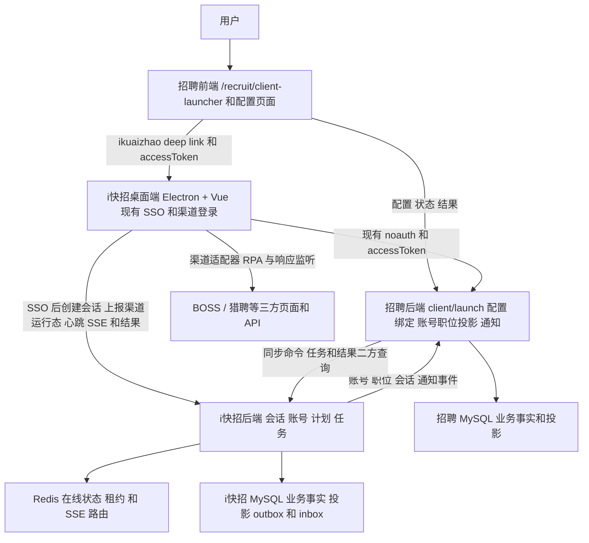
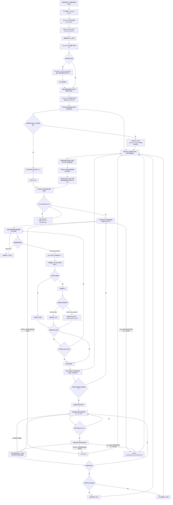
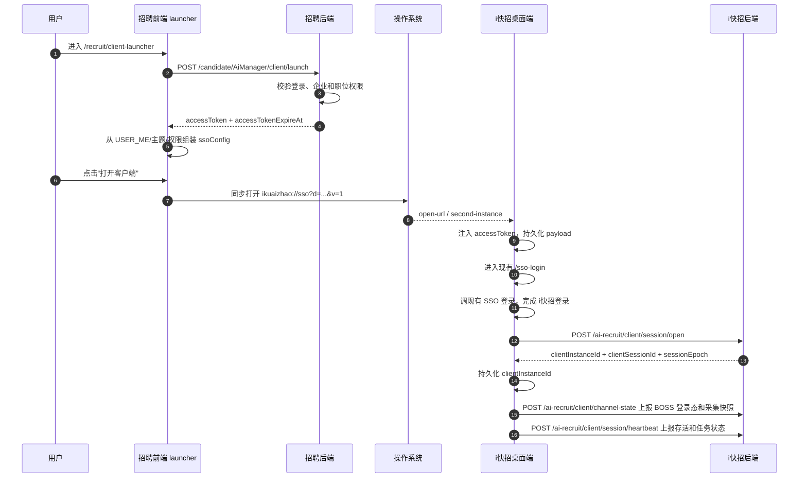
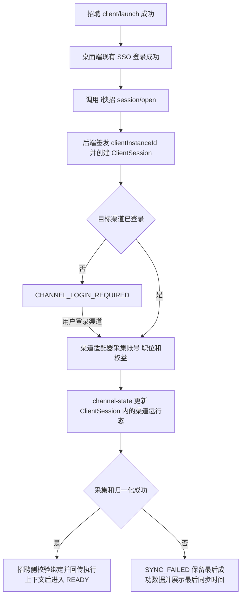
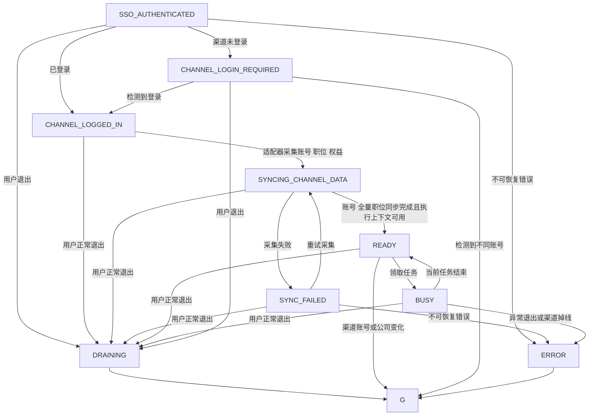
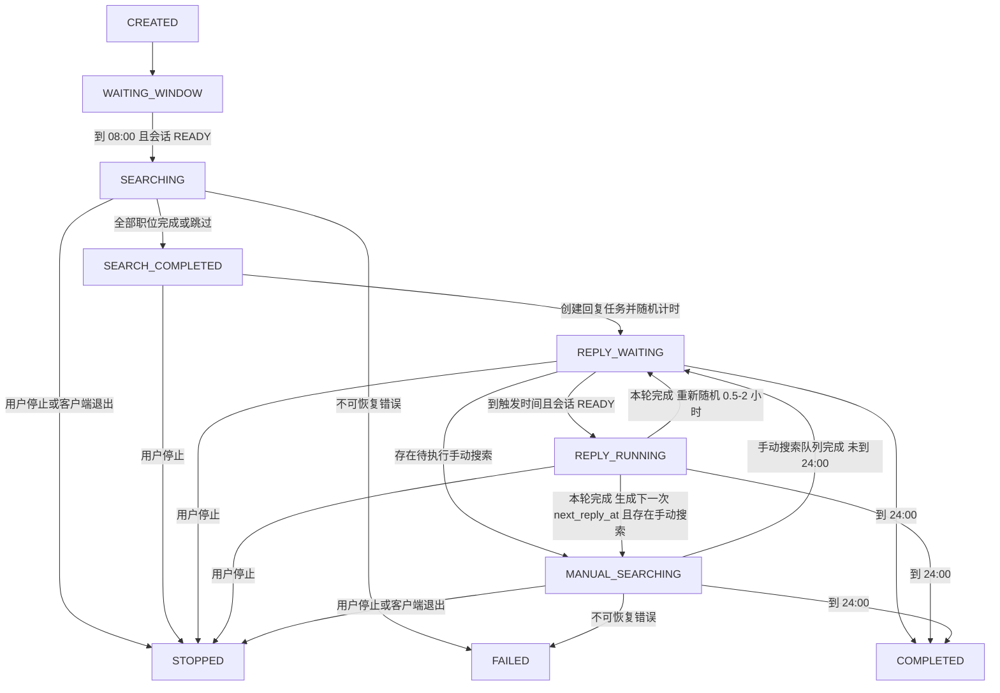
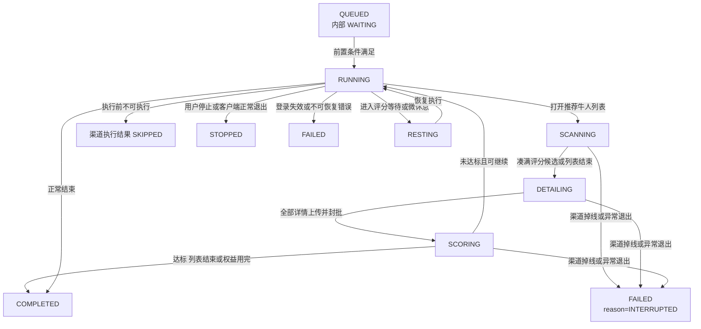
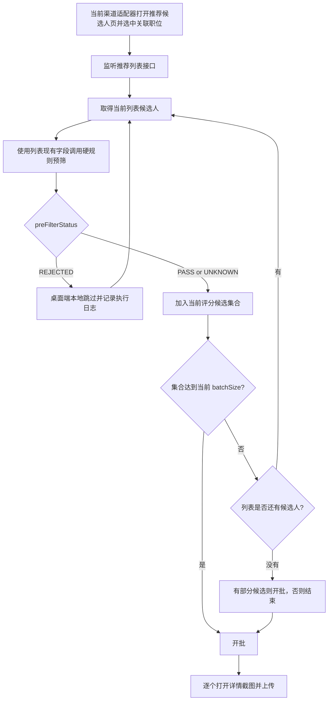
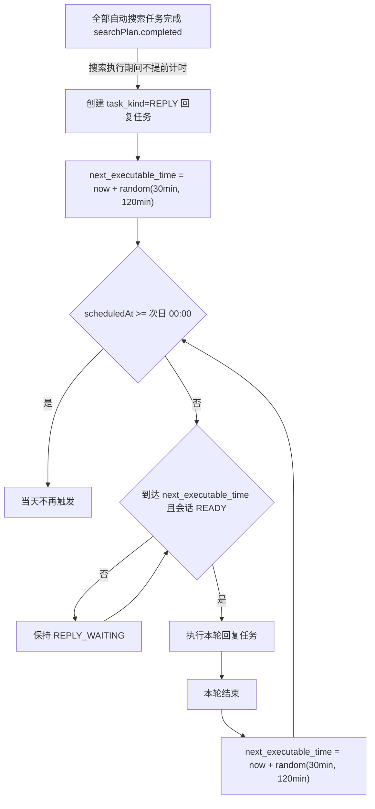
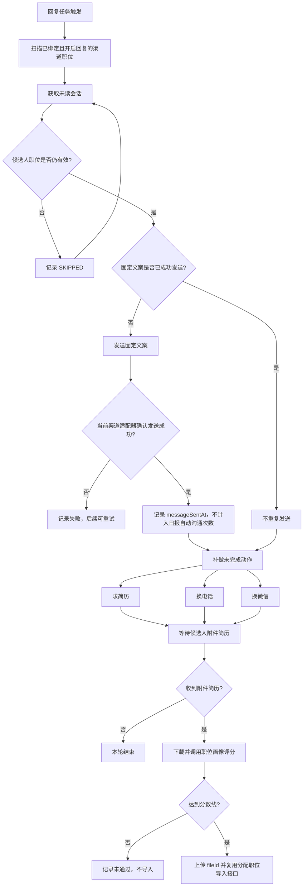

# AI 寻聘助手 V2.1 完整技术方案（沿用现有登录与唤醒链路版）

> 状态：待技术评审
> 日期：2026-11-19
> 范围：招聘侧启动页迁移、现有 SSO 和客户端唤醒链路复用、招聘侧寻聘配置、i快招桌面端会话、通用三方渠道账号/职位/权益模型、BOSS 渠道适配、搜索任务、回复任务、跨服务同步与表设计
> 说明：本文是独立技术方案，不覆盖 `docs/ai-recruit-v2.1-complete-technical-design.md` 和 `docs/ai-recruit-v2.1-technical-design-detailed.md`。
> 拆分文档：[接口设计](./ai-recruit-v2.1-interface-design-legacy-launch.md) | [表设计](./ai-recruit-v2.1-table-design-legacy-launch.md)
>
> 本版明确决策：
> - `/client-launcher` 从 i快招前端迁移到招聘前端。
> - 不修改当前桌面端 SSO 登录流程。
> - 不使用一次性 `launchTicket` 替换当前 deep link 启动协议。
> - 继续使用招聘后端现有 `client/launch` 接口签发的 `accessToken`，并沿用当前 payload 组装、桌面端 SSO 和 token 使用方式。
> - launch ticket 作为后续安全演进，不纳入本期承诺范围。

---

## 1. 结论摘要

本次改造把 `/client-launcher` 的页面和唤起编排迁移到招聘前端，但保留现有桌面端登录与唤醒协议：

- 招聘前端负责启动页、客户端探测、下载引导、deep link 组装和同源调用 `client/launch`。
- 招聘后端继续负责当前用户身份校验、`accessToken` 签发、寻聘配置、职位关联结果、任务和结果二方查询以及对用户的通知。
- i快招桌面端负责渠道登录态、渠道 RPA、候选人详情采集、打招呼、回复和附件简历获取。
- i快招后端负责客户端会话、渠道账号最新权益、绑定职位执行上下文、任务编排、任务执行状态和结果事实。
- 招聘后端负责寻聘配置权威数据、权限校验、账号和职位投影、i快招二方查询和对用户的通知。

推荐最终链路：

```text
招聘工作台
  -> 用户进入招聘侧 /recruit/client-launcher
  -> 招聘前端同源调用现有 client/launch 获取 accessToken
  -> 招聘前端组装现有 ssoConfig 和安全上下文
  -> 浏览器直接打开 ikuaizhao://sso?d=<base64url(payload)>&v=1
  -> i快招桌面端消费现有 payload，进入现有 /sso-login
  -> 完成现有 SSO 登录
  -> 渠道登录并形成 READY 客户端会话
  -> i快招后端生成当日计划
  -> 串行执行各职位搜索任务
  -> 全部自动搜索任务结束后，随机 0.5-2 小时触发回复任务
  -> 自动搜索完成后允许用户基于当前有效关联重复手动搜索，手动搜索优先于下一轮回复
  -> 招聘后端按业务日和授权职位查询 i快招任务和候选人结果
  -> 招聘侧展示实时查询到的状态和结果
```

关键决策：

1. 招聘前端直接承载 `/client-launcher` 页面并直接唤起客户端，不再套 i快招 `/client-launcher` iframe。
2. 当前 deep link、`ssoConfig`、`accessToken`、桌面端 `/sso-login` 和 i快招 token 使用方式保持不变。
3. 当前 deep link 会携带用户敏感数据和约 24 小时 bearer token，该风险作为本期已接受的安全债务；launch ticket 改造后续单独立项。
4. 招聘配置、职位关联和职位画像正文是权威源；画像正文继续复用现有 Harness 能力，但只能通过招聘侧入口读取和修改，i快招不独立维护可编辑画像。i快招修改画像时必须先调用招聘接口保存成功，再读取招聘返回的当前 `positionHarnessProfileId/profileContent`；评分请求只传 `positionHarnessProfileId`，招聘调用 Harness 时按该画像当前最新内容评分，不传也不校验画像版本。i快招不新增配置投影表，而是把 `sync_inbox` 作为追加式同步事件流。`POSITION_CONFIG_PUBLISHED` 和 `JOB_BINDING_PUBLISHED` 保存完整 payload，按 `companyId + consumer + aggregateId + aggregateVersion` 查询当前最新成功事件。职位关联只支持新增或编辑，不提供解绑；停止寻聘用 AI 开关表达。招聘保存成功后同步调用 i快招，失败直接返回给用户；`search_task` 首次开始执行时从最新同步事件读取配置并把画像 ID 固化到 `config_snapshot_json`，完整画像内容继续复用现有 `search_condition.harness_profile_content` 快照。任务筛选配置在首次 `RUNNING` 后冻结；画像评分不冻结版本，同一任务执行期间画像内容更新后，后续评分使用最新内容。自动任务集合和职位执行上下文在首个自动任务创建时固定；现有手动搜索按用户点击时的当前有效关联实时校验，并在任务职位执行单元保存自己的执行快照。
5. 渠道登录后才形成可执行的客户端会话。仅完成招聘授权或 SSO 登录但未登录三方招聘渠道时，不能领取任务。
6. 客户端会话在桌面端完成现有 SSO 登录后创建，不依赖 launch ticket。本期一个 `ai_client_session` 同时承载一次客户端运行生命周期和当前 BOSS 渠道运行态，不再拆独立渠道会话表。
7. 渠道账号采用通用模型：`channelCode + externalUserId` 识别账号，`externalCompanyId` 表达公司上下文；渠道原始 ID 只作为外部标识，业务关联统一使用内部 `channelAccountId`。
8. 渠道职位采用通用模型：`channelAccountId + externalCompanyId + externalJobId` 识别。自动任务的职位上下文保存在日计划 `execution_context_json`；手动搜索允许职位不在自动任务集合中，因此把本次职位执行上下文保存在 `search_task_channel.execution_snapshot_json`。
9. 渠道差异通过渠道适配器和 `channelExt` 隔离。BOSS 是本期第一个适配器；BOSS 页面路径、接口监听、字段解析、状态映射和权益解析写入 BOSS 适配规则，不进入通用任务表。
10. 日计划和回复任务按渠道账号所属企业及 `channelAccountId + externalCompanyId + businessDate` 归属，职位间串行执行；自动搜索任务按 `businessDate + headcountId + channelAccountId` 唯一，手动搜索按 `businessDate + requestId + headcountId + channelAccountId` 唯一。企业范围和渠道编码通过 `channel_account_id` 关联 `channel_account` 获取，不在已有任务表重复保存。
11. 自动搜索任务优先；同一渠道账号的全部自动搜索任务完成后才开始回复任务的随机计时。手动搜索排在下一轮回复之前，但不重置已经开始的回复计时。
12. 列表预筛淘汰的人不算评分批次候选人，不创建详情，不占 `batchSize`，不消耗期望简历数。当前 BOSS 适配器的批大小规则仍按 `min(targetCount, 5)` 动态解析。
13. 通过列表预筛并完成详情截图后，必须先等待画像评分；评分通过才收藏候选人，`FILTER_AND_GREET` 在收藏成功后执行打招呼。
14. “自动沟通次数”只统计搜索任务中配置了“筛选并打招呼”且渠道适配器明确确认成功的自动打招呼。回复任务的固定文案发送成功不计入自动沟通次数；手动沟通只计入手动沟通次数。自动和手动共用 `condition_resume.communication_type`：`0` 自动、`1` 手动、`NULL` 未沟通；结果行最多记录一种成功来源，沟通业务日使用 `condition_resume.create_time`。
15. 招聘侧不新增 `sync_outbox/sync_inbox`；招聘同步 i快招采用同步调用。i快招 `sync_outbox` 承担投递可靠性；`sync_inbox` 同时承担同步命令幂等、完整事件留痕和最新配置/绑定查询。每个职位最新成功配置和绑定事件不得清理。
16. 自动搜索阶段完成后允许用户对当前任意有效关联的职位重复发起手动搜索。手动搜索不受自动任务集合、`position_order_json` 或日计划 `execution_context_json` 限制，当天新增职位或后来修复关联的职位也可以搜索；每次创建独立 `task_kind=SEARCH`、`trigger_source=USER_CLICK` 任务，并保存本次职位执行快照。手动搜索优先于下一轮回复，且不修改 `search_completed_at` 或重置回复随机计时。

---

## 2. 领域对象与权威边界

### 2.1 核心标识

| 标识 | 生成方 | 含义 | 生命周期 |
|---|---|---|---|
| `accessToken` | 招聘后端 | 当前 `client/launch` 签发的客户端 noauth bearer token | 当前配置为 86400 秒 |
| `tenantId` | i快招 `third_party_tenant` | i快招既有接入或部署租户；当前招聘接入链路可统一使用一个租户 | 跟随接入配置 |
| `companyId` | 招聘后端认证上下文 | 招聘企业 ID，是企业级数据的硬隔离边界 | 跟随当前认证用户和企业 |
| `userId` | i快招 `third_party_user` | i快招用户 ID，表示创建人、操作人、归属人或当前登录用户 | 跟随用户生命周期；不作为企业级共享数据的统一过滤键 |
| `clientInstanceId` | i快招后端 | 某台电脑上的客户端安装实例；首次 `session/open` 由后端签发，客户端持久化；逻辑归属按 `tenantId + companyId + clientInstanceId` 区分 | 长期；卸载重装或本地数据丢失后重新签发 |
| `clientSessionId` | i快招后端 | 一次桌面客户端运行会话及其当前单一渠道执行上下文，SSO 成功后创建 | 启动到退出；切换渠道账号时关闭旧会话并创建新值 |
| `channelCode` | i快招后端 | 渠道类型，如 `BOSS`、`LIEPIN` | 随渠道配置 |
| `channelAccountId` | i快招后端 | 三方渠道账号内部稳定 ID，业务表统一使用该值关联 | 长期 |
| `externalUserId` | 三方渠道 | 渠道账号原始业务 ID；BOSS 本期取 `bossUserId` | 跟随渠道账号 |
| `externalCompanyId` | 三方渠道 | 渠道公司/租户上下文；BOSS 本期取 `bossCompanyId` | 跟随渠道登录上下文 |
| `channelJobSnapshotId` | i快招后端 | 某次职位采集为单个职位生成的逻辑版本 ID；自动任务上下文写入日计划 `execution_context_json`，手动任务上下文写入 `search_task_channel.execution_snapshot_json`，不建立独立职位快照表 | 采集版本；随对应任务执行上下文固定 |
| `externalJobId` | 三方渠道 | 渠道职位原始 ID；BOSS 本期取 `encryptJobId` | 跟随渠道职位 |
| `businessDate` | i快招后端 | Asia/Shanghai 时区下 `00:00` 开始的业务日 | 每天一个 |
| `dayPlanId` | i快招后端 | 某渠道账号和公司上下文在某业务日的执行计划 | 每个渠道账号每业务日一个 |
| `searchTaskId` | i快招后端 | 某系统职位、渠道账号某天的一次搜索任务 | 每天每职位每渠道账号最多一条有效执行 |
| `scoreBatchNo` | i快招后端 | 同一搜索任务内的评分批次号 | 与 `taskId` 组合为 `batchId` |
| `replyTaskId` | i快招后端 | 某渠道账号某业务日的回复任务逻辑 ID；实际对应 `task_kind=REPLY` 的 `searchTaskId` | 每个渠道账号每天一个 |
| `configVersion` | 招聘后端 | 寻聘配置版本 | 单调递增 |
| `configSnapshotJson` | i快招后端 | `search_task` 首次开始执行时固定的任务级配置；自动任务的职位、绑定、账号和权益从日计划 `execution_context_json` 读取，手动任务从 `search_task_channel.execution_snapshot_json` 读取 | 首次进入 `RUNNING` 时固定 |
| `eventId` | 事件或同步命令发送方 | 一次跨服务同步请求的唯一 ID | 全局唯一 |

`accessToken` 仅用于客户端调用招聘现有 `/candidate/AiManager/client/noauth/**` 包装接口，不进入任务归属或客户端会话主键。`clientSessionId` 同时表达一次桌面客户端运行和本期唯一的 BOSS 渠道执行上下文；账号级业务归属统一使用 `channelAccountId`。

所有新建表优先使用 `id` 主键。`channel_account/ai_client_session/ai_recruit_day_plan` 的 `id` 直接保存稳定业务 ID，其他表分别通过 `channel_account_id/client_session_id/day_plan_id` 外键列关联；接口字段仍为 `channelAccountId/clientSessionId/dayPlanId`。`ai_client_instance` 使用 `tenant_id + company_id + client_instance_id` 联合主键，不保留无业务引用的自增 `id`。

数据隔离以 `tenantId + companyId` 定位数据域，其中 `companyId` 是招聘企业客户的硬隔离主键。`userId` 只用于用户归属、审计、个人偏好和用户私有数据，不能作为任务、职位、权益、日计划、候选人或回复结果等企业级共享数据的统一过滤条件。

当前招聘接入链路使用同一个 i快招接入租户时，`tenantId` 可以相同；这表示“单一接入租户、多招聘企业”，不代表招聘企业之间没有隔离。新建企业级表默认保存 `companyId`；`search_task/condition_resume` 等已有任务结果表通过全局唯一的 `channelAccountId` 关联 `channel_account` 获取企业范围，不重复保存 `companyId`。所有查询和接口鉴权仍必须校验 `companyId`，且 `companyId/userId` 来自已认证上下文，不能信任客户端请求体。若后续改为每个招聘企业独立 i快招租户，需要动态下发租户凭证并迁移现有 `companyId` 数据。

一次渠道采集会更新 `channel_account` 的最新账号权益，并为完整渠道职位列表中的每个职位生成逻辑 `channelJobSnapshotId`，随后同步给招聘侧当前态投影。i快招不长期保存全量职位列表；生成日计划时只把已绑定且可执行的职位上下文写入 `ai_recruit_day_plan.execution_context_json`，供自动搜索和回复任务按 `day_plan_id + external_job_id` 读取。现有手动搜索允许职位不在自动任务集合中，因此只在本次 `search_task_channel.execution_snapshot_json` 保存单个职位的执行上下文，不复制整个日计划职位列表。搜索和回复共用任务根与职位执行单元，但结果分表：搜索候选人写 `condition_resume/task_resume_detail`，回复候选人写 `reply_task_candidate/resume_blind2/resume_detail2`，评分统一写 `resume_score_record`。两类候选人结果只通过 `search_task_channel_id` 关联各自的职位执行单元，不互相关联。

BOSS 专属字段只在 BOSS 适配器边界出现，并映射为通用字段：

```text
bossUserId    -> externalUserId
bossCompanyId -> externalCompanyId
bossJobId     -> externalJobId
```

### 2.2 数据权威源

| 数据 | 权威源 | 消费方 | 说明 |
|---|---|---|---|
| 用户、企业、功能权限 | 招聘后端 | 招聘前端、i快招后端 | 启动时校验 |
| AI 寻聘开关、筛选方式、分数线、期望简历数、回复开关、沟通上限覆盖值 | 招聘后端 | i快招后端 | i快招保存快照 |
| 系统职位与渠道职位关联 | 招聘后端 | i快招后端 | 使用 `channelCode + channelAccountId + externalCompanyId + externalJobId` 表达渠道账号和职位归属 |
| 渠道登录态、账号/公司信息和账号权益 | 渠道适配器采集 | i快招后端、招聘后端投影 | i快招只在 `channel_account` 保存最新账号权益，不保存账号历史快照；招聘侧把账号权益和最近一次客户端会话合并保存在 `ai_recruit_channel_account` 当前投影 |
| 渠道职位、职位权益和职位能力 | 渠道适配器采集 | 招聘后端 | 招聘侧保存全量当前投影；i快招不长期保存全量列表，只把已绑定且可执行职位写入日计划 `execution_context_json` |
| 客户端会话（含当前渠道运行态）、任务、批次和执行结果 | i快招后端 | 招聘后端、招聘前端 | i快招是执行事实源；招聘侧只在账号投影中保留最近会话，任务和结果通过二方查询读取，不保存完整会话历史或任务/结果投影 |

### 2.3 渠道账号与公司身份

通用账号模型：

- `channel_account` 保存渠道账号稳定身份，一行代表一个渠道登录账号。
- `tenantId + companyId + channelCode + externalUserId` 唯一识别账号；`externalCompanyId/externalCompanyName` 保存最近一次识别的公司上下文，不参与账号主键。
- 渠道账号可以切换公司。公司切换时更新账号最近公司上下文，并由招聘侧按新的公司上下文保存独立的账号和职位当前投影；i快招不新增账号快照行。
- 适配器必须提供稳定 `externalUserId`。如果某个渠道只能提供公司内账号 ID，由适配器生成包含公司作用域的稳定 `externalUserId`；无法稳定识别时标记 `IDENTITY_UNVERIFIED`，禁止启动自动任务。
- 适配器必须提供稳定 `externalCompanyId`。如果渠道没有独立公司概念，由适配器生成作用域稳定的逻辑公司 ID，不能留空；否则日计划、职位唯一键和账号切换校验会出现空值歧义。
- 渠道账号表不保存 Cookie、密码、accessToken 或渠道页面原始登录凭证。登录态属于 `ai_client_session`，最新账号权益属于 `channel_account`，任务执行权益属于日计划 `execution_context_json`。

账号执行互斥使用内部账号 ID、服务端条件更新和会话表唯一键：

```text
sessionScope = companyId + channelCode + channelAccountId + externalCompanyId
activeOwner = clientSessionId
```

同一 BOSS 账号不能同时登录两个客户端，因此正常情况下同一 `sessionScope` 只会有一个有效会话。服务端仍按条件更新保证异常、重放或旧客户端场景下最多一个会话可执行任务：新会话确认账号后，旧会话进入 `CLOSED`，关闭原因写 `SESSION_SUPERSEDED`，停止旧任务并断开 SSE，并退出所有调度候选。

BOSS 适配器账号规则如下。

当前确认：

- 登录 BOSS 后，先建立 `GET /wapi/zpboss/h5/chat/config` 的响应监听，再通过页面路由或地址栏进入 `/web/chat/user-center`，由个人中心页面触发账号信息接口。
- 账号信息样本来自 `/wapi/zpboss/h5/chat/config`：`zpData.userInfo.userBaseInfo.id=658444611`、`zpData.userInfo.userId=658444611`；`zpData.userExtra` 返回 `comId=34716316`、`brandId=19829142`、`companyFullName=上海利唐信息科技有限公司大连分公司`；`zpData.brand` 返回 `id=19829142`、`name=利唐`。
- 职位列表样本来自另一份 `/wapi/zpjob/job/data/list` 响应：产品经理的 `viewRightsUrl.ba.uid=535435066`。该值与上面的账号信息样本不是同一次采集，只用于证明 `ba.uid` 可以解析，不能拿两组历史样本互相比对。
- 同一次有效采集中，所有非空 `viewRightsUrl.ba.uid` 必须等于该次 `/wapi/zpboss/h5/chat/config` 返回的 `bossUserId`。任一值不一致时，整次账号信息采集失败。

BOSS 适配器字段映射：

```text
bossUserId = accountConfig.userInfo.userBaseInfo.id
bossUserIdCheck = accountConfig.userInfo.userId
bossCompanyId = accountConfig.userExtra.comId
bossBrandId = accountConfig.userExtra.brandId
bossCompanyName = accountConfig.userExtra.companyFullName
bossBrandName = accountConfig.brand.name
viewRightsUrl.ba.uid = bossUserId（校验值）
bossJobId = job.encryptJobId
clientSessionId = 一次客户端运行上下文
```

校验约束：

- 账号采集必须先用 `siteNetwork.waitForResponse` 建立监听，再导航到 `/web/chat/user-center`，最后等待 `/wapi/zpboss/h5/chat/config` 响应；页面跳转完成不参与成功判定。其他采集动作同样必须先监听、后操作。
- 主值使用 `zpData.userInfo.userBaseInfo.id`；缺失时回退 `zpData.userInfo.userId`。
- `zpData.userInfo.userId`、`zpData.userExtra.userId` 和 `viewRightsUrl.ba.uid` 均只作为校验值；存在时必须与主值一致，否则本次账号信息采集失败，禁止会话进入 `READY`。
- `zpData.userExtra.comId` 作为 `bossCompanyId`，用于识别同一 BOSS 用户切换公司后的职位和权益上下文变化；缺失时不能形成可执行会话。
- 公司 ID、公司全称、品牌 ID 和品牌名称更新到 `channel_account` 当前态；不保存密码、盐、生日等非必要个人字段，也不保存完整原始响应。
- `bossUserId` 是 BOSS 账号业务 ID，不是招聘 `userId`，不能混用。
- 上线前补一次跨天、换设备登录一致性回归，确认同一 BOSS 账号始终返回相同 `userBaseInfo.id`。

账号接口只按以下白名单提取和落库：

| 目标字段 | BOSS 响应字段 | 用途 |
|---|---|---|
| `externalUserId` | `zpData.userInfo.userBaseInfo.id`，缺失时用 `zpData.userInfo.userId` | 账号业务身份和绑定校验；原始 ID 不再写入 `channelExt` 形成双事实源 |
| `displayName` | `zpData.userInfo.userBaseInfo.name ?? zpData.userInfo.showName` | 招聘侧展示 |
| `externalCompanyId` | `zpData.userExtra.comId` | 公司上下文和日计划唯一键；原始 ID 不再写入 `channelExt` 形成双事实源 |
| `externalCompanyName` | `zpData.userExtra.companyFullName` | 招聘侧展示和人工排查 |
| `channelExt.boss.brandId` | `zpData.userExtra.brandId ?? zpData.brand.id` | BOSS 专属公司品牌上下文 |
| `channelExt.boss.brandName` | `zpData.brand.name` | BOSS 展示扩展 |
| `channelExt.boss.userTitle` | `zpData.userExtra.title` | BOSS 账号身份辅助展示 |

接口返回值中的密码、盐、生日、头像原图、完整用户对象、完整公司对象和其他未列字段不得进入日志或业务表。桌面端提取白名单字段后即可释放响应对象，不需要把 `/chat/config` 全量响应上传后端。

### 2.4 系统职位与渠道职位关系

已确认：

- 本期一个系统职位最多绑定一个 BOSS 账号下的一个职位，即同一 `channelCode=BOSS` 只能有一条有效绑定。
- 一个渠道账号下的同一个外部职位不能同时绑定多个系统职位。
- 通用唯一约束按渠道拆分：`companyId + headcountId + channelCode` 唯一；渠道职位侧 `companyId + channelCode + channelAccountId + externalCompanyId + externalJobId` 唯一。
- 未来接入猎聘等渠道后，同一个系统职位可以分别绑定一个 BOSS 职位和一个猎聘职位，但仍不能在同一渠道绑定多个账号。
- 不支持主动解绑，也不提供解绑接口；用户只能新增或编辑关联关系，每次变更保留历史。
- 编辑关联是一次原子替换，不产生“先解绑、再绑定”的中间状态，也不产生解绑业务事件。
- 用户要停止该职位执行 AI 寻聘时，关闭 AI 寻聘开关，不清空或删除 BOSS 职位关联。
- 招聘侧是关联配置的权威源。编辑时招聘后端先在本地事务内更新当前关联、递增 `bindingVersion`、写入 `operate_log` 并标记为同步中，随后同步调用 i快招；只有 i快招确认成功后才向用户返回保存成功。
- i快招按 `eventId` 幂等、按 `aggregateVersion` 防旧请求覆盖，更新后续自动任务和手动搜索读取的关联；已创建任务继续使用自己的任务配置和职位执行快照，不因本次编辑改变。
- 切换渠道账号或同一账号切换公司后，原关联记录不会被清空或自动改绑；账号不一致标记 `CHANNEL_ACCOUNT_MISMATCH`，公司上下文不一致标记 `EXTERNAL_COMPANY_MISMATCH`，用户需要重新编辑关联。

`bossJobId` 解析规则：

1. 直接使用职位列表中的 `encryptJobId`。
2. 当前样本“产品经理”的 `bossJobId=7f2392448ed78b4a03173N-8FVJZ`。
3. 不依赖 URL 中的任何职位数值字段，职位唯一标识只使用 `encryptJobId`。
4. `encryptJobId` 缺失时该职位不生成可绑定项。
5. `viewRightsUrl` 只用于识别权益来源，并解析 `ba.uid` 校验 `bossUserId`。

`bossUserId` 解析规则：

1. 先用 `siteNetwork.waitForResponse` 建立 `GET /wapi/zpboss/h5/chat/config` 监听。
2. 再通过页面路由或地址栏进入 `/web/chat/user-center`。
3. 等待并读取本次页面触发的新账号信息响应。
4. 从 `zpData.userInfo.userBaseInfo.id` 读取 `bossUserId`，并校验 `zpData.userInfo.userId`。
5. 从 `zpData.userExtra.comId` 读取 `bossCompanyId`，从 `zpData.userExtra.companyFullName` 读取公司名称。
6. 从职位 `viewRightsUrl` 查询参数 `ba` 中解析 JSON并读取 `uid`，所有非空值必须等于 `bossUserId`。
7. 没有可用 `bossUserId` 或账号 ID 校验不一致时会话不能进入 `READY`。

职位开放状态规则：

- 当前样本已确认 `jobStatus=0` 的“产品经理”为已打开职位。
- 当前样本中 `jobStatus=1/3` 的职位均不是可自动执行职位；具体页面文案继续以 BOSS 和产品定义为准，不在后端硬编码关闭或待开放。
- `jobStatus=2` 当前没有样本，不进入自动执行；待产品确认前统一按 `UNKNOWN` 处理。
- `jobAuditStatus` 不用于判断职位是否开放。

本次职位列表样本核对：

| 职位 | 原始 `jobStatus` | 解析结果 | 可自动执行 |
|---|---:|---|---|
| 产品经理 | 0 | `bossJobId=7f2392448ed78b4a03173N-8FVJZ`，`viewRightsUrl.ba.uid=535435066`，`jobStatus=OPEN`，`rightsSource=PURCHASED` | 通过职位状态校验，继续校验权益与配置；`ba.uid` 仍需与同次 `/chat/config` 的 `bossUserId` 比对 |
| 高级运维工程师、机械工程师、后端开发工程师、软件测试工程师 | 3 | `jobStatus=NOT_OPEN` | 否 |
| node.js 高级开发工程师、物理教师 | 1 | `jobStatus=NOT_OPEN` | 否 |

通用绑定状态：

| 状态 | 含义 | 是否可自动执行 |
|---|---|---|
| `ACTIVE` | 当前渠道账号与绑定账号一致，`externalCompanyId` 与绑定公司上下文一致，招聘侧当前职位投影中存在该 `externalJobId`，职位开放且权益已同步 | 是 |
| `CHANNEL_NOT_LOGGED_IN` | 渠道未登录，无法校验 | 否 |
| `CHANNEL_ACCOUNT_MISMATCH` | 当前 `channelAccountId` 与绑定记录不一致 | 否 |
| `EXTERNAL_COMPANY_MISMATCH` | 渠道账号一致，但当前 `externalCompanyId` 与绑定记录不一致 | 否 |
| `JOB_NOT_FOUND` | 账号和公司一致，但招聘侧当前渠道职位投影中找不到绑定职位 | 否 |
| `JOB_NOT_OPEN` | 找到该职位，且已确认不属于开放状态 | 否 |
| `JOB_STATUS_UNKNOWN` | 找到该职位，但渠道状态值尚未确认映射，例如当前 BOSS `jobStatus=2` | 否 |
| `ENTITLEMENT_UNKNOWN` | 权益尚未完成采集 | 否 |
| `NOT_BOUND` | 系统职位未建立该渠道的职位关联，只能通过首次编辑关联离开该状态 | 否 |

切换渠道账号或重新登录后：

1. 渠道适配器采集当前 `channelAccountId + externalUserId + externalCompanyId`。
2. 先比较绑定记录中的 `channelAccountId`；不一致时标记 `CHANNEL_ACCOUNT_MISMATCH`。
3. 账号一致时比较 `externalCompanyId`；不一致时标记 `EXTERNAL_COMPANY_MISMATCH`。
4. 账号、公司一致时，再按 `externalJobId` 校验职位是否存在以及是否开放。
5. 账号、公司、职位均一致且权益完整时恢复为 `ACTIVE`。
6. 找不到职位时标记 `JOB_NOT_FOUND`。
7. 不自动改绑，不根据新账号职位名称或顺序猜测原关联。

BOSS 适配器映射：

- `CHANNEL_NOT_LOGGED_IN` 对应招聘侧“BOSS 未登录”。
- `CHANNEL_ACCOUNT_MISMATCH` 对应原 `BOSS_ACCOUNT_MISMATCH`。
- `EXTERNAL_COMPANY_MISMATCH` 对应原 `BOSS_COMPANY_MISMATCH`。
- `externalJobId` 使用 `encryptJobId`；原始职位 ID 不再重复写入 `channelExt`。

### 2.5 渠道适配器与扩展 JSON

渠道适配器是渠道差异的唯一入口，分为桌面端采集适配和后端归一化适配两部分。通用编排层只依赖标准化后的账号、职位、权益、状态和能力，不直接读取渠道页面字段。

适配器建议接口：

```text
ChannelAdapter
  code(): channelCode
  version(): adapterVersion
  capabilities(): ChannelCapability[]
  detectLogin(rpaContext): NOT_LOGGED_IN / LOGGED_IN / IDENTITY_UNVERIFIED / UNKNOWN
  collectAccount(rpaContext): ChannelAccountPayload
  collectJobs(rpaContext): ChannelJobPayload[]
  collectAccountEntitlement(rpaContext, account): AccountEntitlementPayload
  collectJobEntitlement(rpaContext, jobs): JobEntitlementPayload[]
  listCandidates(rpaContext, executionContext): CandidateListPayload[]
  preFilter(candidate, filterSpec): PASS / REJECTED / UNKNOWN
  openCandidateDetail(rpaContext, candidateRef): CandidateDetailPayload
  performAction(rpaContext, executionContext, action): ActionPayload
  listUnreadConversations(rpaContext, executionContext): UnreadConversationPayload[]
  readAttachment(rpaContext, conversation): AttachmentPayload
  normalizeAccount(raw): ChannelAccountPayload
  normalizeJob(raw): ChannelJobPayload
  normalizeCandidate(raw): CandidateListPayload
  normalizeJobStatus(raw): OPEN / NOT_OPEN / UNKNOWN
  normalizeRightsSource(raw): PURCHASED / ACCOUNT_POOL / CHANNEL_MANAGED / UNKNOWN
  normalizeError(error): ChannelErrorCode
```

桌面端实现 `collect/list/open/perform/read` 等 RPA 能力，后端实现 `normalize` 与任务编排。桌面端不得把页面原始响应直接写库；后端也不得依赖渠道页面选择器或接口路径。

当前 `ChannelCapability` 至少定义：

| 能力 | 含义 |
|---|---|
| `AUTO_SEARCH` | 支持自动搜索候选人 |
| `LIST_PREFILTER` | 支持从渠道列表提取可归一化字段并执行预筛 |
| `CANDIDATE_DETAIL` | 支持打开候选人详情并生成截图/详情结果 |
| `AUTO_GREET` | 支持自动打招呼 |
| `REPLY_RESUME` | 支持回复并求简历 |
| `UNREAD_SCAN` | 支持扫描未读会话 |
| `ATTACHMENT_RESUME` | 支持获取和导入附件简历 |
| `ACTION_ACK` | 支持返回打招呼或消息动作的明确成功/失败结果 |
| `ACCOUNT_ENTITLEMENT` | 支持账号级沟通权益采集 |
| `JOB_ENTITLEMENT` | 支持职位级权益采集 |
| `MULTI_COMPANY_CONTEXT` | 同一账号支持多个公司上下文 |

任务生成时必须检查渠道能力：例如渠道不支持 `AUTO_GREET` 时，`FILTER_AND_GREET` 必须降级为 `FILTER_ONLY`；不支持 `LIST_PREFILTER` 时，列表候选人统一返回 `UNKNOWN` 并进入详情，不能静默判定为 `REJECTED`；不支持 `ACTION_ACK` 时，不能把动作成功计入“AI 已沟通”。

适配器与通用编排层的责任边界：

| 阶段 | 渠道适配器负责 | 通用编排层负责 |
|---|---|---|
| 登录检测 | 判断渠道页面登录态，返回稳定账号和公司标识 | 更新客户端会话内渠道运行态、校验绑定和会话互斥 |
| 数据采集 | RPA 操作页面、先监听后操作、提取白名单字段、归一化 DTO | 校验完整性、更新账号当前态、同步全量职位当前态并接收绑定职位执行上下文 |
| 列表预筛 | 提供归一化候选人列表字段和 `PASS/REJECTED/UNKNOWN` | 应用职位筛选规则、控制批次人数；`UNKNOWN` 不得淘汰 |
| 详情与评分 | 打开详情、截图、返回详情文件引用 | 创建批次、上传详情、调用画像评分、判断分数线和收藏条件 |
| 搜索任务动作 | 执行打招呼并返回明确动作结果 | 幂等记录结果，仅在成功后写入 `communication_type=0` 并计入 AI 已沟通指标，继续下一个职位 |
| 回复任务动作 | 扫描未读、发送固定文案、求简历/换电话/换微信、读取附件引用 | 控制触发时间、维护动作状态、评分和导入招聘、跨任务串行 |
| 异常处理 | 将页面超时、按钮缺失、登录失效等映射为固定错误码 | 按错误类型决定跳过当前职位、停止渠道账号或通知用户 |

渠道适配器的两个标准输出如下。字段只使用通用命名，渠道原始值放在 `channelExt`：

```text
ChannelAccountPayload
  channelCode
  externalUserId
  displayName
  externalCompanyId
  externalCompanyName
  rightsSource
  communicationQuotaTotal / Used / Remaining
  quotaConfidence
  capabilities[]
  channelExt
  extSchemaVersion
  adapterVersion

ChannelJobPayload
  channelCode
  externalJobId
  jobName
  normalizedJobStatus
  rightsSource
  jobPrivilegeCount / UsedCount
  channelRemainingCount
  quotaConfidence
  capabilityCodes[]
  channelExt
  extSchemaVersion
  adapterVersion
```

通用核心字段包括：

```text
channelCode
channelAccountId
externalUserId
externalCompanyId
channelJobSnapshotId
externalJobId
normalizedJobStatus
communicationQuotaTotal / Used / Remaining
allocatedLimit
aiUsedCount
rightsSource
quotaConfidence
collectStatus
capturedAt
adapterVersion
```

渠道扩展 JSON 约定：

```json
{
  "extSchemaVersion": 1,
  "channelExt": {
    "boss": {
      "brandId": "19829142",
      "brandName": "利唐",
      "userTitle": "招聘者",
      "rawJobStatus": "0",
      "rightsPath": "/vip/paid_rights_use",
      "accountPrivileges": {
        "viewQuota": {
          "usedCount": 130,
          "totalCount": 200
        },
        "onlineCompetitiveJobQuota": {
          "usedCount": 4,
          "totalCount": 4
        }
      }
    }
  }
}
```

扩展约束：

- 用于任务准入、权益判断、流程分支、筛选和排序的字段必须是独立通用列，不能只放 `channelExt`。
- `channelExt` 只保存渠道特有展示字段、原始状态、原始链接和排障信息。
- `channelExt` 顶层按渠道命名空间隔离，例如 BOSS 使用 `channelExt.boss`，其他渠道使用各自的 `channelCode` 小写命名；禁止在根层直接放渠道字段。
- `channelExt` 不重复保存 `channelAccountId/externalUserId/externalCompanyId/externalJobId` 等已经标准化的通用字段，避免两套事实源。
- `channelExt` 必须有 `extSchemaVersion`，升级时保持向后兼容。
- 数据库列 `channel_ext_json` 只保存上例中 `channelExt` 的内部对象；`extSchemaVersion` 使用独立列，不重复写入 JSON 外层。接口和事件可继续使用 `channelExt` 与 `extSchemaVersion` 的 camelCase 结构。
- 原始响应只保存白名单脱敏字段；Cookie、token、密码、手机号、邮箱、生日和简历原文不得进入 `channelExt`。
- 适配器输出统一 DTO，数据库写入和跨服务事件只使用通用 DTO，不能直接透传渠道原始响应。
- 后端遇到不支持的 `adapterVersion` 或 `extSchemaVersion` 时，只能保留状态或进入 `SYNC_FAILED`，不得猜测字段或启动自动任务。

---

## 3. 总体架构



模块职责：

| 模块 | 主要职责 |
|---|---|
| 招聘前端 | 启动页、客户端探测、下载引导、deep link 组装、配置页、职位管理详情 AI 寻聘区、渠道状态、任务结果、最后同步时间和未登录提示 |
| 招聘后端 | 现有 `client/launch` 和 `accessToken`、权限、配置版本、渠道职位关联、账号和职位投影、通知、同步协议及 i快招二方查询编排 |
| i快招桌面端 | 现有 deep link 消费、现有 SSO 登录、客户端会话心跳、渠道登录监视、渠道适配器、RPA 页面操作与响应监听、账号/职位/权益采集、详情截图和动作执行 |
| i快招后端 | SSO 成功后的客户端会话（含当前渠道运行态）、渠道账号最新权益、自动任务日计划上下文、手动任务职位执行快照、任务调度、SSE、批次、回复任务、结果事实和二方查询接口 |
| Redis | 会话在线状态、任务临时租约和按 `clientSessionId` 建立的 SSE 路由 |
| MySQL | 两侧业务事实和账号/职位投影；i快招额外保存任务、结果事实和 outbox/inbox |

职责边界：

- 招聘前端不再通过 iframe 与 i快招 launcher 通信，启动页由招聘前端直接承载。
- 招聘后端不因为本次页面迁移而新增 launch grant 或 ticket 兑换职责。
- i快招后端不参与现有招聘 `accessToken` 的签发，也不在启动阶段消费 ticket。
- `clientSession` 同时表达桌面端运行上下文和本期唯一的渠道执行上下文，不等同于招聘 `accessToken`。
- 通用编排层不能直接依赖 BOSS 页面 URL、接口路径和原始字段；这些内容只存在于渠道适配器。

### 3.1 端到端业务流程图



流程约束：

- 招聘配置通过 `configVersion` 和 `search_task.config_snapshot_json` 隔离。任务首次开始执行时从 `sync_inbox` 最新 `POSITION_CONFIG_PUBLISHED` 读取并固化配置；执行中修改不影响当前任务，尚未开始的后续职位在各自开始时使用最新事件。
- i快招不新增配置投影表。配置和绑定以下列 `sync_inbox` 最新成功事件为当前同步源：

```text
companyId + consumer + aggregateId
  -> 按 aggregateVersion DESC, id DESC 取最新一条
```

  - `consumer=IKZ_POSITION_CONFIG`：提供 `filterMode/scoreLine/expectedResumeCount/replyResumeEnabled/channelFilters/chatLimitOverride/configVersion`。
  - `consumer=IKZ_JOB_BINDING`：提供当前系统职位关联的渠道账号、公司和职位。
  - `sync_inbox.payload_json` 必须保存完整业务命令，不能只留审计摘要。
- 自动搜索任务按职位串行执行，全部自动搜索任务结束后才开始回复任务的随机计时；手动搜索在自动搜索完成后插入，并优先于下一轮回复。
- 自动任务集合只在客户端启动并完成账号、职位和权益采集后生成一次。此后新增职位或修复关联不会补建自动任务，只允许用户主动发起手动搜索。
- 单职位异常跳过并继续下一个职位；渠道掉线、重新登录和会话异常停止相关自动任务。BOSS 仅作为本期第一个渠道适配器。
- `STOPPED` 以及 `FAILED + terminalReason=INTERRUPTED` 的任务不会自动创建替代任务，正常退出同样发送通知。
- 招聘后端是配置权威源，i快招后端是执行事实源；账号和职位当前态由事件同步形成，任务和候选人结果由招聘后端实时二方查询；渠道原始字段只在适配器内解析。

---

## 4. 桌面端启动流程

### 4.1 迁移范围

严格区分两个页面：

| 页面 | 当前所在项目 | 本版处理 |
|---|---|---|
| `/client-launcher` | `irecruiting360-web-static` | 迁移到 `ihr360-recruit-static` |
| `/sso-login` | `irecruiting360-web-static` Electron 内 | 保持不变 |

因此，本版迁移的是**客户端唤醒页**，不是桌面端 SSO 登录页。

推荐招聘前端路由：

```text
/recruit/client-launcher
```

如果产品要求保留 `/client-launcher` 短路径，可通过网关或路由别名映射到上述页面，但页面代码仍放在招聘前端。

页面需要迁移或等价实现的能力：

- 客户端协议唤起。
- `127.0.0.1:53531` health probe。
- Windows/macOS 下载引导。
- 未安装客户端提示。
- deep link payload 组装。
- 当前 `accessToken` 预取和错误提示。
- 当前 `intent`、`headcountId` 和 `ihrManageUrl` 处理。
- Electron 环境内直接回主页的判断。

`ihr360-recruit-static` 当前是 React，现有页面是 Vue，不能直接复制组件文件。可复用的对象是协议、状态机、样式、下载地址和交互流程，不要求跨框架复用源码。

### 4.2 当前 deep link 协议

本版继续使用当前协议：

```text
ikuaizhao://sso?d=<base64url(payload)>&v=1
```

payload 继续保持当前结构：

```json
{
  "intent": "sso",
  "ssoConfig": {
    "locale": "zh-CN",
    "userConfig": {
      "tenantCode": "company_a",
      "apiKey": "controlled-api-key",
      "signature": "controlled-signature",
      "thirdPartyUserId": "recruit-user-id",
      "userData": {
        "username": "user",
        "nickname": "user",
        "email": "user@example.com",
        "phone": "13800000000",
        "avatar": ""
      },
      "extendData": {
        "plan": "PlanA",
        "from": "recruit-assistant",
        "assignPositionAuth": true,
        "talentPoolAuth": true,
        "sendJdAuth": true,
        "headcountId": "100001"
      }
    }
  },
  "sysConfig": {
    "color": "#1677ff"
  },
  "companyConfig": {
    "companyId": "company-id"
  },
  "positionIds": ["100001"],
  "ihrManageUrl": "https://recruit.example.com",
  "accessToken": "current-client-access-token",
  "accessTokenExpireAt": "2026-11-17T10:00:00+08:00",
  "tokenParamName": "accessToken",
  "companyId": "company-id",
  "companyName": "公司名称",
  "brand": "brand-id"
}
```

约束：

- 保持 `v=1`，避免要求现有桌面端升级。
- 当前 deep link 只传 `positionIds`，不传完整 `positionList` 和 JD；完整职位列表由桌面端现有逻辑回填。
- `ssoConfig.userConfig` 必须继续传，因为现有桌面端 SSO 直接消费该对象。
- 招聘后端 `client/launch` 返回 token；`companyId/companyName/brand` 由招聘前端从 `USER_ME` 补齐。
- `ihrManageUrl` 在招聘侧直接取当前招聘 manage origin。
- 不新增 `launchId`、`launchTicket`、协议兑换接口或新的协议版本。

### 4.3 启动数据来源

| 数据 | 招聘前端来源 | 处理方式 |
|---|---|---|
| `accessToken/accessTokenExpireAt/tokenParamName` | `POST /candidate/AiManager/client/launch` | 原样放入 payload |
| `companyId/companyName/brand` | `IrsDataStorage.USER_ME` | 与 `client/launch` 返回合并 |
| `sysConfig` | `PRIMARY_THEME.data` | 原样传递 |
| `ssoConfig.locale` | `USER_ME.locale` | 原样传递 |
| `ssoConfig.userConfig.thirdPartyUserId` | `USER_ME.userId` | 原样传递 |
| `ssoConfig.userConfig.userData` | `USER_ME` 用户资料 | 映射 username/email/mobileNo/avatar |
| `extendData` 权限 | 当前招聘页面权限数据 | assignPositionAuth/talentPoolAuth/sendJdAuth |
| `positionIds` | 当前职位列表或 `headcountId` | 只传 ID |
| `ihrManageUrl` | `window.location.origin` | 当前招聘 manage origin |

现有招聘前端已经在 `recruit-assistant/index.tsx` 中完成同类 payload 组装。迁移时应把这部分抽成启动上下文 builder，避免页面迁移后出现两份不一致逻辑。

需要特别处理：

- 当前代码中存在硬编码的 `apiKey/signature` 测试值。正式环境必须确认是否应由服务端下发、按环境注入或继续使用现有受控配置；这是上线门禁，不是页面迁移可以忽略的问题。
- `ssoConfig` 不是完整招聘用户对象的透传，只组装桌面端当前 SSO 所需字段。
- 招聘前端缓存不是权限判断的替代；`client/launch` 后端校验必须保留。

### 4.4 Token 获取与浏览器用户手势

当前 i快招 launcher 通过 iframe postMessage 让招聘父页调用 `client/launch`，原因是跨域和 Cookie。迁移到招聘前端后该层不再需要：

```text
旧: launcher iframe -> postMessage parent -> recruit page fetch -> postMessage result
新: recruit launcher page -> same-origin fetch /candidate/AiManager/client/launch
```

建议状态机：

```text
INIT
  -> PREPARING: 页面加载后预取 client/launch
  -> READY_TO_LAUNCH: token 和 payload 已准备
  -> LAUNCHING: 用户点击后同步触发 deep link
  -> PROBING: 探测 127.0.0.1:53531
  -> LAUNCHED: 探测成功或窗口失焦
  -> NOT_INSTALLED: 超时未探测到客户端
  -> ERROR: launch 接口失败或数据不完整
```

浏览器兼容要求：

- 推荐在页面加载时完成 `client/launch` 预取，用户点击“打开客户端”时同一调用栈内立即触发协议。
- 如果页面采用自动唤起，自动唤起失败后必须保留一个明确的手动按钮。
- 不要要求用户点击后再串行等待多个网络请求后才首次触发协议，否则部分浏览器会丢失用户手势。
- health probe 只用于判断客户端是否已启动，不替代桌面端的 SSO 和渠道登录结果。

### 4.5 启动时序



关键点：

- `client/launch` 是招聘授权校验点。
- `session/open` 是 i快招业务会话创建点，晚于现有 SSO 登录。
- 启动成功与 SSO 成功不是同一个状态；招聘前端 probe 成功只能表示桌面端进程已打开。
- 目标渠道登录、完成账号和全量职位采集，并收到招聘侧绑定职位执行上下文后，客户端会话才可能进入 `READY`。本期目标渠道为 BOSS。

### 4.6 Electron 行为

本版要求桌面端保持现有行为：

1. 解析旧 deep link `v=1`。
2. 从 payload 提取 `accessToken/accessTokenExpireAt`。
3. 将 accessToken 注入 `ihrBridge`。
4. 继续持久化 launcher payload 和 accessToken。
5. 进入现有 `/sso-login`。
6. 由 `SSOLogin.vue` 消费 `ssoConfig` 完成现有登录。
7. SSO 成功后新增调用 i快招 `session/open`；首次由后端签发 `clientInstanceId` 和本次 `clientSessionId`，客户端持久化 `clientInstanceId` 后再进入后续流程。
8. 启动渠道登录监视和身份采集；本期注册 BOSS 适配器。
9. 只有会话进入 `READY` 后建立任务 SSE。

不在本期改动：

- accessToken 的持久化方式。
- deep link payload 字段和协议版本。
- 现有 SSO 请求链路。
- accessToken 的查询参数鉴权方式。

### 4.7 启动失败与降级

| 场景 | 页面处理 |
|---|---|
| `client/launch` 失败 | 不触发 deep link，展示重试 |
| 未登录或职位权限不足 | 展示现有业务错误，不打开客户端 |
| `ssoConfig` 不完整 | 阻止启动，提示刷新工作台 |
| 协议未注册/客户端未安装 | 展示下载引导 |
| 客户端已安装但协议被拦截 | 提供再次打开和下载说明 |
| probe 超时 | 不直接判定 SSO 失败，只提示客户端未响应 |
| 客户端启动但 SSO 失败 | 由桌面端现有错误处理负责 |
| 渠道未登录 | 对应客户端会话保持 `CHANNEL_LOGIN_REQUIRED`；BOSS 适配时展示“BOSS 未登录”和最后同步时间 |

### 4.8 本版安全边界

本版是功能性迁移，不解决以下已知风险：

- deep link 携带 24 小时 bearer token。
- deep link 携带完整 `ssoConfig`，其中可能包含手机号、邮箱、userId 和权限扩展字段。
- payload 使用 base64url 编码但没有加密。
- 桌面端持久化完整 payload 和 accessToken，重启后恢复。
- `accessToken` 作为 query 参数用于招聘 noauth 包装接口。
- Windows 对协议 URL 长度更敏感，完整 payload 存在平台兼容风险。

最低安全要求：

- deep link URL、ticket、token、手机号和邮箱不进入普通日志。
- 客户端退出登录时调用现有 `clearStoredLauncherData()`。
- 招聘侧新增页面不得把 deep link URL 上报到埋点或错误监控。
- 当前硬编码测试凭证上线前必须移除或替换。
- 本版上线需要信息安全或业务负责人明确签收“沿用现有 token 和敏感 payload 风险”。

后续安全演进：

- 引入短时、一次性 `launchTicket`。
- deep link 只携带 `launchId + launchTicket + intent + headcountId`。
- 桌面端通过 i快招后端兑换启动上下文。
- 招聘 `accessToken` 不再通过 URL 传递。

---

## 5. 客户端会话与渠道登录

### 5.1 会话创建时点

本版不使用 launch ticket，因此不能在浏览器唤醒阶段获得招聘授权摘要并直接创建 i快招会话。会话创建时点调整为：



`session/open` 的身份来源是 i快招当前已登录用户，不依赖招聘 deep link 中再次解析一个 ticket。现有 SSO 登录已经携带 `companyId/companyName`，i快招以 `tenantId + thirdPartyUserId` 稳定识别用户，并把招聘企业映射写入 `third_party_user.external_company_id/external_company_name`。`session/open` 由服务端读取 SSO 登录态和该映射，再与桌面端本次 SSO 上下文中的 `recruitCompanyId` 校验；`companyName` 只用于展示，不能作为隔离键。映射缺失返回 `COMPANY_MAPPING_NOT_FOUND`，映射与当前登录企业不一致返回 `SSO_COMPANY_MISMATCH`，两种错误都不得创建或进入 `READY`。切换招聘企业时，同一 i快招用户保留，但必须关闭旧 `clientSessionId` 并创建新会话、新 `sessionEpoch`；不能复用旧企业运行上下文。不能信任桌面端自行提交的 `tenantId/userId` 作为授权事实。

`clientInstanceId` 同样由 i快招后端生成，不由桌面端自行生成。首次调用 `session/open` 时客户端不传该字段，后端生成 `ci_ + UUIDv7/ULID`、创建 `ai_client_instance` 并在响应中返回；客户端按 `tenantId + companyId` 分别持久化实例 ID，成功后才进入渠道采集和任务流程。后续启动只传入当前企业对应的值，后端按 `tenantId + companyId + clientInstanceId` 校验并复用实例；切换企业时使用该企业作用域下首次签发的实例 ID。心跳只更新已有实例，不能创建实例；`clientInstanceId` 不是登录凭证，不能单独用于鉴权。

### 5.2 会话状态机



状态说明：

| 状态 | 含义 | 进入条件 | 可领取新任务 | 下一状态 |
|---|---|---:|---:|---|
| `SSO_AUTHENTICATED` | 招聘授权和现有 SSO 已完成，客户端会话已创建，但渠道状态尚未确认 | `session/open` 成功 | 否 | `CHANNEL_LOGIN_REQUIRED / CHANNEL_LOGGED_IN / DRAINING / ERROR` |
| `CHANNEL_LOGIN_REQUIRED` | 目标渠道未登录 | 适配器检查到未登录 | 否 | `CHANNEL_LOGGED_IN / DRAINING` |
| `CHANNEL_LOGGED_IN` | 渠道已登录，尚未完成账号、职位和权益采集 | 适配器检测到登录 | 否 | `SYNCING_CHANNEL_DATA` |
| `SYNCING_CHANNEL_DATA` | 正在通过适配器采集账号、职位、账号权益和职位权益 | 开始执行渠道数据采集 | 否 | `READY / SYNC_FAILED` |
| `SYNC_FAILED` | 渠道数据采集、全量职位同步或执行上下文获取失败，保留最后一次成功数据 | 采集、同步、校验或执行上下文获取失败 | 否 | 重试后 `SYNCING_CHANNEL_DATA`，或关闭进入 `CLOSED / ERROR` |
| `READY` | 渠道已登录、全量职位版本可用、绑定职位执行上下文已就绪，当前客户端会话是账号执行 owner | SSO 企业映射存在且与当前招聘企业一致，账号、职位、权益和执行上下文校验通过，且同账号其他活动会话已关闭 | 是 | `BUSY / DRAINING / ERROR` |
| `BUSY` | 当前会话正在执行搜索或回复任务 | 领取到任务 | 否 | 任务结束回到 `READY`，或进入 `DRAINING / ERROR` |
| `DRAINING` | 用户正常退出或客户端关闭，正在停止 RPA、释放任务租约并关闭 SSE | 收到正常退出事件 | 否 | `CLOSED` |
| `CLOSED` | 会话正常关闭，属于终态 | `DRAINING` 清理完成或服务端正常关闭会话 | 否 | 新进程创建新的 `clientSessionId` |
| `ERROR` | 会话异常，包括渠道掉线、任务租约丢失或不可恢复错误 | 检测到不可恢复异常 | 否 | 清理后进入 `CLOSED`，由用户重新启动并创建新会话 |

补充约束：

- `state` 是持久化的业务会话状态，不能把 `ONLINE/OFFLINE` 心跳结果直接写入该字段。
- 同一 BOSS 账号不能在两个客户端同时登录；若服务端发现同账号仍有其他活动会话，以新会话为准关闭旧会话，旧会话不得继续执行任务。
- 渠道账号或公司上下文变化时，当前 `clientSessionId` 直接进入 `CLOSED`；重新形成可执行上下文必须创建新的 `clientSessionId`，不能在同一会话内切换账号。
- `SYNC_FAILED` 仍可保持在线并展示最后一次成功数据，但不能领取自动任务。
- `CLOSED` 是唯一正常终态；`ERROR` 是不可恢复的异常收尾状态，停止执行并清理后进入 `CLOSED`。旧会话不能通过修改状态重新领取任务，必须创建新的 `clientSessionId`。
- `close_reason` 保存固定原因码，不能把自由文本作为状态判断依据。

### 5.2.1 连接状态

连接状态由 i快招后端根据 `lastHeartbeatAt` 和服务端当前时间计算，不单独落入会话状态机：

| 连接状态 | 判定规则 | 说明 |
|---|---|---|
| `ONLINE` | `serverNow - lastHeartbeatAt <= 30s`，且会话不是 `CLOSED/ERROR` | 客户端进程在线，可继续执行业务 |
| `OFFLINE` | `serverNow - lastHeartbeatAt > 30s`，且会话不是 `CLOSED/ERROR` | 客户端失联，不能领取或继续执行任务 |
| `UNKNOWN` | 从未收到有效心跳，或旧版本客户端未上报心跳 | 不能据此判断在线，禁止自动执行 |

建议桌面端每 `10s` 发送一次心跳，连续丢失约 `3` 次心跳后判定为 `OFFLINE`。会话恢复心跳后可重新变为 `ONLINE`，但只有会话状态为 `READY` 时才能领取任务。

### 5.2.2 渠道登录状态

`channelLoginState` 是 `ai_client_session` 的独立属性，和 `state` 分开存储：

| 渠道登录状态 | 含义 | 招聘侧处理 |
|---|---|---|
| `NOT_LOGGED_IN` | 当前渠道未登录 | 按渠道名称展示“BOSS 未登录”等文案，禁止自动任务 |
| `LOGGED_IN` | 渠道已登录且 `externalUserId` 可识别 | 允许采集职位、账号权益和职位权益 |
| `ACCOUNT_CHANGED` | 当前 `channelAccountId` 与绑定记录使用的账号不一致 | 绑定失效，停止相关自动任务并通知 |
| `IDENTITY_UNVERIFIED` | 已检测到登录，但适配器无法产出稳定账号身份 | 禁止自动任务并要求重新登录 |
| `UNKNOWN` | 客户端暂未上报或无法读取登录态 | 展示渠道状态未知，禁止自动任务 |

### 5.2.3 招聘侧展示状态

招聘前端不直接组合多个字段判断状态。招聘后端按固定优先级计算 `clientDisplayStatus` 返回：

| 展示状态 | 计算条件 | 建议文案 | 可执行 |
|---|---|---|---:|
| `NOT_INSTALLED` | 无活动会话，launcher 探测未发现客户端 | 未检测到 i快招客户端 | 否 |
| `STARTING` | 已触发唤醒，但尚未创建会话；或会话为 `SSO_AUTHENTICATED` | 正在启动客户端 | 否 |
| `NOT_RUNNING` | 无活动会话，且无法确认客户端是否安装 | 客户端未启动 | 否 |
| `ERROR` | 会话 `state=ERROR`，且原因不是渠道掉线 | 客户端异常，已停止工作 | 否 |
| `CLOSING` | 会话 `state=DRAINING` | 客户端正在退出 | 否 |
| `CLOSED` | 会话 `state=CLOSED` | 客户端已关闭 | 否 |
| `OFFLINE` | `connectionState=OFFLINE` | 客户端离线 | 否 |
| `CHANNEL_ACCOUNT_CHANGED` | `channelLoginState=ACCOUNT_CHANGED`，或存在 `CHANNEL_ACCOUNT_MISMATCH` 绑定 | 渠道账号已切换，请重新关联职位 | 否 |
| `CHANNEL_LOGIN_REQUIRED` | 客户端会话未关闭且 `channelLoginState=NOT_LOGGED_IN`；BOSS 适配时展示“BOSS 未登录” | 渠道未登录 | 否 |
| `CHANNEL_DATA_UNKNOWN` | `channelLoginState=UNKNOWN/IDENTITY_UNVERIFIED`，或当前会话没有完整职位列表同步版本 | 正在获取渠道数据 | 否 |
| `SYNCING` | 客户端会话为 `CHANNEL_LOGGED_IN / SYNCING_CHANNEL_DATA` | 正在同步渠道数据 | 否 |
| `SYNC_FAILED` | 客户端会话 `state=SYNC_FAILED` | 渠道数据同步失败，展示最后同步数据 | 否 |
| `BUSY` | 会话 `state=BUSY` | AI 寻聘执行中 | 已持有任务 |
| `READY` | 会话 `state=READY` 且 `connectionState=ONLINE` | 客户端在线，可执行 | 是 |

计算优先级：

```text
存在活动会话时：
CHANNEL_ACCOUNT_CHANGED > CHANNEL_LOGIN_REQUIRED > ERROR > CLOSING > CLOSED > OFFLINE
      > STARTING > CHANNEL_DATA_UNKNOWN > SYNCING > SYNC_FAILED > BUSY > READY

不存在活动会话时：
NOT_INSTALLED > STARTING > NOT_RUNNING
```

`freshnessState=FRESH/STALE/NEVER_SYNCED` 是数据新鲜度，不能替代 `clientDisplayStatus`。页面可以同时展示“客户端离线”和“最后同步时间”，但不能因为存在旧数据就允许自动任务执行。

状态原因码建议使用：

```text
USER_EXIT
HEARTBEAT_TIMEOUT
CHANNEL_LOGGED_OUT
CHANNEL_ACCOUNT_CHANGED
CHANNEL_DATA_SYNC_FAILED
CHANNEL_JOB_SNAPSHOT_INCOMPLETE
CHANNEL_IDENTITY_UNVERIFIED
SESSION_SUPERSEDED
TASK_LEASE_LOST
APP_CRASH
SESSION_EXPIRED
UNSUPPORTED_VERSION
```

原因码写入 `last_error_code` 或 `close_reason`，用于监控、告警和前端文案细分；业务状态判断仍以 `state + channelLoginState + connectionState` 为准。

### 5.3 会话互斥与任务租约

客户端确认 BOSS 账号和公司后，i快招后端按以下范围保证最多一个活动执行会话：

```text
sessionScope = companyId + channelCode + channelAccountId + externalCompanyId
activeOwner = clientSessionId
```

确认新的可执行会话时，服务端在同一事务内关闭同范围的其他活动会话：

```text
旧会话 state = CLOSED
旧会话 close_reason = SESSION_SUPERSEDED
旧任务停止并记录 TASK_LEASE_LOST
旧 SSE 路由失效
```

任务本身继续使用数据库行级租约：

- 同一 `companyId + businessDate + headcountId + channelCode + channelAccountId` 只允许一个有效搜索任务。
- 任务领取使用数据库行锁或条件更新，只有当前活动 `clientSessionId` 可以领取。
- 任务租约字段为 `lease_owner = clientSessionId`、`lease_epoch` 和 `lease_expires_at`，客户端回传时还必须携带 `taskLeaseEpoch`，防止同一任务被重复领取后旧执行继续写结果。
- SSE、批次、详情和结果上报都必须携带 `clientSessionId + sessionEpoch + channelCode + channelAccountId + externalCompanyId`，服务端校验会话仍为活动 owner，并校验公司上下文与任务字段及日计划职位执行上下文一致。
- Redis 只保存 SSE 实例路由和必要的短期在线信息，不再保存账号级租约。

### 5.4 渠道账号切换与职位变化

1. BOSS 退出登录时，当前会话停止 RPA，当前任务标记 `FAILED` 且 `terminalReason=INTERRUPTED`，发送通知；会话保持活动但 `channelLoginState=NOT_LOGGED_IN`，不能领取新任务。
2. 用户在同一会话重新登录同一账号和同一公司时，适配器重新采集账号、公司、全量职位和权益，递增 `channelStateVersion`，收到新的招聘侧执行上下文后恢复 `READY`。
3. 用户登录不同 BOSS 账号，或同一账号切换到不同公司时，旧会话直接进入 `CLOSED`，停止任务、断开 SSE，并创建新的 `clientSessionId`；不得在原会话中覆盖账号上下文。
4. `channelAccountId` 或 `externalCompanyId` 与职位绑定记录不一致时，分别标记 `CHANNEL_ACCOUNT_MISMATCH / EXTERNAL_COMPANY_MISMATCH`，不自动改绑。
5. 账号、公司一致时，再按 `externalJobId` 判断职位是否存在、是否开放。
6. 账号、公司和职位均一致，权益与全量职位版本已同步且招聘侧执行上下文已回传时，新的活动会话进入 `READY`。
7. 找不到职位时标记 `JOB_NOT_FOUND`；未开放或状态未知时分别标记 `JOB_NOT_OPEN / JOB_STATUS_UNKNOWN`。

---

## 6. 配置、账号、职位和权益同步

### 6.1 招聘侧配置

招聘侧 `ai_recruit_position_config` 保存：

- `aiEnabled`
- `filterMode`: `FILTER_ONLY` / `FILTER_AND_GREET`
- `scoreLine`
- `expectedResumeCount`
- `replyResumeEnabled`
- `channelFiltersJson`
- `chatLimitOverride`
- `configVersion`

业务规则：

- `expectedResumeCount` 为空或 `0`：该职位不执行自动搜索。
- 待开放职位不属于可自动执行职位。
- 有职位权限的用户可以编辑。
- 多人编辑采用最后保存覆盖，保存时 `configVersion + 1`。
- 正在执行的任务使用首次开始时固定的任务配置。配置首次进入 `RUNNING` 时从 `sync_inbox` 最新 `POSITION_CONFIG_PUBLISHED` 事件读取并固化；自动任务的职位、账号和权益通过 `day_plan_id + external_job_id` 读取日计划职位执行上下文，手动任务从 `sync_inbox` 最新 `JOB_BINDING_PUBLISHED` 事件校验关联后读取 `execution_snapshot_json`。上述快照均不受后续配置或关联编辑影响。
- 现有手动搜索在每次用户点击时重新校验当前有效关联和招聘同步配置，因此可以搜索客户端启动后新增的职位，也可以搜索后来修复或变更关联的职位；不会补建自动任务。
- `channelFiltersJson` 按 `channelCode` 分组保存渠道独有筛选配置，例如 `{"BOSS": {...}, "LIEPIN": {...}}`。通用配置字段不写入该 JSON。
- 职位关联也由招聘侧维护。编辑某渠道的职位关联时，不通过“解绑”实现，而是直接覆盖该渠道当前关联并同步通知 i快招；其他渠道关联不受影响，新关联从下一次日计划或任务生成开始生效。
- 关闭 AI 寻聘只改变 `aiEnabled`，不删除职位关联；重新打开后继续使用当前有效关联，若关联已失效则必须先编辑关联或完成恢复。

### 6.2 渠道数据采集与 BOSS 适配器

通用采集流程：

1. 渠道适配器先建立目标页面/API 响应监听，再执行导航、点击或滚动。
2. 适配器提取账号、公司、职位和权益，并完成结构校验与字段归一化。
3. 输出统一 `ChannelAccountPayload`、`ChannelJobPayload[]` 和权益结果；渠道原始字段只进入 `channelExt`。
4. 后端按 `tenantId + companyId + channelCode + externalUserId` 创建或更新 `channel_account`，把最新账号权益写入该当前态表；为本次采集的每个职位生成逻辑 `channelJobSnapshotId`，但不落独立职位快照表。
5. 后端校验账号、公司、职位以及权益是否完整，更新客户端会话内的渠道运行态，并通过同步事件把全量渠道职位当前态写入招聘侧投影。
6. 任一必需响应超时、API 失败、账号身份不稳定或完整性校验失败时，本次采集失败，不能使用旧响应冒充新数据。

本期登录 BOSS 后，桌面端执行 BOSS 渠道适配器采集：

本任务统一采用“RPA 操作 BOSS 页面 + 监听 BOSS 页面自身发起的接口响应”。桌面端不得通过 `fetch`、`universalRequest` 或其他方式主动请求 BOSS 职位、账号和权益业务接口；现有基于 `universalRequest` 或页面 `fetch` 的 BOSS 职位直连实现不进入本期方案，也不能作为 RPA 采集失败后的兜底。

所有接口监听统一遵循“先监听、后操作、再等待”：先创建 `siteNetwork.waitForResponse` 的 `waitPromise`，记录 `sinceTs` 和预期接口，再执行导航、点击或滚动，最后 `await waitPromise` 并解析响应。任何操作都不得先执行再补监听；任一目标响应超时或 API 错误时，当前采集步骤直接失败，不得使用旧响应继续。

1. 记录本次采集的 `clientSessionId`、`channelStateVersion` 和职位列表版本，并清空 BOSS `siteNetwork` 旧响应缓存。
2. 先监听 `GET /wapi/zpboss/h5/chat/config`，再通过页面路由或地址栏进入 `https://www.zhipin.com/web/chat/user-center`，最后等待 BOSS 个人中心页面触发的响应；桌面端不得主动请求该接口。
3. 从账号信息响应提取：

```text
bossUserId      = userInfo.userBaseInfo.id ?? userInfo.userId
bossUserIdCheck = userInfo.userId
bossUserName    = userBaseInfo.name ?? userInfo.showName
bossUserTitle   = userExtra.title
bossCompanyId   = userExtra.comId
bossBrandId     = userExtra.brandId ?? brand.id
bossCompanyName = userExtra.companyFullName
bossBrandName   = brand.name
```

4. 校验 `userBaseInfo.id`、`userInfo.userId`、`userExtra.userId` 和所有非空 `viewRightsUrl.ba.uid`；任一同次采集值不一致时采集失败。
5. RPA 职位列表采集：先建立首屏 `GET /wapi/zpjob/job/data/list` 的 `waitPromise`，再通过页面路由或地址栏进入 `https://www.zhipin.com/web/chat/job/list`，最后等待首屏响应；不得由桌面端直接请求该 list 接口。
   - 首屏导航前和每次滚动前都必须单独创建新的 list `waitPromise`，记录 `sinceTs`；不能复用上一页监听，也不能滚动后再补监听。
   - 每收到一页响应，读取 `zpData.page/pageSize/totalSize/hasMore/data`，按 `encryptJobId` 去重并累加职位；`bossJobId` 直接取 `encryptJobId`。
   - 当 `hasMore=true` 时，先创建下一页 list `waitPromise`，再滚动职位列表容器到底部并等待该 Promise；收到响应后继续判断。当 `hasMore=false` 时结束。
   - `hasMore=true` 但等待新响应超时、返回空页、页码不前进或连续多轮没有新增职位时，判定采集失败，不能发布完整职位列表或进入 `READY`。
   - 使用最后一次响应的 `totalSize` 做完整性核对；唯一职位数应与 `totalSize` 一致，不一致时标记职位列表不完整。
   - 当前已知 list 接口路径为 `/wapi/zpjob/job/data/list`；如 BOSS 页面改版，以实际页面监听结果为准并更新采集器，不允许退回主动请求接口。
6. 先建立账号权益接口的 `waitPromise`，再 RPA 点击右上角“账号权益”，最后等待 BOSS 页面打开的账号权益响应；从 `zpData.currentPrivilegeUsed.privileges` 中按 `countType=2` 读取“今日沟通权益”，从 `limit/used` 解析总量和已用量。该接口不得由桌面端主动请求：

```http
GET /wapi/zpblock/privilege/my/detail
```

7. 对存在 `PURCHASED` 职位的账号，先建立购买职位权益接口的 `waitPromise`，再 RPA 在职位管理列表 hover“更多”并点击“剩余权益”，最后等待 BOSS 页面打开的权益响应；只打开一次抽屉，本期先按第一页处理。从 `zpData.jobPrivilegeList[].jobDayUsedPrivilegeList` 读取该职位“今日消耗沟通权益”的 `privilegeCount/privilegeUsedCount`，不得由桌面端主动请求：

```http
GET /wapi/zpblock/privilege/paid/detail?page=1&business=9&type=0
```

8. 从 `viewRightsUrl.ba.uid` 校验账号，并通过 `viewRightsUrl` 分类：

```text
viewRightsUrl.ba.uid           -> bossUserId（校验值）
/vip/paid_rights_use           -> PURCHASED
/vip/privilege/boss            -> VIP_CREATED
jobStatus=0                    -> OPEN
jobStatus=1/3                  -> NOT_OPEN
jobStatus=2/其他未知值           -> UNKNOWN
字段缺失或解析失败               -> UNKNOWN
```

9. BOSS 适配器将 `bossUserId/bossCompanyId/bossJobId` 映射为 `externalUserId/externalCompanyId/externalJobId`，将品牌、标题、原始职位状态和脱敏后的权益路径分类写入 `channelExt`；完整 `viewRightsUrl` 只用于适配器即时解析，不落库。
10. 更新 `channel_account` 的最新用户、公司、品牌扩展和账号权益；完整职位列表不写入 i快招独立快照表，而是生成每个职位的逻辑 `channelJobSnapshotId` 后同步招聘侧当前态投影。招聘侧完成配置和关联计算后，把已绑定可执行职位的执行上下文回传 i快招，i快招只写入对应日计划的 `execution_context_json`。
11. 先按 `channelAccountId` 校验账号；不一致时更新 `CHANNEL_ACCOUNT_MISMATCH`，不再继续职位校验。
12. 账号一致后按 `externalCompanyId` 校验公司上下文；不一致时更新 `EXTERNAL_COMPANY_MISMATCH`。
13. 账号、公司一致后按 `externalJobId` 校验职位，更新 `ACTIVE/JOB_NOT_FOUND/JOB_NOT_OPEN/JOB_STATUS_UNKNOWN/ENTITLEMENT_UNKNOWN`。
14. 通过 outbox 同步到招聘后端。
15. 至少一个职位可执行、账号和公司已确认、招聘侧执行上下文已回传且同范围旧活动会话已关闭时，当前客户端会话进入 `READY`；否则保持不可执行状态。

### 6.3 权益归一化口径

通用规则：

- 适配器必须输出 `communicationQuotaTotal/Used/Remaining`、`rightsSource` 和 `quotaConfidence`。
- 最新账号级权益放 `channel_account`，职位级权益随全量职位列表同步到招聘侧当前投影；生成日计划时把任务执行所需的账号、职位和权益字段写入唯一的 `ai_recruit_day_plan.execution_context_json`，任务不再复制。
- `rightsSource` 统一使用 `PURCHASED / ACCOUNT_POOL / CHANNEL_MANAGED / UNKNOWN`。BOSS `VIP_CREATED` 映射为 `ACCOUNT_POOL`，原始枚举值保存在 `channelExt.boss.rawRightsSource`。
- `quotaConfidence` 使用 `EXACT / ESTIMATED / UNKNOWN`。自动任务只接受 `EXACT/ESTIMATED`，`UNKNOWN` 禁止执行。
- 招聘侧沟通上限是 AI 使用上限，不等于渠道权益；执行中渠道返回权益不足时必须立即停止当前职位。

职位权益来源按以下顺序解析：

1. 适配器明确返回职位级 `rightsSource=PURCHASED` 时，使用该职位自己的权益额度，不能被账号池平均值覆盖。
2. 适配器明确返回 `ACCOUNT_POOL` 或 `CHANNEL_MANAGED` 时，使用账号级权益和适配器声明的分配规则。
3. 职位级来源缺失且适配器声明支持账号池时，可以回退账号级来源；否则记为 `UNKNOWN`。
4. 职位级与账号级来源冲突且适配器无法解释时记为 `UNKNOWN`，禁止自动执行并保留原始状态用于排障。

BOSS 适配器账号级沟通权益：

```text
countType=2
total = parse(limit)
used = parse(used)
```

招聘 AI 寻聘助手顶部账号权益栏的 BOSS 口径：

| 展示项 | BOSS `countType` | 取值 | 说明 |
|---|---:|---|---|
| 今日查看权益消耗 | `1` | `used / limit` | 展示为已用/总量 |
| 今日沟通权益消耗 | `2` | `used / limit` | 同时写入通用 `communicationQuotaTotal/Used`，供沟通权益分配和任务停止使用 |
| 在线竞招/集招职位 | `7` | `used / limit` | “竞招/集招职位”是同一职位类型描述，`4 / 4` 表示已用权益/总权益 |

`countType=4` 表示“在线普通职位”，不并入“在线竞招/集招职位”展示。`countType=1` 和 `countType=7` 只用于招聘页面展示与经营数据辅助，不参与 AI 沟通上限分配；其最新值写入 `channel_account.channel_ext_json.boss.accountPrivileges`，随 `CHANNEL_ACCOUNT_SYNCED` 同步到招聘侧。`countType=2` 继续使用通用沟通权益字段，不在 `channelExt` 重复存储。

账户池职位分配：

- 只对当前可自动执行的开放职位分配。
- BOSS `VIP_CREATED` 映射为 `ACCOUNT_POOL`，使用账号总沟通权益平均分配。
- `base = floor(total / eligibleJobCount)`。
- `remainder = total % eligibleJobCount`。
- 余数随机分配给部分职位，只随机一次并持久化。
- 如后续开放职位集合变化，重新采集权益时生成新分配版本；当前自动任务日计划不修改，新分配版本从下一个业务日计划开始生效。手动搜索使用点击时重新校验的当前权益，但不改变自动分配结果。

购买职位：

- `PURCHASED` 使用该职位自己的权益。
- 独立读取 `jobDayUsedPrivilegeList` 中“今日消耗沟通权益”。
- 不使用账号级平均值覆盖。

职位实际沟通上限：

```text
aiUsedCount =
  COUNT(condition_resume cr
        JOIN search_task st ON st.id = cr.search_task_id
        WHERE st.business_date = :businessDate
          AND st.task_kind = 'SEARCH'
          AND st.headcount_id = :headcountId
          AND st.channel_account_id = :channelAccountId
          AND cr.communication_type = 0)

jobRemainingAllocation = max(allocatedLimit - aiUsedCount, 0)
effectiveRemainingCount = min(jobRemainingAllocation, channelRemainingCount)
```

说明：

- 招聘侧沟通上限与 BOSS 权益是弱关联。
- 招聘侧可以配置较小上限。
- 即使招聘侧仍有余量，渠道返回权益不足时也必须停止当前职位任务。
- i快招不新增任务或职位累计列，`aiUsedCount` 按同一业务日、渠道账号和系统职位下全部 `task_kind=SEARCH` 任务的自动沟通成功结果行实时聚合，自动搜索和手动搜索共用同一个职位日额度。招聘侧 `ai_recruit_channel_job_projection.ai_used_count` 只作为最近一次同步的兜底展示值，不能替代 i快招结果事实或参与任务停止判断。招聘侧展示“今日已沟通”时，优先调用 i快招任务二方查询并按 `businessDate + channelAccountId + headcountId` 聚合 `aiCommunicatedCount`；投影值仅在查询不可用时兜底，并必须同时返回同步时间和数据新鲜度。
- 当 `effectiveRemainingCount=0` 或渠道执行中返回权益不足时，当前搜索任务结束；手动搜索不能绕过招聘侧职位分配上限，也不能超过渠道实时剩余权益。
- 执行器在打开职位、每次准备自动打招呼前都必须重新计算 `effectiveRemainingCount`；自动打招呼成功后在同一业务事务内写入 `communication_type=0`，提交后立即重算。达到 `aiUsedCount >= allocatedLimit` 时，当前职位任务标记 `COMPLETED`，不再为该职位发起后续打招呼，继续下一个职位。
- 当前任务使用的 `allocatedLimit`、`chatLimitOverride`、权益分配批次和职位执行上下文随任务首次进入 `RUNNING` 冻结。运行中修改沟通上限、重新采集权益或调整分配只影响后续尚未开始的任务，不修改当前任务的停止边界；当前任务只按已冻结上限和渠道实时权益不足兜底停止。
- “今日已沟通”只记录搜索任务中 AI 寻聘机器人自动打招呼成功的次数。
- 手动沟通不计入 AI 已沟通。

### 6.4 招聘侧旧数据展示

招聘页面必须同时返回：

```json
{
  "channelCode": "BOSS",
  "channelLoginState": "NOT_LOGGED_IN | LOGGED_IN | ACCOUNT_CHANGED | IDENTITY_UNVERIFIED | UNKNOWN",
  "channelAccountId": "ca-10001",
  "externalUserId": "535435066",
  "externalCompanyId": "34716316",
  "lastChannelSnapshotAt": "2026-11-16T10:30:00+08:00",
  "lastConfigSyncedAt": "2026-11-16T10:31:00+08:00",
  "freshnessState": "FRESH | STALE | NEVER_SYNCED"
}
```

展示规则：

- 未登录：按渠道名称展示“BOSS 未登录”或“猎聘未登录”。
- 渠道账号切换：展示“BOSS 账号已切换，请重新关联职位”，不得静默复用旧账号权益。
- 有旧数据但当前未登录：同时展示“BOSS 未登录”和“最后同步时间”。
- 从未同步：展示“尚未获取 BOSS 账号、职位和权益”。
- 旧数据可以展示，但所有依赖实时身份的自动任务必须禁用。
- 已绑定职位在最新完整职位列表中不存在：展示 `JOB_NOT_FOUND`，提示“当前登录的渠道账号下未找到该职位，请确认账号或重新关联”。
- 已绑定职位存在但未开放：展示 `JOB_NOT_OPEN`，提示“该渠道职位当前不可执行”。
- 已绑定职位状态未知：展示 `JOB_STATUS_UNKNOWN`，提示“职位状态待确认”。
- 配置仍可编辑，标记“待同步”。

---

## 7. 当日计划与调度

### 7.1 业务日

```text
timezone = Asia/Shanghai
businessDate = 服务器本地日期的 00:00
executionWindow = 08:00-24:00
replyRandomWindow = 0.5-2 hours
```

- 00:00 后属于新业务日，但 `00:00` 只切换 `businessDate`，不触发面向全量用户的日计划批处理。日计划采用按需创建：客户端会话进入 `READY` 且招聘侧执行上下文已就绪时，i快招按当前企业、渠道账号、公司上下文和业务日幂等创建或复用当天计划。
- 用户当天未登录客户端或 BOSS 未进入 `READY` 时，不生成可执行日计划，也不保留空的执行任务。客户端跨天保持在线时，在新业务日首次执行调度或建立 SSE 快照时幂等创建新 `dayPlanId`，旧业务日计划只结束和留档。
- 08:00 前任务可创建，但状态为 `QUEUED`，原因为 `OUT_OF_WORK_PERIOD`。
- 到 24:00 仍未执行的任务停止或等待下一业务日，不跨午夜继续回复任务。
- 日计划按 `companyId + channelCode + channelAccountId + externalCompanyId + businessDate` 唯一；同一渠道账号和公司上下文重启客户端时复用当天计划，账号或公司上下文变化时生成新计划。
- 本期每个 `clientSessionId` 只承载一个 BOSS 日计划。未来同一客户端接入多个渠道时，每个渠道账号分别生成日计划，并由桌面端按渠道 worker 串行或受控并行执行，避免多个 RPA 页面争用同一客户端。

### 7.2 日计划状态



### 7.3 职位执行顺序

日计划生成时确定一次执行顺序：

1. 只选 `aiEnabled=true`、当前 `channelAccountId + externalCompanyId` 与绑定记录一致、职位开放、适配器具备 `AUTO_SEARCH` 能力、期望简历数大于 0、职位分配沟通上限大于 0 的职位。
2. 按招聘配置中的 `sortOrder` 升序。
3. 相同顺序按 `headcountId` 升序，保证可重复。
4. 顺序保存进 `ai_recruit_day_plan.position_order_json`。
5. 当前职位结束后再执行下一个，不能并行打开多个渠道职位搜索；平台明确支持安全并发时也必须由适配器声明并通过独立开关启用。

### 7.6 手动搜索调度

自动搜索阶段完成后允许用户在现有 i快招桌面端手动发起简历搜索，用于继续使用职位当日剩余分配额度。手动搜索复用现有手动搜索入口和任务执行器，但配置来源改为招聘同步配置。手动搜索不是新的日计划，也不能绕过自动搜索和回复任务的串行约束：

- 只允许在 `search_completed_at` 已存在后创建。目标职位按用户点击时的当前有效关联、职位开放状态、权益和招聘同步配置实时校验，不要求存在于自动任务集合、`position_order_json` 或日计划 `execution_context_json`。
- 当天客户端启动后才新增的系统职位，或启动后才完成、修复或变更的 BOSS 职位关联，只要点击时有效，都允许手动搜索；这些变化不会补建自动任务。
- 每次用户触发必须携带新的 `requestId`，任务范围键写 `USER:{requestId}:JOB:{headcountId}`；同一请求重试复用同一任务。
- 手动任务使用 `task_kind=SEARCH`、`trigger_source=USER_CLICK`，创建独立 `search_task` 和 `search_task_channel`，不能复用自动任务或重新打开已完成任务。
- 手动任务首次进入 `RUNNING` 时从 `sync_inbox` 读取该职位最新 `POSITION_CONFIG_PUBLISHED` 和 `JOB_BINDING_PUBLISHED` 事件，并把本次使用的账号、公司、系统职位、BOSS 职位、绑定版本和权益上下文写入 `search_task_channel.execution_snapshot_json`。后续关联修改不得覆盖该快照。
- 日计划处于 `REPLY_WAITING` 时，有待执行手动搜索则进入 `MANUAL_SEARCHING`；处于 `REPLY_RUNNING` 时，先完成当前回复轮次并按正常规则生成下一次 `next_reply_at`，再进入 `MANUAL_SEARCHING`。
- 手动任务之间串行执行。队列清空后回到 `REPLY_WAITING`，保留原 `next_reply_at`；若已到触发时间，则在当前手动任务结束后立即允许回复。
- 手动搜索不重置 `search_completed_at`，不重新生成回复任务，也不改变自动搜索的完成状态。
- 多个用户连续操作按 `requestId` 幂等并按创建时间串行处理；同一职位允许用户使用不同 `requestId` 在同一天多次搜索，但每次都必须重新校验职位状态和剩余权益。

### 7.4 会话中断处理

- 网络瞬断、SSE 断开：会话租约内自动重连，任务可恢复。
- 用户正常关闭客户端：当前执行项标记 `STOPPED`，发送通知，不自动创建替代任务。
- 第二天生成新日计划，不恢复前一天已停止的搜索任务。
- 队列中尚未开始的职位是否继续，按现有队列逻辑保留为 `WAITING`；新会话 `READY` 后可继续领取，但不会把已 `STOPPED` 的任务重跑。
- 异常退出：当前执行项标记 `FAILED`，`terminalReason=INTERRUPTED`，发送与正常退出相同的通知，不自动创建。
- 渠道账号或公司上下文发生变化时，关闭当前客户端会话并停止其任务；新上下文必须创建新的 `clientSessionId`，旧任务不自动恢复。

### 7.5 SSE 日计划快照与恢复

日计划不提供独立查询接口。桌面端与 i快招后端之间的日计划状态全部通过按 `clientSessionId` 路由的 SSE 同步。

建连成功后，服务端必须先发送一次 `DAY_PLAN_SNAPSHOT`，再发送后续增量事件。首次进入 `READY`、SSE 断线重连和客户端重启均复用该流程，客户端不需要区分“首次打开”和“重启后恢复”，只按快照中的计划和任务状态继续执行。

`DAY_PLAN_SNAPSHOT` 至少包含：

```text
eventId
dayPlanId
businessDate
planVersion
status
ownerClientSessionId
positionOrder
currentSearchTaskId
currentReplyTaskId
nextReplyAt
startedAt
searchCompletedAt
lastErrorCode
serverTime
```

规则：

- 服务端先注册 SSE emitter，再读取并发送当前日计划快照，最后继续发送后续事件；快照与订阅之间发生的并发变化由 `planVersion` 处理。
- 同一业务日、账号和公司上下文存在日计划时，快照返回现有计划和当前任务，不因客户端重启重新创建计划。
- 收到招聘侧 `EXECUTION_CONTEXT_PUBLISHED` 且客户端进入 `READY` 后，或在 SSE 建连时发现执行上下文已就绪，服务端必须幂等创建或复用当前业务日的日计划；创建失败时发送可重试的 `DAY_PLAN_UNAVAILABLE` 错误事件且不发送任务，不能发送不含 `dayPlanId` 的空快照。
- 后续日计划变化发送 `DAY_PLAN_CHANGED`，必须携带 `dayPlanId` 和单调递增的 `planVersion`。
- 客户端以快照为基线，只应用版本更高的变化事件；收到旧 `planVersion` 时丢弃。
- 客户端本地状态丢失、`planVersion` 连续性无法确认或 SSE 重连时，重新建连并以新的 `DAY_PLAN_SNAPSHOT` 覆盖本地状态。
- SSE 是任务下发和日计划恢复通道；会话活动状态、任务租约和结果回写仍通过普通 HTTP 接口校验，不能依赖 SSE 连接本身证明执行权。

---

## 8. 搜索任务完整执行流程

### 8.1 任务前置条件

搜索任务开始前必须同时满足：

- 客户端会话 `READY`。
- 目标渠道已登录且 `channelLoginState=LOGGED_IN`。
- 当前 `channelAccountId + externalCompanyId` 与绑定记录一致。
- 系统职位与该渠道职位绑定 `ACTIVE`。
- 职位开放且属于可执行状态。
- 自动任务必须能在当前日计划 `execution_context_json` 中找到绑定的 `externalJobId`；手动任务改为从 `search_task_channel.execution_snapshot_json` 读取本次职位上下文，不要求职位存在于日计划自动执行集合。
- 当前本次执行上下文中的职位权益已采集，岗位分配沟通上限大于 0，`quotaConfidence != UNKNOWN`。
- 渠道适配器具备搜索所需的 `AUTO_SEARCH` 能力。
- `expectedResumeCount > 0`。
- 当前时间在 `08:00-24:00`。
- 当前没有更高优先级搜索任务。

### 8.2 任务生命周期



状态口径：

| 对外状态/原因 | 含义 | 持久化与边界 |
|---|---|---|
| `QUEUED` | 已创建但尚未领取执行权，正在等待前置条件、时间窗口或队列轮次 | 对外统一展示为 `QUEUED`；i快招现有表继续存 `WAITING`，不新增同义数据库状态。`waiting_reason` 说明等待原因。 |
| `RUNNING` | 已取得任务租约并向客户端下发执行指令 | 当前执行项。`RESTING` 是现有代码中的非终态内部微休息状态，对外仍视为运行中。 |
| `COMPLETED` | 正常到达业务终点 | 包括达到期望简历数、推荐列表翻完、职位分配额度或渠道权益耗尽等。仍在执行中才发现权益不足时，保留已完成结果并以 `stopReason=RIGHTS_EXHAUSTED` 结束当前职位。 |
| `STOPPED` | 业务上被主动停止 | 用户停止、客户端正常退出、到达 24:00 等；终态，不自动补建。 |
| `FAILED` | 执行开始后发生不可恢复错误 | 单职位异常可记录该职位失败并继续下一职位；账号级异常按现有规则停止后续自动任务。 |
| `SKIPPED` | 职位执行单元在打开列表前即不满足执行条件 | 不计为根任务状态。用于权益未知或为 0、职位失效、期望简历数为 0 等；渠道执行单元以终态加 `result=SKIPPED` 和固定原因码表达。 |
| `INTERRUPTED` | 执行已开始，但因 BOSS 退出、掉线、客户端崩溃或账号/公司上下文失效而中断 | 作为终止原因展示；持久化根状态映射为 `FAILED`，原因码为 `INTERRUPTED`，不另造第七个根状态。 |

`SKIPPED`、`INTERRUPTED` 是结果/原因语义，不与根任务状态并列。接口可以返回 `status`、`result`、`terminalReason` 三个明确字段，避免前端把“正常完成、跳过、中断”混成同一含义。

### 8.3 列表预筛流程

这是本次改动最关键的行为变化。

预筛规则必须来自招聘侧当前生效的职位画像内容。i快招在任务首次进入 `RUNNING` 时固定 `positionHarnessProfileId`，后续预筛、详情评分和回复附件评分都以该画像 ID 查询招聘当前最新内容，不传 `profileVersionId/profileVersionCode` 等版本参数。招聘侧在同一任务执行期间保存了新画像内容后，后续评分立即使用最新内容，已经完成评分的历史结果不回写；因此允许同一任务前后候选人使用不同画像内容。i快招内部修改画像时，必须先调用招聘画像保存接口成功，再允许使用已保存内容。预筛接口只接收候选人列表摘要、任务职位执行单元和预筛请求序号，由服务端按画像 ID 加载当前最新规则。



预筛结果：

| 值 | 含义 | 是否进入详情 | 是否占批次 |
|---|---|---:|---:|
| `PASS` | 硬性要求通过且没有一票否决 | 是 | 是 |
| `REJECTED` | 命中硬性不满足或一票否决 | 否 | 否 |
| `UNKNOWN` | 列表字段不足，无法确定 | 是 | 是 |

`UNKNOWN` 不能直接淘汰，否则会因页面字段缺失造成漏选。

### 8.4 批次定义

单批硬上限为 5，但当前 `batchSize` 不是固定 5。任务首次开始执行时按当时配置的 `targetCount > 0 ? min(targetCount, 5) : 5` 解析，例如 `targetCount=3` 时每批最多 3 个，`targetCount=10` 时每批最多 5 个。桌面端保留扫描、预筛拒绝和批次调度明细用于本地执行日志；后端不保存预筛拒绝候选人明细，也不单独保存预筛通过数或拒绝数。桌面端对同一职位执行单元按 `prefilterRequestNo` 单调递增且串行调用预筛接口；后端仅在新序号大于 `search_task_channel.scan_cursor_json.lastPrefilterRequestNo` 时，把 `prefilter_total_count` 原子加 1，并把序号和本次结果写回游标。相同序号直接返回上次结果，旧序号返回 `STALE_REQUEST` 且不计数：

```text
desktopScannedCandidateCount
  = 当前渠道列表实际扫描人数

desktopPreFilterRejectedCount
  = 列表预筛 REJECTED 人数

prefilterTotalCount
  = 当前职位累计调用预筛接口的人数，包含 PASS/REJECTED/UNKNOWN

scoringCandidateCount
  = condition_resume 中当前 taskId + scoreBatchNo 的实际结果行数，最多当前 batchSize
```

后端只接收 `PASS/UNKNOWN` 候选人和 `scoreBatchNo` 作为结果行，不接收被拒绝候选人的个人信息。搜索结果详情中的预筛进度使用 `prefilterTotalCount` 展示，进入评分人数按 `condition_resume.score_batch_no` 的实际结果行统计。服务端不能依赖客户端日志补算预筛总数。

示例：

| 列表扫描 | 预筛拒绝 | PASS/UNKNOWN | 开批人数 |
|---:|---:|---:|---:|
| 10 | 6 | 4 | 4 |
| 20 | 14 | 6 | 5，剩余 1 人留到下一批 |
| 5 | 5 | 0 | 0，不开批，继续扫描或结束 |

### 8.5 详情、截图和打招呼

按最新业务口径：

1. 打开候选人详情。
2. 截图并上传简历文件。
3. 调用 `/detail` 保存任务简历详情。
4. 继续处理本批下一位候选人，完成本批全部详情并封批。
5. 等待后端画像评分进入终态。
6. 只有评分达到职位分数线，才收藏候选人。
7. `FILTER_ONLY`：收藏成功后结束该候选人的筛选动作，不打招呼。
8. `FILTER_AND_GREET`：只有评分通过且收藏成功，才调用当前渠道适配器执行打招呼；BOSS 适配器的实现是点击 BOSS 打招呼按钮。
9. 评分不通过：不收藏、不打招呼，继续处理下一位候选人。

重要业务后果：

- 收藏以最终画像分数为门槛，不能先收藏再等待评分。
- 打招呼以“评分通过 + 收藏成功 + `FILTER_AND_GREET`”为门槛。
- 收藏失败时不执行打招呼，记录失败原因并继续处理其他候选人。
- 打招呼失败不回滚已完成的收藏。
- 评分不通过的候选人既不收藏也不打招呼，不计入达标简历数。

打招呼计数：

```text
greetingStatus = SUCCESS
  -> condition_resume.communication_type = 0
  -> 消耗当前职位沟通权益
```

不新增任务或职位级 AI 沟通累计列。日报和沟通上限判断均按成功结果行聚合；收藏失败、未配置打招呼、打招呼失败或结果未知均不计入。

#### 8.5.1 沟通状态更新与计数

搜索结果行 `condition_resume` 使用单个 `communication_type` 记录沟通来源：`NULL` 未成功沟通，`0` 自动筛选并打招呼，`1` 手动立即沟通。首次确认成功后写入，后续其他来源不覆盖。沟通时间不新增字段，统一使用 `condition_resume.create_time`。

`immediate_chat_flag` 与 `communication_type` 必须保持同一次事务内的一致性：新数据 `immediate_chat_flag=0` 对应 `communication_type=NULL`；成功沟通时写 `immediate_chat_flag=1`，同时写 `communication_type=0/1`。历史数据迁移时，`immediate_chat_flag=1` 统一回填 `communication_type=1`，因为改造前只有用户手动立即沟通，不存在自动打招呼来源。

手动立即沟通：

```text
RPA 执行成功
  -> communication_type = 1
  -> immediate_chat_flag = true
```

自动筛选并打招呼：

```text
评分通过 + 收藏成功 + FILTER_AND_GREET
  -> RPA 明确确认消息发送成功
  -> communication_type = 0
  -> immediate_chat_flag = true
```

约束：

- 统计粒度是 `condition_resume`，即 `taskResumeId`。同一真实候选人在不同任务中产生不同结果行时，按多个结果分别统计。
- 同一 `taskResumeId` 最多统计一次。用户多次点击“再次沟通”不会重复增加手动沟通次数。
- 自动和手动共用同一字段；首次成功来源写入后不再被另一种来源覆盖。
- 已经成功写入的 `communication_type` 不能被后续失败结果回退。
- 自动打招呼只计入 AI 已沟通指标，手动沟通永远不计入 AI 已沟通。
- 回复任务的固定文案发送成功只更新回复任务自身状态，不写入 `condition_resume.communication_type`，也不计入日报的自动沟通次数。若后续需要“AI 回复数”，作为独立指标设计。
- BOSS 客户端外部或网页直接发起的沟通不经本链路，不纳入日报。

### 8.6 开批、封批和评分

开批：

```http
POST /search/taskChannel/{taskChannelId}/results
```

请求关键字段：

```json
{
  "taskId": 80001,
  "searchConditionId": 187002,
  "businessChannel": "RECOMMEND",
  "channelCode": "BOSS",
  "channelAccountId": "ca-10001",
  "externalCompanyId": "34716316",
  "channelJobSnapshotId": "job-snapshot-10001",
  "externalJobId": "7f2392448ed78b4a03173N-8FVJZ",
  "scoreBatchNo": 1,
  "scoreBatchComplete": false,
  "resultItems": [
    {
      "rawResume": {
        "uniqSign": "candidate-id"
      }
    }
  ]
}
```

封批：

```json
{
  "taskId": 80001,
  "scoreBatchNo": 1,
  "scoreBatchComplete": true,
  "resultItems": []
}
```

后端在以下条件全部满足后发送批次完成：

- 当前 `scoreBatchNo` 已封批。
- `condition_resume.score_batch_no = scoreBatchNo` 的候选人都已落库。
- 对应 `task_resume_detail` 的详情全部进入 `SCORED/FAILED`。
- 批次完成事件按 `taskId + scoreBatchNo` 幂等。

### 8.7 批次统计

`RESUME_SCORE_BATCH_COMPLETED` 建议字段：

| 字段 | 含义 |
|---|---|
| `taskId` | 搜索任务 |
| `scoreBatchNo` | 批次号 |
| `batchId` | `taskId:scoreBatchNo` |
| `scoringCandidateCount` | 进入详情评分数，由结果行实时统计 |
| `detailCompletedCount` | 详情完成数 |
| `qualifiedCount` | 最终达标数 |
| `greetedCount` | 本批成功打招呼数 |
| `failedCount` | 详情或评分失败数 |
| `shouldContinue` | 是否继续下一批 |

响应和页面可以返回以下聚合指标，但都由结果行和详情行实时查询，不新增任务累计列：

```text
detailCompletedCount
qualifiedCount
greetedCount
aiCommunicatedCount
```

不新增批次级的 `score_batch_scanned_count/score_batch_prefilter_rejected_count/score_batch_scoring_candidate_count`。当前批大小和评分人数直接按 `condition_resume.score_batch_no` 统计；列表预筛只保存 `search_task_channel.prefilter_total_count`，不保存通过数、拒绝数和被拒绝候选人明细，也不单独创建批次记录表。`qualifiedCount/greetedCount/aiCommunicatedCount` 分别按评分终态、收藏且自动打招呼成功结果和 `communication_type=0` 聚合。

### 8.8 继续、完成和跳过

一个职位停止条件：

| 条件 | 当前职位结果 | 后续动作 |
|---|---|---|
| 最终达标数达到期望简历数 | `COMPLETED` | 下一个职位 |
| AI 已沟通达到职位分配上限 | `COMPLETED` | 下一个职位 |
| 当前渠道推荐列表翻完 | `COMPLETED` | 下一个职位 |
| 用户停止 | `STOPPED` | 按队列逻辑处理 |
| 渠道退出登录 | `FAILED`，`terminalReason=INTERRUPTED` | 停止该渠道账号的全部自动任务并通知 |
| 渠道掉线或重新登录后招聘侧职位当前投影不匹配 | `FAILED`，`terminalReason=INTERRUPTED` | 按 `channelAccountId + externalJobId` 失效对应绑定，停止该渠道账号的自动任务 |
| 当前职位权益不足 | 开始时不足为 `SKIPPED`；执行中不足为 `COMPLETED`，`stopReason=RIGHTS_EXHAUSTED` | 跳过并执行下一个职位 |
| 单职位 RPA 异常 | `FAILED` | 记录并执行下一个职位 |
| 到 24:00 | `STOPPED` | 当天结束，次日新计划 |

“权益不足”有两种：

- 自动执行前权益未知或为 0：渠道执行结果 `SKIPPED`，不打开列表，不生成运行结果。
- 执行中渠道提示权益不足：保留已完成结果，当前职位结束，继续下一个职位。

### 8.9 配置快照

`search_task` 首次进入 `RUNNING` 时，把当时最新且已同步成功的任务级可编辑配置复制到 `search_task.config_snapshot_json`：

- `configVersion`
- `positionHarnessProfileId`
- `filterMode`
- `scoreLine`
- `expectedResumeCount`
- `replyResumeEnabled`
- `channelFilters`
- `chatLimitOverride`
- 固定回复文案版本

画像读取与评分规则：

- 招聘侧 `POST /candidate/AiManager/client/noauth/position/profile/query` 返回当前画像的 `positionHarnessProfileId/profileContent`；i快招不得自行把旧会话画像当作权威当前内容。
- i快招内编辑画像后，调用招聘侧现有 `POST /candidate/AiManager/client/noauth/position/profile/save`；只有招聘返回保存成功并重新查询成功后，才允许使用新画像内容。
- 预筛、详情评分和回复附件评分只传 `positionHarnessProfileId` 和简历数据；招聘代理直接调用 Harness，不向 Harness 传画像版本，由 Harness 使用该画像当前最新内容评分。
- `search_task.config_snapshot_json` 只保存画像 ID 用于关联排障；每次评分实际使用的画像内容摘要写入评分记录或导入结果，不在任务快照中冻结。完整画像正文继续保存在现有 `search_condition.harness_profile_content`，由任务职位执行单元引用对应条件，避免在多个表重复保存正文。
- 任务筛选方式、分数线、期望简历数等任务配置仍按首次 `RUNNING` 的快照执行；画像内容是评分规则，不随任务快照冻结。

快照时机和边界：

- 对外状态 `QUEUED`（内部 `WAITING`）阶段不生成最终配置快照，允许用户继续修改配置。
- 首次领取并在同一事务内进入 `RUNNING` 时，按 `companyId + IKZ_POSITION_CONFIG + headcountId` 查询 `sync_inbox` 最新 `aggregateVersion` 的 `POSITION_CONFIG_PUBLISHED` 事件，校验 payload 中的 `configVersion` 与事件版本一致后写入 `config_snapshot_json`；该事务完成即视为任务开始执行。
- 任务已经开始后，重新连接、失败重试、客户端恢复或重新领取同一任务时，必须继续使用原快照，不能重新读取最新配置。
- 搜索任务每个职位独立执行，因此同一业务日的不同职位可以使用不同 `configVersion`。
- 手动搜索与普通搜索使用相同快照时机，首次 `RUNNING` 时从 `sync_inbox` 读取最新同步配置；同一手动任务重试不得刷新快照。
- 回复任务是账号级任务，首次进入 `REPLY_RUNNING` 时生成按职位分组的配置快照，后续回复轮次继续使用该快照。
- 最新 `POSITION_CONFIG_PUBLISHED` 不存在、payload 不完整、`configVersion` 不一致或 `aiEnabled=false` 时，任务不得进入 `RUNNING`，返回明确的 `CONFIG_NOT_SYNCED` 或 `AI_RECRUIT_DISABLED`。

示例：当天有 5 个职位，职位 3 正在执行且快照为 `configVersion=12`。此时把职位 4 的配置更新为 `configVersion=13`，职位 3 继续使用 v12；职位 3 完成后，职位 4 首次进入 `RUNNING` 时生成 `configVersion=13` 的快照并使用 v13。

自动任务的职位级执行上下文保存在 `ai_recruit_day_plan.execution_context_json`，通过 `search_task.day_plan_id + search_task_channel.external_job_id` 关联读取：

- `channelCode`
- `channelAccountId`
- `externalUserId`
- `externalCompanyId`
- `channelJobSnapshotId`
- `externalJobId`
- `rightsSource`
- `quotaConfidence`
- `channelExt`
- 权益分配版本
- `bindingVersion`
- `headcountId`
- 职位画像引用

当天第一个自动 `search_task` 创建前，日计划可以应用更高版本的执行上下文。服务端必须在创建首个自动 `search_task` 的同一事务内锁定日计划，并固定本业务日自动任务的 `execution_context_json/position_order_json`；判断依据是当前 `day_plan_id` 下是否已存在自动搜索任务，不额外保存固定标记。固定后到达的更高版本不能替换当前日计划中的自动任务集合，服务端把它写入当前业务日起最早的未应用日计划，通常是下一业务日计划，不存在时创建该未来计划。

自动任务的读取路径为：先按 `taskId` 读取 `search_task` 和任务配置，再用 `search_task.day_plan_id` 按主键读取日计划，最后在 `execution_context_json.jobs[]` 中按 `externalJobId` 取唯一职位上下文。手动任务不执行该职位集合校验，而是直接读取 `search_task_channel.execution_snapshot_json`。该字段只保存单个职位执行单元的执行上下文，不复制日计划里的自动职位列表。

### 8.10 现有手动简历搜索任务

| 维度 | 自动搜索任务 | 现有手动搜索任务 |
|---|---|---|
| 触发来源 | 客户端启动、岗位与权益校验通过并生成日计划后由系统创建 | 全部自动搜索完成后由用户点击创建 |
| 任务标识 | `trigger_source=SYSTEM`，`task_scope_key=JOB:{headcountId}` | `trigger_source=USER_CLICK`，`task_scope_key=USER:{requestId}:JOB:{headcountId}` |
| 职位范围 | 首次自动任务创建时固定的可执行职位集合，后续不补建 | 每次点击按当前有效关联实时校验，可包含当天新增或修复关联的职位 |
| 配置读取 | 首次 `RUNNING` 从 `sync_inbox` 最新 `POSITION_CONFIG_PUBLISHED` 读取并固化任务快照 | 同样在首次 `RUNNING` 从 `sync_inbox` 固化，但不会覆盖自动任务快照 |
| 职位上下文 | 日计划 `execution_context_json` | `search_task_channel.execution_snapshot_json` |
| 调度顺序 | 自动搜索阶段优先，按日计划职位顺序串行 | 自动搜索完成后插入手动队列，优先于下一轮回复 |
| 业务语义 | 机器人自动搜索；是否自动打招呼由职位配置决定 | 用户触发搜索；机器人自动打招呼仍按实际动作写入沟通类型 |

手动简历搜索只用于自动搜索阶段已经结束、当前职位仍有效的用户主动搜索场景。它复用 i快招现有手动搜索入口和 `/search/task/create`，不再由招聘前端或招聘后端创建：

- i快招桌面端按当前 `chatId/headcountId` 获取招聘同步配置和当前 BOSS 职位关联；界面只保留 BOSS 职位选择，不展示也不允许修改期望简历数、分数线或 BOSS 筛选项。
- 用户可以选择当前任意有效关联的职位，包括客户端启动后新增的职位或当天修复关联的职位；不要求该职位存在于自动任务集合。
- 需求由 i快招桌面端生成新的 `requestId` 并调用现有 `/search/task/create`。同一请求超时重试复用同一 `requestId`，用户再次点击使用新值。
- i快招后端校验 `search_completed_at`、活动客户端会话、BOSS 登录态、职位权限、AI 启用状态、当前有效关联、渠道权益和 `expectedResumeCount`。AI 启用状态、配置和当前关联分别取 `sync_inbox` 最新 `POSITION_CONFIG_PUBLISHED/JOB_BINDING_PUBLISHED` 事件；配置为 0 时拒绝创建，不回退到本地默认值。
- 任务固定 `task_kind=SEARCH`、`task_type=INITIAL`、`trigger_source=USER_CLICK`，任务范围键为 `USER:{requestId}:JOB:{headcountId}`。
- 首次进入 `RUNNING` 时从 `sync_inbox` 读取最新 `POSITION_CONFIG_PUBLISHED/JOB_BINDING_PUBLISHED` 事件，把任务级配置写入 `search_task.config_snapshot_json`，同时把本次账号、公司、系统职位、BOSS 职位、绑定版本和权益上下文写入 `search_task_channel.execution_snapshot_json`；重试和恢复不得刷新。
- 列表预筛、详情、评分、自动打招呼和结果写入沿用普通搜索流程；手动触发不会把机器人自动打招呼改成手动沟通，沟通类型仍按实际动作写入。
- 任务停止条件与普通搜索一致，达到本任务期望简历数、职位日分配额度耗尽、推荐列表翻完、渠道退出或到 24:00 时停止。
- 手动任务完成或跳过后继续下一个手动任务；队列清空后恢复回复任务状态。用户关闭客户端时当前任务标记 `STOPPED`，队列中未开始任务按现有队列规则等待新会话恢复。

---

## 9. 回复任务完整执行流程

### 9.1 任务定位

回复任务：

- 按渠道账号所属企业及 `channelAccountId + externalCompanyId + businessDate` 每天一个，不按职位拆成多个回复任务；企业范围和渠道编码通过 `channel_account_id` 关联 `channel_account` 获取。
- 只处理当前招聘职位绑定、开启了“回复并求简历”且渠道适配器具备 `REPLY_RESUME` 能力的职位。
- 只处理未读消息。
- 在全部自动搜索任务结束后才创建 `task_kind=REPLY` 的 `search_task` 根记录，并为可回复职位创建 `search_task_channel`，随后开始随机计时。
- 触发后重新随机计时下一次。
- 手动搜索不会重新进入自动搜索阶段，也不会补建自动任务；它执行期间暂停下一轮回复，队列清空后恢复原回复计时。

客户端重启会创建新的 `clientSessionId`，但只要 `channelCode + channelAccountId + externalCompanyId + businessDate` 不变，就复用同一 `task_kind=REPLY` 的 `search_task` 根记录。固定文案继续使用永久幂等键，作为跨会话二次防重。

### 9.2 触发时间



不在搜索任务执行过程中提前计时。

### 9.3 回复流程



### 9.4 固定回复文案

暂定：

```text
你好，方便发一份简历过来吗？
```

规则：

- 仅用于“回复并求简历”模式。
- “筛选并打招呼”是搜索任务中的另一个动作，不共用该文案。
- 每个候选人只发送一次固定文案。
- 消息成功后永不重发，只允许补做未完成动作。
- 消息失败时可在后续触发中重试发送。

### 9.5 候选人动作幂等

`reply_task_candidate.action_state_json` 保存。每个回复候选人一行，不再通过 `condition_resume` 区分搜索/回复：

```json
{
  "message": {
    "status": "SUCCESS",
    "sentAt": "2026-11-16T14:10:00+08:00",
    "externalMessageId": "xxx"
  },
  "requestResume": {
    "status": "SUCCESS",
    "completedAt": "2026-11-16T14:10:05+08:00"
  },
  "exchangePhone": {
    "status": "FAILED",
    "errorCode": "BUTTON_NOT_FOUND"
  },
  "exchangeWechat": {
    "status": "SUCCESS",
    "completedAt": "2026-11-16T14:10:08+08:00"
  }
}
```

重试规则：

- 只重试非 `SUCCESS` 的动作。
- 所有动作都成功后，候选人状态进入 `WAITING_ATTACHMENT`。
- 如果候选人已通过聊天发送附件简历，则进入附件评分。

### 9.6 附件简历结果

- 附件简历低于分数线：记录“未通过”，不导入。
- 附件简历达到分数线：复用现有“分配职位”链路导入招聘，不另造附件导入业务。
- 候选人已存在或重复：复用招聘现有去重/合并方案。
- 导入成功后进入招聘初筛阶段。

回复附件导入流程：

1. 桌面端把 BOSS 附件截图或下载文件调用现有 `POST /candidate/AiManager/client/noauth/resume/upload` 上传到招聘文件中心，返回原始 `fileId`。
2. 使用该 `fileId` 调用现有 `POST /candidate/AiManager/client/noauth/import`，按分配职位现有流程先执行 `isSelectPosition=false` 解析和查重。
3. 以回复任务的 `positionHarnessProfileId` 查询当前最新画像评分报告，补齐 `harnessScoreReport/scoringProfile`，再执行 `isSelectPosition=true` 正式导入。
4. 招聘导入接口不增加 `Idempotency-Key`。i快招以 `companyId + replyTaskCandidateId + resumeInfo.id` 作为固定业务键，锁定 `reply_task_candidate` 行并通过 `import_status` 防止同一候选人并发或重复导入。
5. 调用前先将 `import_status` 置为 `IMPORTING`；明确成功后写 `SUCCESS/REPEATED`，明确失败后才允许在同一业务键下重试。超时或响应未知时进入 `PENDING_CONFIRM`，不得自动重复调用导入接口。
6. `reply_task_candidate.import_result_json` 至少记录原始 `fileId`、招聘候选人 ID、Application ID、导入状态、查重结果、本次评分使用的画像内容摘要和失败原因码。

回复任务把调度和最终导入状态保存在 `reply_task_candidate`：

```text
id
search_task_id
search_task_channel_id
conversation_id
candidate_ref
result_status
action_state_json
import_status
import_result_json
```

附件文件、简历详情和评分属于回复附件事实，写入现有 `resume_blind2/resume_detail2/resume_score_record`：

- `reply_task_candidate.resume_blind_id` 关联 `resume_blind2.id`，`latest_resume_detail_id` 关联 `resume_detail2.id`。
- `resume_detail2` 保存附件详情，`resume_score_record.reply_candidate_id` 关联本次回复候选人，`task_resume_id` 对回复评分为空。
- `reply_task_candidate.detail_status/score/score_json/score_record_id` 只保存最近一次附件处理摘要，完整详情和评分历史仍以 `resume_detail2/resume_score_record` 为准。
- 未收到附件时 `resume_blind_id/latest_resume_detail_id` 为空，接口返回 `attachmentStatus=NOT_RECEIVED`。
- `scorePass` 根据评分记录和 `search_task.config_snapshot_json.scoreLine` 中冻结的职位分数线实时计算，不在候选人结果行重复保存。
- `reply_task_candidate.last_action_at` 维护最近动作时间；接口如需按动作细分时间，再从 `action_state_json` 读取，不以动作时间覆盖候选人终态时间。
- 自动搜索和回复任务的 `channelExt`、扩展版本以日计划 `execution_context_json` 为准；现有手动搜索任务的对应内容保存在 `search_task_channel.execution_snapshot_json`。两类任务的候选人结果行都不复制渠道扩展。

回复任务的数据边界：

- 回复任务主记录复用 `search_task`，通过 `task_kind=REPLY` 区分。
- 每个可回复职位复用一行 `search_task_channel`，只保存职位执行单元、扫描状态和游标；职位、绑定、权益及渠道扩展通过父任务 `day_plan_id + external_job_id` 读取日计划上下文。
- 回复候选人写新增 `reply_task_candidate`，不写 `condition_resume`；搜索和回复结果表并列，不建立直接关联。
- 固定文案、求简历、换电话、换微信的状态合并在 `reply_task_candidate.action_state_json`，不拆三张动作表。
- 附件简历摘要、详情和评分写 `resume_blind2/resume_detail2/resume_score_record`，不写搜索专用 `task_resume_detail`。

固定文案幂等键：

```text
companyId + channelCode + channelAccountId + externalCompanyId + conversationId + REPLY_MESSAGE
```

只要某个账号与候选人的会话已经成功发送过固定文案，即使更换客户端会话或任务恢复，也不得再次发送。

---

## 10. 跨服务同步协议

### 10.1 同步消息信封

跨服务同步只使用以下最小信封：

```json
{
  "eventId": "uuid",
  "eventType": "POSITION_CONFIG_PUBLISHED",
  "eventVersion": 1,
  "occurredAt": "2026-11-16T10:00:00+08:00",
  "companyId": "45034a9abd0b4d0183f659b268f54222",
  "aggregateType": "POSITION_CONFIG",
  "aggregateId": "headcount-id",
  "aggregateVersion": 12,
  "traceId": "trace-id",
  "payload": {}
}
```

| 字段 | 必填 | 用途 |
|---|---|---|
| `eventId` | 是 | 同步命令或事件唯一值，用于 inbox/业务幂等；重试复用。 |
| `eventType` | 是 | 消费端路由和 schema 选择。 |
| `eventVersion` | 是 | 消息 schema 版本，不等于业务配置版本。 |
| `occurredAt` | 是 | 业务消息产生时间，用于延迟监控、排障和审计。 |
| `companyId` | 是 | 企业隔离和消费端权限校验。 |
| `aggregateType` | 是 | 聚合类型，用于版本判断和 outbox 索引。 |
| `aggregateId` | 是 | 聚合业务 ID，例如 `headcountId/channelAccountId/taskId`。 |
| `aggregateVersion` | 是 | 聚合版本，用于拒绝旧消息。 |
| `traceId` | 是 | 跨服务链路追踪。 |
| `payload` | 是 | 当前事件或同步命令的业务数据。 |

以下字段不进入通用信封：

| 字段 | 处理方式 |
|---|---|
| `source` | 删除。消息方向已由调用接口确定，例如 `/sync/commands` 只能是招聘 -> i快招，`/sync/events` 只能是 i快招 -> 招聘。 |
| `bossAccountRef` | 不使用。当前没有稳定可验证的 BOSS 账号唯一 ID；账号关联统一使用 payload 中的内部 `channelAccountId`。 |
| `snapshotId` | 删除。任务配置直接使用 `search_task.config_snapshot_json` 内的 `configVersion`，职位执行使用 `channelJobSnapshotId` 和 `executionContextVersion`，避免泛化 ID 指向不清。 |
| `channelCode/channelAccountId/externalUserId/externalCompanyId` | 不进通用信封。仅账号、职位、绑定、任务等确实需要的消息放入 `payload`。 |
| `adapterVersion/extSchemaVersion/channelExt` | 不进通用信封。仅渠道适配相关消息放入 `payload`。 |
| `clientSessionId/sessionEpoch` | 不进通用信封。仅客户端会话、心跳、任务执行相关消息放入 `payload`。 |

字段规则：

- 招聘调用 i快招时，`eventId` 作为同步命令请求 ID；超时后重试必须复用。i快招发送事件给招聘时，`eventId` 是事件唯一值。
- `aggregateVersion` 是业务聚合版本；`eventVersion` 是消息 schema 版本，两者不能混用。
- 招聘 -> i快招采用同步调用，不写招聘 outbox；i快招消费成功后写入 i快招 inbox，唯一键为 `consumer + event_id`。
- i快招 -> 招聘采用事务性 outbox 至少一次投递。
- 招聘侧不新增 inbox，消费 i快招账号、职位和通知事件时通过业务唯一键、业务状态机和版本字段保证幂等；任务状态和候选人结果通过二方查询读取，不写任务/结果投影。
- `payload` 只放当前消息真正需要的业务字段，不要求所有事件携带渠道、账号、会话和适配器字段。

### 10.2 同步命令与事件类型

招聘 -> i快招同步命令：

| 类型 | 说明 |
|---|---|
| `POSITION_CONFIG_PUBLISHED` | 职位寻聘配置变化；用户保存时同步调用 i快招 |
| `JOB_BINDING_PUBLISHED` | 系统职位与某渠道职位绑定变化；用户保存时同步调用 i快招 |
| `EXECUTION_CONTEXT_PUBLISHED` | 招聘侧应用职位当前态、配置、绑定或权益分配后，同步调用 i快招回传自动任务职位上下文；i快招写入当前业务日起最早的未应用自动任务日计划，当前计划已生成自动任务时写入下一业务日的未来计划。该命令不限制手动搜索实时读取当前有效关联 |
| `AI_RECRUIT_ENABLEMENT_CHANGED` | 用户/职位启用状态变化；用户保存时同步调用 i快招 |

i快招 -> 招聘：

| 事件 | 说明 |
|---|---|
| `CHANNEL_ACCOUNT_SYNCED` | 渠道账号、公司信息、账号能力和最新账号权益更新 |
| `CHANNEL_JOB_LIST_SYNCED` | 渠道职位、职位能力和职位权益的当前列表更新 |
| `CLIENT_SESSION_CHANGED` | 客户端会话生命周期或会话内渠道运行态变化 |
| `TASK_TERMINATED` | 正常/异常停止通知；只触发招聘侧通知，不驱动任务或结果投影 |

任务、批次、日计划摘要和候选人结果由招聘后端按需调用 i快招二方查询接口，不通过事件同步到招聘数据库。桌面端需要的 `DAY_PLAN_CHANGED` 仍由 i快招 SSE 下发，但不作为招聘侧任务投影事件。

`CHANNEL_ACCOUNT_SYNCED` 和 `CLIENT_SESSION_CHANGED` 共同更新招聘侧合并后的 `ai_recruit_channel_account` 当前态：前者更新账号、公司、权益和账号版本，后者更新最近会话、登录态、心跳和会话版本。账号尚未识别时 `CLIENT_SESSION_CHANGED` 先按 `CLIENT:{userId}:{clientInstanceId}` 保存临时运行态，识别账号后再迁移到 `ACCOUNT:{channelAccountId}:{externalCompanyId}`。`CHANNEL_JOB_LIST_SYNCED` 携带 `jobSnapshotVersion`、`isFullList=true` 和完整当前职位列表，每个职位使用逻辑 `channelJobSnapshotId` 标识本次采集版本，并携带职位权益字段。招聘侧应用职位列表并完成配置、绑定和权益分配后，同步调用 i快招的 `EXECUTION_CONTEXT_PUBLISHED` 命令，只回传当前自动任务集合使用的职位上下文；后续配置、绑定或权益分配变化也同步调用该命令。i快招按当前业务日起最早的未应用自动任务日计划应用该版本，当前计划已生成自动任务时写入未来日计划。手动搜索不依赖该事件刷新，直接按点击时招聘同步配置和当前有效关联校验。通用信封只固定携带 `companyId`。具体消息在 `payload` 中按需携带 `channelCode/channelAccountId/externalUserId/externalCompanyId/clientSessionId/sessionEpoch/adapterVersion/extSchemaVersion`；账号、职位和通知相关字段不得为了统一封装而放入每条消息，渠道特殊字段只放 `channelExt`。

为兼容已有命名，招聘 -> i快招的同步命令继续沿用 `*_PUBLISHED` 类型名，但它们不再通过招聘 outbox 或 MQ 异步发布，而是由招聘接口直接同步调用 i快招。

`EXECUTION_CONTEXT_PUBLISHED.payload` 至少包含：

```json
{
  "channelAccountId": "ca-10001",
  "externalCompanyId": "34716316",
  "executionContextVersion": 18,
  "jobSnapshotVersion": 12,
  "jobs": [
    {
      "headcountId": "100001",
      "bindingVersion": 3,
      "channelJobSnapshotId": "job-version-uuid",
      "externalJobId": "7f2392448ed78b4a03173N-8FVJZ",
      "jobStatus": "OPEN",
      "rightsSource": "PURCHASED",
      "quotaConfidence": "EXACT",
      "allocatedLimit": 30,
      "adapterVersion": "1.0.0"
    }
  ]
}
```

### 10.3 配置同步命令示例

```json
{
  "eventId": "7f73a95b-e08f-4e1e-98aa-8e68ec4a98af",
  "eventType": "POSITION_CONFIG_PUBLISHED",
  "eventVersion": 1,
  "occurredAt": "2026-11-16T10:00:00+08:00",
  "companyId": "45034a9abd0b4d0183f659b268f54222",
  "aggregateType": "POSITION_CONFIG",
  "aggregateId": "100001",
  "aggregateVersion": 12,
  "traceId": "2b323d63",
  "payload": {
    "headcountId": "100001",
    "configVersion": 12,
    "aiEnabled": true,
    "filterMode": "FILTER_AND_GREET",
    "scoreLine": 75,
    "expectedResumeCount": 10,
    "replyResumeEnabled": true,
    "chatLimitOverride": null,
    "channelFilters": {
      "BOSS": {}
    },
    "sortOrder": 1
  }
}
```

职位关联同步命令示例：

```json
{
  "eventId": "0dc8a89f-0b64-495f-a6b5-f3ce17e41c2e",
  "eventType": "JOB_BINDING_PUBLISHED",
  "eventVersion": 1,
  "occurredAt": "2026-11-16T10:10:00+08:00",
  "companyId": "45034a9abd0b4d0183f659b268f54222",
  "aggregateType": "JOB_BINDING",
  "aggregateId": "100001",
  "aggregateVersion": 3,
  "traceId": "1c7e9a42",
  "payload": {
    "headcountId": "100001",
    "bindingVersion": 3,
    "action": "CHANGE",
    "channelCode": "BOSS",
    "channelAccountId": "ca-10001",
    "externalUserId": "535435066",
    "externalCompanyId": "34716316",
    "externalJobId": "7f2392448ed78b4a03173N-8FVJZ",
    "jobName": "产品经理",
    "previousChannelAccountId": "ca-10001",
    "previousExternalCompanyId": "34716316",
    "previousExternalJobId": "4ad25bb75584a0390nx_2ty1EVtR",
    "extSchemaVersion": 1,
    "channelExt": {}
  }
}
```

说明：

- `action` 只允许 `BIND` 或 `CHANGE`，不设计 `UNBIND/UNBOUND` 动作。
- 首次建立某渠道关联发送 `BIND`；改绑到该渠道另一个职位发送 `CHANGE`。
- 关联未变化时接口幂等返回当前结果，不重复递增版本或调用 i快招同步命令。
- 旧关联只保留在招聘侧 `operate_log` 中，不发送单独的删除或解绑事件。

### 10.4 一致性与重试

招聘 -> i快招：

- 招聘配置、职位关联和启用状态采用同步调用，不写招聘 outbox，也不依赖招聘后台异步补偿。
- 招聘本地先写入新版本并标记 `SYNCING`，i快招确认后更新为 `SYNCED/last_synced_at`；失败或超时更新为 `SYNC_FAILED` 并返回前端错误。
- 用户重试必须复用同一 `eventId` 和同一业务版本；i快招将其写入 inbox，重复请求直接返回首次成功结果。`eventId` 由服务端按 `companyId + aggregateType + aggregateId + aggregateVersion + channelCode` 确定性生成，或持久化后复用，不能每次请求随机生成。
- 招聘不自动后台重试用户保存请求。进程异常遗留的 `SYNCING` 状态允许用户再次保存或调用同步重试接口。
- `sync_inbox` 是当前配置和绑定的同步查询源。查询最新事件必须使用：

```sql
SELECT payload_json
FROM sync_inbox
WHERE company_id = :companyId
  AND consumer = :consumer
  AND aggregate_id = :aggregateId
ORDER BY aggregate_version DESC, id DESC
LIMIT 1;
```

- 每个 `companyId + consumer + aggregateId` 的最新成功事件必须长期保留；历史事件可以归档，但不能清理到只剩日志摘要。`payload_json` 对配置和绑定命令必须为完整业务 payload。

i快招 -> 招聘：

- i快招 outbox 状态为 `PENDING / SENDING / SENT / FAILED / DEAD`，指数退避建议 `1s, 5s, 30s, 2m, 10m, 30m`，超过最大重试进入死信并告警。
- 招聘侧不新增 inbox。账号和职位事件按业务唯一键 upsert，并用 `sourceVersion/jobSnapshotVersion` 拒绝旧事件；任务和结果不落招聘投影，通过 i快招二方查询读取；`TASK_TERMINATED` 仅按通知业务幂等键处理。
- 招聘侧展示 `lastChannelSnapshotAt`、`lastConfigSyncedAt`，账号和职位投影允许短期最终一致。
- 招聘后端调用 i快招任务/候选人二方查询时必须设置超时、熔断和链路日志；任务列表允许 2-5 秒短缓存，候选人结果不允许用本地持久化副本兜底。i快招不可用时明确返回数据不可用，不能把查询失败转换成空任务或空结果。
- i快招启动任务前必须确认配置版本、关联版本、职位列表版本和执行上下文版本，不使用未知旧版本静默执行。

### 10.5 日志

两侧接口和事件消费日志统一包含：

```text
traceId, eventId, requestId, eventType, aggregateType, aggregateId,
aggregateVersion, companyId, channelCode, channelAccountId, externalCompanyId,
clientSessionId, sessionEpoch, channelJobSnapshotId, externalJobId,
adapterVersion, extSchemaVersion,
fromStatus, toStatus, latencyMs, result
```

敏感字段：

- accessToken、satoken、cookie、手机号、邮箱和完整 deep link 不打印；SSE 建连 URL 的查询参数也必须脱敏。
- 渠道页面原始响应、完整权益响应和候选人简历原文不打印；仅记录适配器归一化结果和脱敏扩展字段。

---

## 11. 主要接口设计

本章已拆分至 [AI 寻聘助手 V2.1 接口设计](./ai-recruit-v2.1-interface-design-legacy-launch.md)。章节编号保持不变。

---

## 12. 表设计

本章已拆分至 [AI 寻聘助手 V2.1 表设计](./ai-recruit-v2.1-table-design-legacy-launch.md)。章节编号保持不变。

---

## 13. 并发、幂等与事务

### 13.1 会话领取任务

任务领取必须使用租约：

```sql
UPDATE search_task t
JOIN channel_account a ON a.id = t.channel_account_id
SET t.lease_owner = :clientSessionId,
    t.lease_epoch = t.lease_epoch + 1,
    t.lease_expires_at = now() + INTERVAL 30 SECOND
WHERE t.task_status = 'WAITING'
  AND a.company_id = :companyId
  AND a.channel_code = :channelCode
  AND t.channel_account_id = :channelAccountId
  AND t.external_company_id = :externalCompanyId
  AND (t.lease_owner IS NULL OR t.lease_expires_at < now())
ORDER BY t.create_time
LIMIT 1
```

实际实现建议使用行锁或条件更新，确保只有一个活动会话领取。账号互斥已由 `ai_client_session.active_owner_key` 保证，任务行租约只负责同一任务不被重复领取。

任务领取必须校验 `session.companyId = channel_account.companyId`、渠道账号、渠道公司、会话 epoch 和租约，不能要求 `session.userId = task.userId`。同一企业内，任务可以由创建人之外的其他已认证用户启动客户端执行；`userId` 只记录操作归属。

### 13.2 批次

- `taskId + scoreBatchNo` 唯一。
- 同一批次不能追加封批后的新候选人。
- 批次完成事件重复发送时，客户端按 `batchId` 去重。
- 批次超时不是自动成功；必须标记 `SCORING_TIMEOUT` 并可查询。

### 13.3 回复动作

- 锁定 `reply_task_candidate` 行；同一企业、回复任务、职位执行单元和 `conversation_id` 唯一，唯一键为 `uk_reply_candidate`。
- 每个动作独立状态，不允许因“换电话失败”重复发送固定文案。
- 固定文案使用跨任务、跨会话的永久幂等键：

```text
replyMessageDedupeKey =
  companyId + channelCode + channelAccountId + externalCompanyId + conversationId + REPLY_MESSAGE
```

其他可补做动作使用单次执行幂等键：

```text
replyActionExecutionKey =
  companyId + channelCode + channelAccountId + externalCompanyId + taskId + conversationId + actionType + actionAttemptNo
```

### 13.4 通知

正常退出和异常退出共用：

```text
标题：您的AI寻聘机器人遇到异常情况
场景：i快招客户端关闭、遇到异常情况停止
文案：您的AI寻聘机器人遇到异常情况，已经停止工作，请到i快招客户端查看
通知对象：i快招客户端对应的账号
```

通知幂等键：

```text
clientSessionId + notificationType
```

同一会话只发送一次。

---

## 14. 仍需确认事项与上线门禁

### 14.1 上线门禁

1. **现有启动安全模型签收**
   - 本版 deep link 继续包含用户敏感数据和 24 小时 `accessToken`。
   - 上线前必须由信息安全或指定业务负责人明确签收。
   - 如果评审要求 deep link 不包含 token/PII，则本版不能直接上线，必须切回 launch ticket 方案。

2. **生产凭证确认**
   - 当前招聘代码中存在 `test_api_key_123` 和固定 signature。
   - 上线前必须确认来源、环境隔离和轮换方式，不能把测试值作为生产凭证。

3. **日志与监控脱敏**
   - 招聘前端埋点、网关日志、Electron 日志和错误监控必须确认不会记录完整 deep link 或 token。
   - SSE 继续使用 `satoken` Query 参数，Nginx、网关、代理和后端访问日志必须过滤完整 SSE URL 或对 `satoken` 做掩码。
   - 验收时保留一次人工检查记录。

### 14.2 开发前仍需关闭的 P0

1. **沿用现有启动链路的安全签收**
   - deep link 继续携带敏感 `ssoConfig` 和 24 小时 `accessToken`，上线前必须完成 14.1 的安全负责人签收、生产凭证确认和全链路日志脱敏验收。

以下事项已确认，不作为开发前 P0：状态根枚举采用 `WAITING/RUNNING/COMPLETED/STOPPED/FAILED`，`QUEUED` 为 `WAITING` 的对外展示；`SKIPPED` 是执行单元结果，`INTERRUPTED` 是 `FAILED` 的终止原因；招聘侧是职位画像正文权威源；Harness 评分只传画像 ID，按当前最新画像内容执行，不传版本号，并接受同一任务前后画像内容可能变化；附件导入不加通用 `Idempotency-Key`，使用 `reply_task_candidate` 业务状态锁和 `PENDING_CONFIRM` 处理不确定结果；现有 SSO 以 `tenantId + thirdPartyUserId` 识别用户，使用 `companyId/companyName` 建立企业映射，切换企业创建新会话和新 `sessionEpoch`，映射缺失或企业不一致禁止进入 `READY`。

---

## 15. 改动范围与实施拆分

### 15.1 `ihr360-recruit-static`

- 新增 `/recruit/client-launcher` 页面。
- 迁移协议唤起、用户手势状态机、health probe、下载引导和错误提示。
- 抽取招聘启动上下文 builder，组装 `ssoConfig/sysConfig/companyConfig/positionIds/accessToken`。
- 改为同源调用 `client/launch`，删除 `request-launch-token` postMessage 依赖。
- 新增 AI 寻聘助手批量职位及关联编辑、职位详情 AI 寻聘配置、客户端状态、权益和任务结果 UI。
- 旧 iframe 入口保留灰度开关和回滚能力。

### 15.2 `ihr360-recruit`

- 保持 `POST /candidate/AiManager/client/launch` 和 accessToken 契约不变。
- 新增 `ai_recruit_channel_account`、`ai_recruit_position_config`、`ai_recruit_job_binding`、`ai_recruit_channel_job_projection`，共 4 张表。招聘侧不新增任务投影和结果投影表，任务与候选人结果由招聘后端调用 i快招二方查询接口；招聘侧不新增 `sync_outbox/sync_inbox`，客户端会话当前态并入 `ai_recruit_channel_account`，不再新增独立会话投影表。
- 新增 AI 寻聘助手批量职位查询、单职位配置聚合查询（包含配置、客户端和运行摘要）、配置保存、关联编辑、任务候选人查询和同步接口。
- 所有配置、账号/职位投影和任务查询接口只接收/返回通用渠道字段；BOSS 原值不进入 API 主键和查询条件。
- 不新增 launch grant、launch consume 和 launch exchange。
- 配置和职位关联保存后同步调用 i快招；账号、职位和任务终止通知事件使用业务唯一键与版本实现幂等；任务和候选人结果通过 i快招二方查询接口读取，不落招聘任务/结果投影。

### 15.3 `irecruiting360-web-static`

- 保留现有 deep link 解析、launcher payload 持久化和 accessToken 注入。
- 保留现有 `/sso-login` 和 SSO 登录流程。
- SSO 成功后调用 i快招 `session/open`。
- 增加客户端会话心跳、会话内 BOSS 登录态上报、`externalUserId` 归一化和账号切换校验；本期注册 BOSS 适配器。
- 复用 `GET /sseManager/connect?satoken=...`，追加 `clientSessionId + sessionEpoch`；建连后接收 `DAY_PLAN_SNAPSHOT`、`DAY_PLAN_CHANGED` 和任务消息。
- 建立桌面端 `ChannelAdapter` 契约、能力声明、适配器版本和 `channelExt` schema 校验；BOSS 适配器实现账号、职位、权益、列表预筛、详情、打招呼、未读回复和附件读取。
- 增加 RPA 账号信息、职位列表、账号权益和购买职位权益采集。所有接口先监听后操作：个人信息进入 `/web/chat/user-center`，职位列表进入 `/web/chat/job/list` 并滚动加载，权益通过点击权益入口触发，不使用主动接口请求。
- 增加账号级日计划、搜索任务、回复任务和结果上报。
- 改造现有手动简历搜索配置面板：只保留 BOSS 职位选择；期望简历数、分数线、BOSS 筛选和筛选方式从招聘同步配置读取，不再使用 `lastResumeCountByChatId`、`getCurrentConditionByChatId` 或本地默认值作为权威来源。
- 手动搜索时按当前 `headcountId` 实时获取招聘同步配置和当前有效关联。用户修改 BOSS 职位关联时先同步招聘后端，成功后再调用现有 `/search/task/create`；关闭或失败不能继续使用本地选择创建任务。
- 手动搜索允许当天新增职位和后来修复关联的职位，不要求职位存在于自动任务集合；每次点击生成新 `requestId`，同一请求重试复用同一值。任务结果通过 `trigger_source=USER_CLICK` 区分任务来源，不区分候选人沟通来源。

### 15.4 `ihire-solution`

- 新增 `ai_client_instance`、`ai_client_session`、`channel_account`、`ai_recruit_day_plan`、`reply_task_candidate`、`sync_outbox`、`sync_inbox`，共 7 张表。回复任务根继续复用 `search_task`；搜索候选人写 `condition_resume`，回复候选人写 `reply_task_candidate`，两类结果不直接关联。
- 不新增招聘配置投影表。`sync_inbox` 保存完整同步事件，并通过 `company_id/consumer/aggregate_id/aggregate_version` 提供最新配置、绑定和启用状态查询；任务首次进入 `RUNNING` 时把查询结果固化到任务快照。
- 新增 `session/open`，但不新增 launch ticket exchange。
- 新增客户端会话心跳、任务租约和渠道状态接口；账号执行互斥由 `ai_client_session.active_owner_key` 保证。
- 保留现有 `satoken` SSE 鉴权，将 emitter 注册和 Redis 实例映射从 `userId` 改为 `clientSessionId`。
- SSE 订阅注册成功后先下发 `DAY_PLAN_SNAPSHOT`，后续按 `planVersion` 下发 `DAY_PLAN_CHANGED`；不新增日计划查询接口。
- 建立后端适配器归一化注册表，按 `channelCode + adapterVersion + extSchemaVersion` 选择 DTO 校验和状态映射；不兼容版本禁止进入 `READY`。
- 新增日计划、预筛、批次、搜索、手动搜索上下文、回复、统一候选人动作结果，以及任务/候选人二方查询接口。
- 扩展现有 `search_task`、`search_task_channel`、`condition_resume`、`task_resume_detail`、`resume_score_record`。其中 `search_task` 新增 11 列，不增加 `company_id/channel_code/session_epoch`；`search_task_channel` 新增 4 列并将 `search_condition_id` 改为可空，新增 `execution_snapshot_json` 保存手动搜索的职位执行上下文，不单独保存 `channel_job_snapshot_id`；`condition_resume` 新增 2 列（`score_batch_no/communication_type`），不增加 `company_id`、独立沟通时间和本轮索引；`task_resume_detail` 不新增字段；`resume_score_record` 新增 `reply_candidate_id`。`condition_resume` 主键不迁移，回复附件不写 `task_resume_detail`。
- 7 张新增表均设计业务唯一键和查询索引；`reply_task_candidate` 使用企业、任务、职位执行单元和会话组成唯一键，并按任务状态、职位状态、附件详情和评分记录建立辅助索引。完整索引矩阵见表设计文档。

### 15.5 实施顺序

1. i快招 `sync_outbox/sync_inbox`、`sync_inbox` 最新事件查询、招聘同步命令接口和业务幂等约束。
2. 招聘配置、绑定、账号/职位投影和任务/候选人二方查询接口。
3. 招聘 launcher 页面迁移，保持旧登录协议联调通过。
4. i快招 `session/open`、会话心跳，以及 RPA 账号信息、职位列表、账号权益和购买职位权益采集。
5. i快招日计划、搜索、回复、结果事实和任务/候选人二方查询。
6. 招聘配置 UI、状态和结果页面。
7. 灰度、安全门禁和旧入口下线。

---

## 16. 最终设计结论

本版方案的核心是：

```text
迁移启动页
  + 删除 launcher iframe
  + 保留现有 SSO/accessToken/deep link
  + 使用通用 channelCode、channelAccountId 和 externalJobId 关联账号与职位
  + BOSS 适配器负责将 bossUserId、bossCompanyId 和 encryptJobId 归一化为通用字段
  + 新增客户端会话、会话内 BOSS 运行态和渠道账号级任务执行
  + launch ticket 后续演进
```

功能上可行，且不会阻塞 AI 寻聘配置、渠道账号权益同步、搜索任务、回复任务和结果二方查询。本期只实现 BOSS 适配器，通用模型为后续猎聘等渠道预留扩展点。

方案通过的前提是：

1. 明确接受当前 deep link 敏感数据和 24 小时 token 风险。
2. 清理生产环境测试凭证。
3. 保证现有桌面端 SSO 和 accessToken 链路回归通过。
4. 在 SSO 成功后可靠创建客户端会话；BOSS 登录后更新同一会话内的渠道运行态，能正确识别 `externalUserId`、通过 `active_owner_key` 保证账号执行互斥并隔离旧 epoch 请求。本期 BOSS 适配器必须通过账号身份、公司上下文、招聘侧职位当前投影和任务执行上下文校验。

如果上述安全风险不被接受，本方案不能以“页面迁移”为理由直接上线，应切换到 launch ticket 版本。
